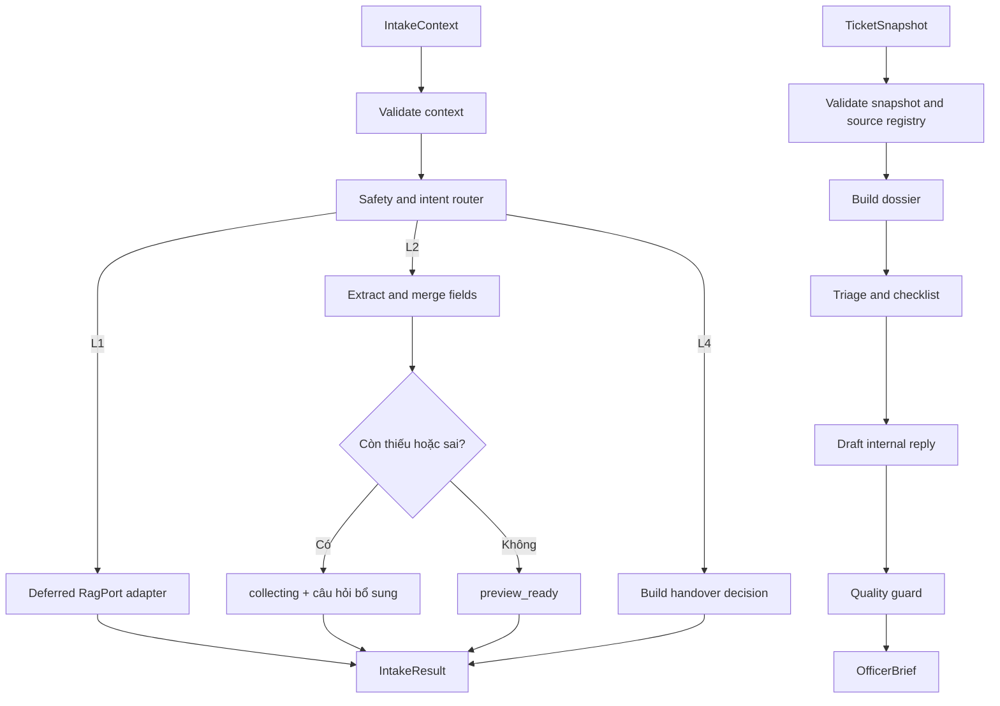

# Kế hoạch triển khai AI Agent L2–L4 cho Grok

**Dự án:** Campus 24/7 (EDU-14 / P-120)  
**Nhánh:** `feat/ai-agent`  
**Ngày cập nhật:** 29/09/2026  
**Đối tượng thực hiện:** Grok hoặc lập trình viên phụ trách module AI Agent

## 1. Mục tiêu

Xây dựng implementation thật của `AgentPort` để thay `StubAgent`, tập trung vào ba năng lực:

1. **L2 — Intake Agent:** nhận diện yêu cầu cấp giấy, thu thập thông tin qua nhiều lượt và tạo dữ liệu preview.
2. **L3 — Officer Copilot:** tạo `OfficerBrief` gồm summary, facts có provenance, missing items, checklist, priority suggestion và draft nội bộ.
3. **L4 — Safety Router:** nhận diện khiếu nại, wellbeing và yêu cầu vượt quyền; tạo quyết định handover an toàn.

Agent vẫn phải nhận diện được **L1** để không chuyển nhầm câu hỏi thủ tục sang L2/L4. Trong giai đoạn này, L1 chỉ đi qua một adapter/stub an toàn. Không triển khai RAG thật; RAG sẽ được nối sau qua `RagPort` hiện có.

Kết quả cuối của plan này là module agent có thể chạy độc lập bằng fake/stub dependencies, được backend gọi qua `AgentPort`, có test hành vi và sẵn điểm nối RAG.

## 2. Phạm vi bắt buộc

### Trong phạm vi

- Implement `AgentPort.run_intake(IntakeContext) -> IntakeResult`.
- Implement `AgentPort.prepare_officer_brief(TicketSnapshot) -> OfficerBrief`.
- Tạo hai LangGraph workflow riêng cho intake và officer brief.
- Routing theo ngữ cảnh, không chỉ tìm từ khóa đơn lẻ.
- Structured output bằng Pydantic contract hiện có.
- Rule safety chạy trước nhánh L1/L2.
- L2 hỗ trợ hội thoại nhiều lượt và merge với preview hiện tại.
- L4 tạo handover packet, không thông báo thành công thay backend.
- L3 tạo dữ kiện có source ID, checklist chưa đánh dấu và draft nội bộ.
- Guard kiểm tra output, source reference, ticket ID và revision.
- Chuyển lỗi module thành `ModuleCallError` đúng contract.
- Unit test, graph test và bộ evaluation fixture cho các case L2–L4.
- Điểm nối `RagPort` để tích hợp sau.

### Ngoài phạm vi

- Ingestion tài liệu, chunking, embedding và vector database.
- Retrieval, reranking, đánh giá citation hoặc corpus policy thật.
- Implement `RagPort` production.
- Database, migration, job queue và transaction backend.
- Auth/RBAC, idempotency và persistence.
- Frontend/API adapter.
- Submit 1/Submit 2 và thao tác ghi ticket.
- Tự động gửi phản hồi, tự bàn giao thành công hoặc tự resolve ticket.

Nếu phát hiện lỗi backend/RAG ảnh hưởng integration, ghi thành handoff issue; không mở rộng module agent để sở hữu logic đó.

## 3. Contract và file phải đọc trước khi code

Grok phải đọc các file sau và dùng chúng làm nguồn sự thật:

- [ports_v1.py](../backend/src/campus247/models/ports_v1.py): hai method của `AgentPort` và interface `RagPort`.
- [contracts_v1.py](../backend/src/campus247/models/contracts_v1.py): `IntakeContext`, `IntakeResult`, `TicketSnapshot`, `OfficerBrief`, `ModuleError`.
- [stubs.py](../backend/src/campus247/agents/stubs.py): hành vi tạm thời cần thay thế và các case demo hiện có.
- [runtime.py](../backend/src/campus247/services/runtime.py): composition root hiện đang trả `StubAgent`.
- [student.py](../backend/src/campus247/services/student.py): backend gọi `run_intake` và xử lý kết quả L1/L2/L4.
- [jobs.py](../backend/src/campus247/services/jobs.py): worker gọi `prepare_officer_brief`.
- [Quy ước kỹ thuật P0](Quy-uoc-ky-thuat-P0-va-phan-cong.md): đặc biệt mục 14–17 về contract, lỗi, timeout và fixture.
- [Pipeline L2–L3–L4](Pipeline-L2-L3-L4.md): hành vi nghiệp vụ cần giữ.

Không sửa JSON OpenAPI trực tiếp. Không đổi Pydantic contract nếu chưa chứng minh contract hiện tại không biểu diễn được đầu ra bắt buộc.

## 4. Kiến trúc cần triển khai



Tạo một adapter `CampusAgent` implement `AgentPort`:

```text
CampusAgent.run_intake()
  → intake_graph.ainvoke()
  → validate IntakeResult

CampusAgent.prepare_officer_brief()
  → officer_graph.ainvoke()
  → validate OfficerBrief
```

Hai graph không truy cập database, không tự đọc biến auth và không ghi dữ liệu. Mọi dữ liệu phải đến từ input contract hoặc dependency đã inject.

Model và agent được khởi tạo qua hai factory có trách nhiệm riêng:

```text
Settings
  → services.llm.create_chat_model(settings) -> BaseChatModel
  → agents.factory.create_agent(model, rag) -> CampusAgent
  → intake_graph / officer_graph
```

- `services/llm.py` chọn provider và tạo `BaseChatModel`; đây là nơi duy nhất biết `ChatOpenAI`, `ChatGoogleGenerativeAI` hoặc `ChatGroq`.
- `agents/factory.py` lắp model, `RagPort`, prompts và hai graph vào `CampusAgent`; file này không đọc API key và không chọn provider.
- Node nhận dependency qua closure hoặc constructor; không gọi `get_settings()` và không tự tạo model.
- `openai_base_url` chỉ áp dụng cho OpenAI-compatible provider. Groq và Grok là hai dịch vụ khác nhau; `langchain-groq` không phải adapter cho model Grok của xAI.

## 5. Cấu trúc file đề xuất

```text
backend/src/campus247/agents/
  adapter.py
  factory.py
  intake_graph.py
  officer_graph.py
  state.py
  errors.py
  guards.py
  prompts/
    __init__.py
    common.py
    intake.py
    officer.py
  nodes/
    intake_router.py
    intake_l2.py
    intake_l4.py
    dossier.py
    triage.py
    drafter.py
    quality.py
  stubs.py

backend/tests/test_agents/
  test_adapter.py
  test_model_factory.py
  test_state.py
  test_intake_router.py
  test_l2_intake.py
  test_l4_handover.py
  test_officer_brief.py
  test_agent_guards.py
  fixtures/
    intake_cases.json
    brief_cases.json

eval/agent/
  README.md
  dataset.jsonl
  run_eval.py

backend/src/campus247/services/
  llm.py                     refactor thành provider factory
```

Có thể điều chỉnh tên file nếu code gọn hơn, nhưng phải giữ ranh giới intake/officer/guard rõ ràng. Xóa hoặc cô lập graph `analyze → respond` mẫu sau khi runtime mới hoạt động; không để hai graph cùng được gọi dưới tên “agent” gây nhầm lẫn.

### 5.1. State schema bắt buộc

`state.py` dùng state riêng cho hai graph. Không tiếp tục dùng `AgentState` mẫu gồm `query/analysis/response`. Khung tối thiểu:

```python
from typing import Literal, Required, TypedDict

from pydantic import BaseModel, Field

from campus247.models.contracts_v1 import (
    ChecklistItem,
    Citation,
    Fact,
    FieldIssue,
    Fields,
    IntakeContext,
    IntakeResult,
    MissingItem,
    ModuleError,
    OfficerBrief,
    Priority,
    RagResult,
    Risk,
    Route,
    TicketSnapshot,
    WarningItem,
)


class RouteDecision(BaseModel):
    route: Route
    intent: Literal[
        "policy_question",
        "student_certificate",
        "academic_complaint",
        "wellbeing",
        "unauthorized_action",
    ]
    risk_type: Risk | None = None
    reason: str
    confidence: float | None = Field(default=None, ge=0.0, le=1.0)


class FieldExtraction(BaseModel):
    provided_fields: list[Literal["purpose", "destination_org", "receive_method"]]
    purpose: str | None = None
    destination_org: str | None = None
    receive_method: Literal["digital_pdf", "paper_stamped"] | None = None
    invalid_fields: list[FieldIssue] = Field(default_factory=list)


SourceKey = tuple[
    Literal["student_message", "profile", "policy", "tool_result"],
    str,
]


class IntakeState(TypedDict, total=False):
    context: Required[IntakeContext]
    decision: RouteDecision
    extracted_fields: FieldExtraction
    rag_result: RagResult
    result: IntakeResult
    error: ModuleError


class OfficerState(TypedDict, total=False):
    snapshot: Required[TicketSnapshot]
    source_registry: set[SourceKey]
    summary: str
    facts: list[Fact]
    missing_items: list[MissingItem]
    checklist: list[ChecklistItem]
    suggested_priority: Priority
    priority_reasons: list[str]
    draft_reply: str | None
    citations: list[Citation]
    warnings: list[WarningItem]
    quality_status: Literal["pass", "fail"]
    brief: OfficerBrief
    error: ModuleError
```

`total=False` cho phép mỗi node trả partial state; chỉ input gốc dùng `Required`. Không đặt model client, API key hoặc database session vào state. `provided_fields` phân biệt field không được nhắc tới với field model không extract được, tránh ghi `None` đè preview cũ. Final merge vẫn phải validate lại qua `Fields`/`Intake`. `RouteDecision` cần validator bắt buộc `risk_type` khi route L4 và cấm risk khi không phải L4. `approved_sources` vẫn nằm trong snapshot; `source_registry` chỉ là chỉ mục ID/type để guard kiểm tra provenance. Nếu cần passage trung gian, dùng kiểu `list[Passage]`, không dùng `dict[str, Any]`.

### 5.2. Quy chuẩn prompt và ngôn ngữ

- Tất cả system prompt, câu hỏi bổ sung L2 và draft tiếng Việt phải dùng tiếng Việt.
- Nội dung gửi sinh viên dùng đại từ **“bạn”**, lịch sự và ngắn gọn. Không trộn “bạn/em” trong cùng luồng.
- Officer Brief dùng văn phong trung lập, nghiệp vụ; phân biệt rõ “sinh viên khai báo”, “profile demo” và “đã được cán bộ xác minh”.
- Chỉ viết “nhà trường/phòng phụ trách đã…” khi snapshot chứa sự kiện đã hoàn tất tương ứng. Nếu chưa có, dùng “bộ phận phụ trách sẽ kiểm tra” hoặc mẫu tiếp nhận đã duyệt.
- Không chẩn đoán wellbeing, không hứa SLA/kết quả và không nhắc chi tiết triển khai kỹ thuật cho người dùng.
- Mỗi prompt có `PROMPT_VERSION`, mô tả input đáng tin cậy, dữ liệu không đáng tin cậy và output schema.
- Dùng `model.with_structured_output(PydanticModel)` làm cơ chế chính. Không yêu cầu model xuất JSON text rồi parse bằng regex. Chỉ ở adapter fallback không hỗ trợ native structured output mới yêu cầu JSON thuần, không Markdown/code fence, sau đó validate lại bằng Pydantic.

### 5.3. Quy chuẩn async

- Hai method của `CampusAgent` phải là `async def` đúng `AgentPort` và gọi graph bằng `await graph.ainvoke(...)`.
- Node gọi LLM/RAG hoặc I/O khác phải là `async def` và dùng `await model.ainvoke(...)` / `await rag.answer_question(...)`.
- Node thuần dữ liệu như merge field, validate source hoặc quality guard có thể là `def`; không cần ép mọi node thành async.
- Không gọi `.invoke()` cho network model bên trong request FastAPI. Không dùng `asyncio.run()` trong agent/node; worker/backend hiện tại chịu trách nhiệm tạo async boundary.
- Timeout/retry phải bọc lời gọi async và tuân theo ngân sách Task 7; không dùng sleep blocking.

## 6. Thứ tự thực hiện cho Grok

### Task 0 — Xác nhận baseline

Chạy trước khi sửa code:

```bash
cd backend
../.venv/bin/pytest tests -q --tb=short
../.venv/bin/ruff check src tests
cd ..
PYTHONPATH=backend/src .venv/bin/python -m scripts.export_contracts_v1 --check
```

Baseline tại thời điểm viết plan: **109 test pass**, Ruff pass và contract export pass. Nếu baseline mới khác, ghi lại kết quả trước khi sửa.

### Task 1 — Tạo adapter và dependency boundary

1. Refactor `services/llm.py` thành `create_chat_model(settings: Settings) -> BaseChatModel`.
2. Chuẩn hóa `llm_provider` thành enum/Literal được hỗ trợ, tối thiểu gồm `openai`, `google`, `groq`, `openai_compatible`; provider lạ phải fail fast với lỗi cấu hình rõ ràng.
3. Với OpenAI dùng `langchain-openai`; Gemini dùng `langchain-google-genai`; Groq dùng `langchain-groq`. Cập nhật đồng thời `pyproject.toml` và `requirements.txt` cho provider thực sự được bật.
4. Validate model name, API key và `openai_base_url` theo provider tại startup khi `agent_mode=langgraph`; không bắt test/stub mode có key thật.
5. Tạo `agents/factory.py` để nhận `BaseChatModel` và `RagPort`, build hai graph rồi trả `CampusAgent`.
6. Tạo `CampusAgent` implement đầy đủ `AgentPort`; cả hai method là async và dùng `await graph.ainvoke(...)`.
7. Inject model và `RagPort`; không khởi tạo network client trong node hoặc khi import module.
8. Giữ `StubAgent` cho unit/integration test backend hiện hữu và dùng fake `BaseChatModel` cho test graph.
9. Cho phép chọn stub/real bằng config rõ ràng; mặc định test không gọi API thật.
10. Không thay đổi signature trong `ports_v1.py`.

Không đặt provider factory thứ hai trong `agents/`. `services/llm.py` sở hữu provider; `agents/factory.py` sở hữu graph/agent composition.

Repo đã có `llm_provider`, `llm_model`, `model_name`, các API key và `openai_base_url`. Khi triển khai, dùng `llm_model` làm tên model chuẩn; giữ `model_name` như alias tương thích trong một giai đoạn hoặc xóa có migration rõ ràng, không để hai giá trị cạnh tranh. Với Gemini, ưu tiên `GOOGLE_API_KEY` rồi mới fallback `GEMINI_API_KEY`. Không quảng bá provider trong `.env.example` nếu factory và dependency tương ứng chưa hoạt động.

| `llm_provider` | Model class | Package | Credential/config |
|---|---|---|---|
| `openai` | `ChatOpenAI` | `langchain-openai` | `OPENAI_API_KEY` |
| `google` | `ChatGoogleGenerativeAI` | `langchain-google-genai` | `GOOGLE_API_KEY`, fallback `GEMINI_API_KEY` |
| `groq` | `ChatGroq` | `langchain-groq` | `GROQ_API_KEY` |
| `openai_compatible` | `ChatOpenAI` | `langchain-openai` | `OPENAI_API_KEY` và `OPENAI_BASE_URL` bắt buộc |

Factory chỉ truyền tham số chung khi provider hỗ trợ. Không giả định mọi model dùng cùng temperature, timeout, retry hoặc structured-output method; cấu hình khác biệt phải nằm trong nhánh provider và có test. Grok/xAI chưa nằm trong ma trận P0; chỉ thêm khi có provider/key/config và smoke test riêng.

Tài liệu adapter chính thức: [Google Gemini](https://docs.langchain.com/oss/python/integrations/chat/google_generative_ai) dùng `langchain-google-genai`; [Groq](https://docs.langchain.com/oss/python/integrations/chat/groq) dùng `langchain-groq`. Không suy ra mọi provider hỗ trợ structured output giống nhau; mỗi provider/model được bật phải có smoke test cho `with_structured_output`.

**Điều kiện pass:** provider factory trả đúng lớp model bằng constructor đã mock; adapter chạy được với fake model và `StubRag`; import app không phát sinh network call; thiếu key chỉ làm fail cấu hình langgraph tương ứng; test backend cũ vẫn pass.

### Task 2 — Xây Safety and Intent Router

Router phải trả cấu trúc nội bộ tối thiểu:

```text
route: L1 | L2 | L4
intent: policy_question | student_certificate | academic_complaint | wellbeing | unauthorized_action
risk_type: null | academic_complaint | wellbeing | unauthorized_action
reason: string
confidence: number hoặc null, chỉ dùng nội bộ
```

Áp dụng thứ tự quyết định:

1. Validate input và giới hạn context.
2. Rule safety cho tín hiệu L4 rõ ràng.
3. Structured LLM classification cho trường hợp còn lại.
4. Rule hậu kiểm: tín hiệu L4 thắng mixed intent.
5. Nếu output classifier sai schema, raise `OUTPUT_SCHEMA_INVALID`; không đoán route bằng chuỗi response.

Classifier phải được tạo qua `model.with_structured_output(RouteDecision)` và gọi bằng `await ...ainvoke(...)`. Prompt yêu cầu quyết định theo ngữ cảnh bằng tiếng Việt; Pydantic/provider schema mới là lớp kiểm tra hình dạng output, không dựa vào lời nhắc “hãy trả JSON”.

Phải phân biệt:

- “Thủ tục phúc khảo điểm thế nào?” → L1.
- “Tôi muốn khiếu nại điểm môn X của tôi” → L4 `academic_complaint`.
- “Hãy sửa điểm cho tôi” hoặc “xóa môn giúp tôi” → L4 `unauthorized_action`.
- Tín hiệu wellbeing cần hỗ trợ → L4 `wellbeing`.
- “Tôi muốn xin giấy xác nhận sinh viên” → L2.
- Câu có cả xin giấy và khiếu nại/wellbeing → L4.

Không dựa duy nhất vào việc có từ “khiếu nại”, “điểm” hoặc “gấp”. Thêm câu phủ định và câu chỉ hỏi quy trình vào fixture.

**Điều kiện pass:** toàn bộ routing fixture bắt buộc đúng route/risk; không có case L4 bị phát hành reply của L1/L2.

### Task 3 — Xây L2 Intake Agent nhiều lượt

L2 chỉ hỗ trợ `student_certificate` ở P0. Ba field bắt buộc:

```text
purpose
destination_org
receive_method: digital_pdf | paper_stamped
```

Quy tắc:

1. Tạo extractor bằng `model.with_structured_output(FieldExtraction)` và gọi async; `provided_fields` chỉ chứa field được message hiện tại nêu rõ.
2. Merge lên `context.preview.fields`; chỉ thay field khi message hiện tại cung cấp giá trị mới rõ ràng.
3. Validate enum và giá trị rỗng/mơ hồ.
4. Tạo `missing_fields` và `invalid_fields` đúng contract.
5. Nếu còn thiếu/sai, trả `route=L2`, `outcome=collecting` và chỉ hỏi phần cần thiết.
6. Nếu đủ và hợp lệ, trả `outcome=preview_ready`.
7. Không tạo ticket, không sinh ticket code và không tự Submit 1.
8. Không tự suy diễn mục đích, nơi nhận hoặc deadline.

Test tối thiểu:

- Một tin nhắn chứa đủ ba field.
- Ba lượt, mỗi lượt bổ sung một field.
- Lượt sau sửa receive method.
- Chỉ nói “gấp” không tạo deadline.
- Giá trị receive method không hợp lệ.
- Preview hiện tại có hai field, message bổ sung field còn lại.
- Message L4 xuất hiện khi đang có preview L2: route phải chuyển L4.

**Điều kiện pass:** L2 nhiều lượt không mất field đã xác nhận, không tạo preview ready khi thiếu dữ liệu và không thực hiện thao tác ghi.

### Task 4 — Xây L4 Handover Decision

Khi router chọn L4, node trả `IntakeResult` đúng invariants:

```text
route = L4
outcome = handover_required
reply = null
citations = []
intake = null
handover != null
```

`handover` phải có:

- `risk_type` đúng enum.
- Lý do ngắn, không chẩn đoán và không hứa đã bàn giao.
- Summary chỉ dựa trên message/history được cấp.
- `source_message_ids` chỉ gồm ID thực sự có trong context.

Backend chịu trách nhiệm lưu safety decision, khóa conversation, tạo/nâng ticket và trả mã sau commit. Agent tuyệt đối không trả “đã chuyển thành công”.

**Điều kiện pass:** complaint, wellbeing, unauthorized action và mixed intent đều tạo packet hợp lệ; source ID bịa bị guard chặn.

### Task 5 — Xây L3 Officer Copilot

Graph nhận duy nhất `TicketSnapshot` và thực hiện các node:

#### 5.1 Validate snapshot

- `ticket.id` phải tồn tại và khớp output cuối.
- `source_ticket_revision == ticket.revision`.
- Lập source registry từ profile, messages và `approved_sources`.
- Không dùng ticket/message ngoài snapshot.

#### 5.2 Dossier Builder

- Summary tối đa 2.000 ký tự, chỉ dùng facts trong snapshot.
- Mỗi fact có `source_type`, `source_id` và `verification_status`.
- Claim do sinh viên cung cấp luôn là `unverified`, trừ khi có nguồn xác minh thuộc loại được contract cho phép.
- Profile demo không được mô tả là đã đối soát với hệ thống trường.
- Xác định missing item cần cán bộ kiểm tra.

#### 5.3 Triage and Checklist

- **Quy tắc an toàn (Floor):** Không hạ `priority: high` có sẵn từ snapshot; ca `wellbeing` nguy cơ cao luôn giữ `high`.
- **Đánh giá đa chiều (Urgency & Impact):** Phân loại độ ưu tiên không phụ thuộc cứng nhắc vào route hay category, mà đánh giá kết hợp:
  - *Thời gian / Deadline:* Đề xuất `high` cho bất kỳ ticket nào (kể cả L2 xin giấy xác nhận) nếu có mốc thời gian gấp/hạn nộp sát nút (ví dụ $< 24h$ hoặc cần nộp ngay trong ngày).
  - *Loại việc & Mức độ ảnh hưởng:* Đánh giá tác động đến quyền lợi sống còn của sinh viên (nguy cơ lỡ học bổng, visa, thôi học, vi phạm SLA). Các khiếu nại quy chế thông thường không gấp có thể giữ `normal` nếu backend chưa set `high`.
- Mọi trường hợp đề xuất `suggested_priority: high` bắt buộc phải có lý do cụ thể trong `priority_reasons`.
- Checklist lấy từ template code/config P0 đã duyệt, không để model tự đặt quy trình tùy ý.
- Mọi `checked` phải là `false`.

#### 5.4 Response Drafter

- Draft là nội dung nội bộ cho cán bộ review.
- Không hứa SLA, kết quả phúc khảo hoặc hành động chưa diễn ra.
- Không tự gửi và không viết như thể ticket đã resolved.
- Nếu thiếu nguồn để viết claim policy, dùng mẫu tiếp nhận/hỏi bổ sung hoặc để `draft_reply=null` kèm warning.
- `existing_officer_draft` là dữ liệu cần bảo toàn; agent không được tuyên bố sẽ ghi đè.

#### 5.5 Quality Guard

Kiểm tra bằng code sau khi model trả structured output:

- Ticket ID và revision khớp snapshot.
- Fact source ID có trong source registry.
- Citation chỉ tham chiếu `approved_sources`.
- Student message không được đánh `verified`.
- Checklist không được tự tick.
- Priority high có reason.
- Không còn placeholder như `[Tên sinh viên]`, `TODO`, `<...>`.
- Draft không chứa claim policy thiếu nguồn hoặc tuyên bố hành động đã hoàn tất.

Nếu guard fail, trả `quality_status=fail`, thêm warning rõ ràng và không phát hành draft không an toàn. Lỗi schema/reference không thể biểu diễn thành brief an toàn thì raise `ModuleCallError` với stage phù hợp.

**Điều kiện pass:** ticket giấy và ticket L4 tạo được brief hợp lệ; hallucinated source, verified claim sai, checked checklist và stale revision đều bị chặn.

### Task 6 — L1 bridge để chờ RAG

Không viết RAG. Chỉ giữ boundary sau:

1. Router xác định L1.
2. Nếu có `RagPort`, gọi `answer_question` và map nguyên trạng thái/citations sang `IntakeResult`.
3. Trong dev/test chưa có RAG thật, dùng `StubRag` hiện tại để trả `insufficient_evidence` an toàn.
4. Không tự tạo citation và không dùng web search thay RAG.
5. Lỗi `RagPort` được map thành `ModuleCallError`, không đổi thành câu “không có nguồn”.

**Điều kiện pass:** thay fake `RagPort` bằng implementation khác không cần sửa intake graph hoặc contract.

### Task 7 — Error mapping, timeout và retry boundary

Dùng đúng `ModuleError`:

- Provider timeout → `PROVIDER_TIMEOUT`.
- Provider/rate limit → `PROVIDER_UNAVAILABLE` hoặc `PROVIDER_RATE_LIMITED`.
- Structured output không hợp lệ → `OUTPUT_SCHEMA_INVALID`.
- Source ID/citation không hợp lệ → `SOURCE_REFERENCE_INVALID`.
- Scope RAG bị từ chối → `POLICY_SCOPE_DENIED`.

Mọi error phải có stage và `request_id` từ input. Không log API key hoặc toàn bộ dữ liệu cá nhân.

Tuân thủ ngân sách đã chốt:

- Intake tổng tối đa 25 giây.
- Mỗi provider call tối đa 10 giây và không vượt ngân sách còn lại.
- Chỉ một retry lỗi tạm thời trong lượt intake; tắt retry SDK ẩn hoặc tính nó vào ngân sách.
- Officer brief tối đa 60 giây/lần; retry job thuộc backend, agent không tự tạo vòng retry vô hạn.
- Dùng timeout async quanh lời gọi provider; không dùng `time.sleep`, client sync hoặc `.invoke()` trong node I/O.

**Điều kiện pass:** fake async timeout/rate limit/schema error tạo đúng code/stage/request ID; test không đợi thời gian thật và event loop vẫn xử lý được coroutine khác trong lúc fake provider chờ.

### Task 8 — Runtime integration

1. Dùng config `AGENT_MODE=stub|langgraph`; không tạo model thật khi mode là `stub`.
2. `runtime.py` gọi `services.llm.create_chat_model(settings)`, sau đó `agents.factory.create_agent(model, rag)` để tạo duy nhất một `CampusAgent`.
3. API và worker cùng lấy agent qua `get_agent()`.
4. Test mặc định dùng stub/fake và không cần API key provider thật.
5. Không đổi flow transaction trong `student.py` hoặc `jobs.py` trừ khi cần sửa bug integration rõ ràng và có test tái hiện.
6. Endpoint graph mẫu trong `api/routes.py` phải được xóa, đổi thành adapter mới hoặc ghi rõ demo; không để production route gọi graph nối chuỗi cũ.

**Điều kiện pass:** một L2 message và một prepare brief đi qua `CampusAgent` trong integration test; toàn bộ test backend cũ vẫn pass.

### Task 9 — Evaluation và tài liệu bàn giao

Tạo dataset có expected output cho ít nhất:

- 10 case L2, gồm nhiều lượt và chỉnh field.
- 10 case L4, gồm complaint, wellbeing, unauthorized action, mixed intent và câu phủ định.
- 5 câu hỏi thủ tục phải giữ L1.
- 10 snapshot L3, gồm certificate (có cả case thường và case deadline gấp trong ngày để kiểm tra đề xuất high kèm lý do), complaint, thiếu dữ liệu, dữ liệu mâu thuẫn và source injection.

Tách dataset dùng để chỉnh prompt và dataset giữ lại để kiểm tra. Báo cáo:

- Route accuracy theo từng lớp.
- L4 false negative và L1 false positive.
- Field extraction accuracy cho L2.
- Provenance validity và quality-guard pass/fail cho L3.
- p50/p95 latency, token và lỗi theo graph khi chạy model thật.

Không ghi “100% an toàn” từ một bộ mẫu nhỏ. Báo rõ model, prompt version, dataset version, số mẫu và số lần chạy.

## 7. Quy tắc code bắt buộc

- Dùng Pydantic contract làm output; không parse JSON bằng regex.
- Node trả partial state, không mutate object input.
- Prompt đặt trong module riêng, dùng tiếng Việt và có `PROMPT_VERSION`.
- Nội dung sinh viên thống nhất xưng hô “bạn”; Officer Brief dùng văn phong nghiệp vụ trung lập.
- Structured output dùng `with_structured_output`; không coi lời nhắc “trả JSON” là validation.
- `CampusAgent` và mọi node I/O phải async; node thuần validate/merge có thể sync.
- Không hardcode secret, model name hoặc API key.
- Không gọi network ở module import time.
- Không tạo ID nghiệp vụ giả.
- Không bịa citation hoặc source ID.
- Không đánh dấu claim sinh viên là verified.
- Không tự tick checklist.
- Không cho model gọi tool ghi dữ liệu.
- Không nuốt exception thành câu trả lời thành công.
- Mọi test mặc định deterministic và không gọi provider thật.
- Giữ tương thích Python 3.11 của CI, dù local venv có thể là Python 3.12.

## 8. Thứ tự commit đề xuất

```text
feat(agent): add provider model factory and configuration validation
feat(agent): add typed graph states and AgentPort adapter
feat(agent): implement contextual L2 and L4 routing
feat(agent): implement multi-turn certificate intake
feat(agent): implement officer brief workflow
feat(agent): add output and provenance guards
test(agent): add L2 L3 L4 fixtures and failure cases
chore(agent): wire runtime mode and document RAG boundary
```

Mỗi commit phải chạy được test liên quan. Không gom thay đổi frontend, RAG hoặc migration vào chuỗi commit này.

## 9. Definition of Done

Plan hoàn thành khi đáp ứng tất cả điều kiện sau:

- `CampusAgent` implement đúng hai method của `AgentPort`.
- Provider factory trả `BaseChatModel`, tách khỏi agent factory và fail rõ ràng khi provider/config không hợp lệ.
- `IntakeState` và `OfficerState` dùng typed partial state, không chứa client/secret/session.
- Prompt tiếng Việt tuân thủ văn phong đã chốt và mọi model output được Pydantic validate.
- Lời gọi LLM/RAG chạy async; không block event loop FastAPI.
- L2 thu thập đủ ba field qua một hoặc nhiều lượt và không tự submit.
- L4 nhận đúng ba nhóm risk, mixed intent ưu tiên safety và không báo thành công trước backend.
- L3 tạo brief có facts truy được source, checklist false, priority có reason và draft an toàn.
- Guard chặn source bịa, verified claim sai, stale/mismatched output và placeholder.
- L1 có bridge qua `RagPort`/`StubRag`, không có implementation RAG trong phạm vi này.
- Timeout/error trả đúng `ModuleCallError` và request ID.
- Unit/integration test agent pass mà không cần API key thật.
- Toàn bộ backend regression test, Ruff và contract export pass.
- Có dataset evaluation và hướng dẫn chạy; kết quả model thật ghi rõ phiên bản và giới hạn.
- Có ghi chú bàn giao cho nhóm backend và RAG về dependency, config và input/output kỳ vọng.

## 10. Lệnh kiểm tra cuối

```bash
cd backend
../.venv/bin/ruff check src tests
../.venv/bin/pytest tests/test_agents -q --tb=short
../.venv/bin/pytest tests -q --tb=short
cd ..
PYTHONPATH=backend/src .venv/bin/python -m scripts.export_contracts_v1 --check
git diff --check
```

Grok chỉ báo hoàn thành khi các lệnh trên pass. Nếu test cần provider thật, chuyển test đó sang eval/manual profile; không đưa network call không ổn định vào regression suite.

## 11. Handoff để nối RAG sau

Khi nhóm RAG hoàn thành, việc tích hợp chỉ được yêu cầu:

1. Cung cấp implementation của `RagPort`.
2. Inject implementation đó vào `CampusAgent` tại composition root.
3. Chạy lại fixture L1 và test scope/citation.
4. Sau khi backend cấp `approved_sources`, chạy lại OfficerBrief evidence cases.

Không sửa routing L2/L4 hoặc graph L3 chỉ để nối RAG. Nếu contract RAG thay đổi, hai nhóm phải cập nhật `ports_v1.py`, Pydantic schema, fixture và contract export trong cùng thay đổi được review.
