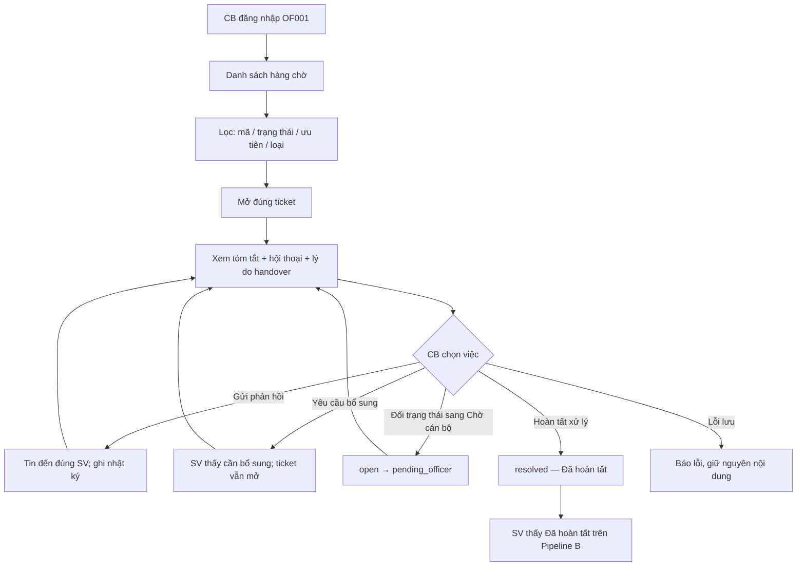
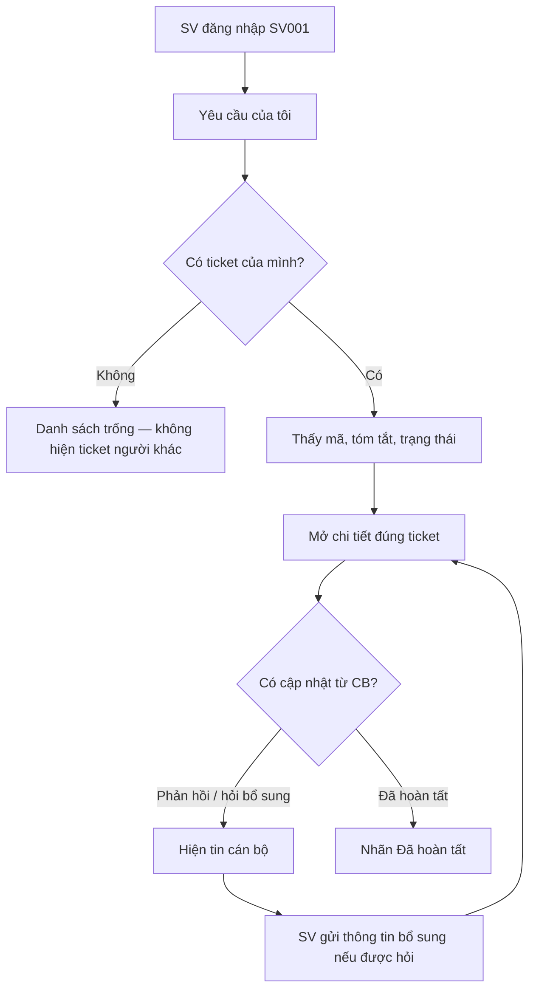

# L3 — Giai đoạn 2: CB + AI xử lý ticket + SV theo dõi

**Dự án:** Campus 24/7 (EDU-14 / P-120)  
**Câu nhớ:** AI **chuẩn bị hồ sơ** — CB **review rồi Submit 2**; SV **theo dõi được**.

L3 bắt đầu **khi đã có ticket** (Submit 1 từ L2 giấy, hoặc handover L4).  
AI gắn ưu tiên, tóm tắt, checklist, draft phản hồi. **CB review** rồi mới gửi / hoàn tất. AI không tự trả lời hộ, không tự `resolved`.

Pipeline: [Pipeline L2 · L3 · L4](Pipeline-L2-L3-L4.md) · [L2](L2-Tiep-nhan-yeu-cau-dich-vu.md)

---

## 1. Ba lớp khái niệm — đừng trộn

| Khái niệm | Là gì | Ví dụ |
|---|---|---|
| **Ticket** | **Hồ sơ yêu cầu** đã ghi nhận, có mã và trạng thái | `TKT-2026-0142` |
| **Hàng chờ** | Danh sách ticket cán bộ được quyền xem và xử lý | Dashboard lọc `open` / `pending_officer` |
| **Theo dõi** | SV xem **đúng yêu cầu của mình**: mã, trạng thái, phản hồi | Mục “Yêu cầu của tôi” |
| **Khiếu nại / xin giấy** | **Loại việc** trên ticket vào hàng chờ (`complaint` / `action`) | L3 xử lý hồ sơ giấy và handover |

Ticket vào L3 từ:

| Nguồn | `category` | Trạng thái lúc vào hàng chờ |
|---|---|---|
| L2 **xin giấy** | `action` | `open` (Mới tiếp nhận) |
| L4 handover nhạy cảm | `complaint` (hoặc action kèm `handover_reason`) | `pending_officer` (Chờ cán bộ) |

AI **không thay cán bộ duyệt hay đóng ticket**. Trên L3, AI chuẩn bị hồ sơ (tóm tắt, checklist, draft); CB review rồi Submit 2.

---

## 2. Painpoint L3 gỡ

| Painpoint | Cách L3 gỡ |
|---|---|
| CB bị dồn việc, khó ưu tiên | Dashboard lọc trạng thái / ưu tiên / loại / mã |
| Tiếp nhận ca mà không biết SV đã hỏi gì | Tóm tắt + hội thoại bàn giao trên ticket |
| SV gửi xong “mất hút” | SV xem mã, trạng thái, phản hồi của đúng yêu cầu mình |
| Khó truy trách nhiệm | Nhật ký: ai phản hồi, đổi trạng thái thế nào |
| Phản hồi một câu bị hiểu là đã xong | Gửi phản hồi **không** tự `resolved`; phải bấm Hoàn tất |

---

## 3. Phạm vi L3

### 3.1. Trong L3 (làm cả hai mặt)

| Mặt | Case chuẩn Gate 1 | Người dùng | Kết quả |
|---|---|---|---|
| **Hàng chờ cán bộ** | `OF001` mở `TKT-2026-0142` | Cán bộ | Lọc → xem ngữ cảnh → phản hồi / hỏi bổ sung / hoàn tất |
| **Theo dõi của SV** | `SV001` xem yêu cầu của mình | Sinh viên | Thấy mã, nhãn trạng thái, phản hồi mới |

Trạng thái thống nhất:

| Mã | Nhãn UI | Ý nghĩa |
|---|---|---|
| `open` | Mới tiếp nhận | Đã ghi nhận, chưa vào tay cán bộ xử lý |
| `pending_officer` | Chờ cán bộ | Đang ở luồng cán bộ (mở hồ sơ / handover) |
| `resolved` | Đã hoàn tất | Cán bộ bấm hoàn tất xử lý |

### 3.2. Không thuộc L3

| Việc | Ai dẫn |
|---|---|
| Hỏi quy chế có nguồn | **L1** |
| Thu thập + SV review rồi **Submit 1** ticket giấy | **L2** |
| Nhận diện nhạy cảm, dừng AI, bàn giao | **L4** |
| Tự cấp giấy chính thức, portal/LMS thật | Ngoài MVP |

---

## 4. Vai trò AI so với không có AI

### Không có AI / không có hàng chờ

Cán bộ nhận email/form rời, phải hỏi lại SV đã nói gì. SV gửi rồi không biết đang ở bước nào. Không có lọc ưu tiên, không có nhật ký ai đổi trạng thái.

### Có L3 (HITL)

AI đã làm việc ở L1/L2/L4 **trước khi** vào hàng chờ. Trên L3:

| Bước | Hệ thống / AI để lại | Cán bộ / hệ thống không làm |
|---|---|---|
| Vào hàng chờ | Hiện ticket đúng mã, loại, ưu tiên, tóm tắt | Giấu ticket vừa tạo; bịa trạng thái |
| Mở hồ sơ | Hội thoại + lý do handover (nếu có) | CB phải hỏi lại từ đầu |
| Phản hồi | Gửi đúng SV của ticket; ghi nhật ký | Tự đóng ticket chỉ vì vừa gửi một tin |
| Hoàn tất | Đổi `resolved` khi CB bấm Hoàn tất | AI tự `resolved` |
| Theo dõi | SV thấy cập nhật thật | SV thấy ticket của người khác |

Ba quy tắc cứng:

1. **Phản hồi ≠ hoàn tất.**
2. **SV chỉ thấy ticket của mình; CB chỉ thấy hồ sơ thuộc quyền.**
3. **Lỗi lưu không hiện thành công giả.**

Sau handover L4, AI **dừng trả lời** trên thread đó; SV vẫn gửi thông tin bổ sung **cho cán bộ** (L3 nhận).

---

## 5. Pipeline hai luồng L3

Cổng chung: đã có ticket từ L2 hoặc L4.

```text
Ticket được tạo (L2 hoặc L4)
        │
        ├── Cán bộ đăng nhập OF001     → Pipeline A — hàng chờ
        └── Sinh viên đăng nhập SV001  → Pipeline B — theo dõi
```

### 5.1. Pipeline A — Cán bộ xử lý hàng chờ



| Bước | Ai | Việc | Kết quả để sang bước sau |
|---|---|---|---|
| A0 | L2 / L4 | Đưa ticket vào hàng chờ | Có mã, tóm tắt, `category`, `priority` |
| A1 | CB | Đăng nhập `OF001` | Chỉ thấy hồ sơ thuộc quyền |
| A2 | CB | Lọc / tìm mã | Mở đúng dòng, không lẫn SV khác |
| A3 | Hệ thống | Hiện ngữ cảnh: chat, tóm tắt, `handover_reason` | CB hiểu ca trước khi gõ |
| A4a | CB | **Gửi phản hồi** | SV thấy tin; status **không** tự `resolved` |
| A4b | CB | **Yêu cầu bổ sung** | SV bổ sung trên thread; ticket còn mở |
| A4c | CB | Nhận việc / chuyển `pending_officer` | Nhãn **Chờ cán bộ** |
| A5 | CB | **Hoàn tất xử lý** | `resolved`; nhật ký người + thời điểm + trạng thái trước/sau |
| A6 | Hệ thống | Ghi `OfficerLog` | Truy được ai làm gì |

Quy tắc pipeline A:

- Mở ticket L2-A (`action` xin giấy) phải thấy đúng loại giấy + mục đích SV đã xác nhận.
- Mở ticket L4 phải thấy lý do chuyển + hội thoại; ca riêng tư không nằm danh sách dùng chung.
- Hàng chờ chỉ ticket giấy (L2-A) và handover (L4).
- Dropdown trạng thái chỉ các bước hợp lệ: `open → pending_officer → resolved`.

### 5.2. Pipeline B — Sinh viên theo dõi yêu cầu



| Bước | Ai | Việc | Kết quả để sang bước sau |
|---|---|---|---|
| B0 | L2 / L4 | Ticket gắn `student_id = SV001` | Chỉ SV này nhìn thấy |
| B1 | SV | Mở “Yêu cầu của tôi” | Danh sách mã + nhãn trạng thái thật |
| B2 | SV | Mở đúng ticket vừa gửi | Khớp tóm tắt đã xác nhận |
| B3 | Hệ thống | Đẩy phản hồi / hỏi bổ sung từ Pipeline A | SV thấy nội dung mới, không “mất hút” |
| B4 | SV | Gửi bổ sung khi CB hỏi | CB thấy trên chi tiết ticket |
| B5 | Hệ thống | Khi CB hoàn tất | SV thấy **Đã hoàn tất** |

Quy tắc pipeline B:

- Đổi sang tài khoản SV khác → không còn thấy ticket của `SV001`.
- Trạng thái trên cổng SV **cùng mã** với dashboard CB (`open` / `pending_officer` / `resolved`).
- Không hứa giờ cán bộ sẽ trả lời nếu nhóm chưa chốt SLA.

---

## 6. Dữ liệu tối thiểu trên hồ sơ

Demo: sinh viên `SV001` · Nguyễn Văn An; cán bộ `OF001` · Cán bộ hỗ trợ học vụ. Không dùng hồ sơ thật.

| Mặt | Field tối thiểu |
|---|---|
| Hàng chờ | Mã, tóm tắt, sinh viên, `category`, `priority`, trạng thái, thời gian |
| Chi tiết CB | Hội thoại, tóm tắt, `handover_reason` (nếu có), người phụ trách, ô phản hồi, nhật ký |
| Cổng SV | Mã, tóm tắt, nhãn trạng thái, phản hồi của **đúng** ticket |

Nhãn UI: `open` = Mới tiếp nhận · `pending_officer` = Chờ cán bộ · `resolved` = Đã hoàn tất.

---

## 7. Done của L3

- [ ] Ticket L2/L4 xuất hiện trên hàng chờ đúng tóm tắt.
- [ ] CB lọc theo mã / trạng thái / ưu tiên / loại và mở đúng hồ sơ.
- [ ] CB thấy ngữ cảnh hội thoại trước khi trả lời.
- [ ] Gửi phản hồi ≠ tự hoàn tất.
- [ ] Hoàn tất → `resolved`; SV thấy **Đã hoàn tất**.
- [ ] Có nhật ký thao tác (ai, khi nào, trạng thái trước/sau).
- [ ] SV chỉ thấy ticket của mình; đổi tài khoản không lộ dữ liệu.
- [ ] Lỗi lưu: giữ nội dung, không hiện thành công giả.

---

## 8. Checklist bản demo L3

Chạy sau khi đã có ít nhất một ticket **xin giấy** từ L2-A và một ticket từ L4 nếu demo handover. Dữ liệu mẫu: `SV001` / `OF001` / `TKT-2026-0142`.

### A. Hàng chờ cán bộ

- [ ] **A1. Đăng nhập CB.** Vào dashboard bằng `OF001`. Không dùng cổng sinh viên.
- [ ] **A2. Thấy hàng chờ.** Ticket **xin giấy** vừa tạo từ L2-A có trên danh sách, đúng tóm tắt loại giấy + mục đích.
- [ ] **A3. Lọc.** Lọc theo trạng thái, ưu tiên, phân loại; tìm theo mã `TKT-2026-0142` ra đúng một dòng.
- [ ] **A4. Mở hồ sơ.** Chi tiết có hội thoại + tóm tắt SV đã xác nhận. Ticket L4 thì có lý do handover.
- [ ] **A5. Gửi phản hồi.** CB gõ tin → SV001 thấy tin đó trên yêu cầu của mình.
- [ ] **A6. Phản hồi ≠ xong.** Sau A5 trạng thái **chưa** là Đã hoàn tất.
- [ ] **A7. Yêu cầu bổ sung.** CB hỏi thêm → SV gửi bổ sung → CB thấy nội dung mới trên cùng ticket.
- [ ] **A8. Chuyển Chờ cán bộ.** `open` → `pending_officer`; nhãn **Chờ cán bộ** ở cả hai cổng.
- [ ] **A9. Hoàn tất.** Bấm Hoàn tất xử lý → `resolved` / **Đã hoàn tất**; có tên CB và thời điểm trên nhật ký.
- [ ] **A10. Lỗi lưu.** Tắt/gãy lưu → báo lỗi, nội dung phản hồi còn đó, không hiện đã gửi.

### B. Sinh viên theo dõi

- [ ] **B1. Có mã.** Sau L2 xác nhận, SV001 thấy ticket trong “Yêu cầu của tôi”, đúng mã.
- [ ] **B2. Khớp trạng thái.** Nhãn trên cổng SV = nhãn trên dashboard CB.
- [ ] **B3. Thấy phản hồi.** Sau A5, SV đọc được tin cán bộ mà không hỏi lại ngoài hệ thống.
- [ ] **B4. Bổ sung.** SV trả lời yêu cầu bổ sung trên đúng ticket.
- [ ] **B5. Thấy hoàn tất.** Sau A9, SV thấy **Đã hoàn tất**.
- [ ] **B6. Không thấy hộ.** Đăng nhập SV khác (vd. `SV024`) → không có `TKT-2026-0142`.

### C. Ranh giới và nối luồng

- [ ] **C1. Nối L2-A.** Ticket xin giấy vừa xác nhận vào hàng chờ, không cần CB tạo tay.
- [ ] **C2. Nối L4.** Ticket handover vào hàng chờ `pending_officer`; AI đã dừng trên thread SV.
- [ ] **C3. Ca riêng tư.** Ticket nhạy cảm không hiện trên danh sách dùng chung nếu CB không có quyền.
- [ ] **C4. Đổi tài khoản.** `OF001` → SV001 (hoặc ngược lại) không lộ hàng chờ / ticket người khác.
- [ ] **C5. L3 không tạo loại việc.** CB không “xin giấy hộ” hay “khiếu nại hộ”; chỉ xử lý hồ sơ đã có.

### Dữ liệu demo gợi ý

| Mục | Giá trị |
|---|---|
| Sinh viên | `SV001` · Nguyễn Văn An |
| Cán bộ | `OF001` · Cán bộ hỗ trợ học vụ |
| Ticket chính | `TKT-2026-0142` · giấy xác nhận SV · `action` |
| Ticket L4 (nếu demo) | Khiếu nại / handover · `complaint` · ưu tiên cao |
| Trạng thái đi hết | `open` → `pending_officer` → `resolved` |

---

## 9. Bàn giao cho luồng khác

| Tình huống | L3 làm | Luồng liên quan |
|---|---|---|
| Ticket giấy mới | Hiện trên hàng chờ, chờ CB | L2 chốt field tóm tắt |
| Ticket handover | Hiện ca + lý do; CB xử lý; AI câm | L4 |
| SV hỏi “yêu cầu em đến đâu rồi?” | Cổng theo dõi, không cần hỏi lại L1 | L3 |
| Rule trạng thái / cấm tự đóng khi mới reply | Áp trên UI + API | L2 chốt rule Submit 1 |

---

## 10. Lịch sử

| Phiên bản | Ngày | Nội dung |
|---|---|---|
| 0.1 | 2026-09-23 | Tổng hợp L3: pipeline CB + pipeline SV; checklist demo |
| 0.2 | 2026-09-23 | Hàng chờ nhận xin giấy + L4 |
