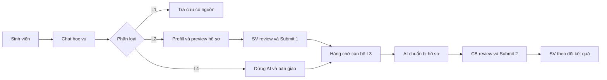
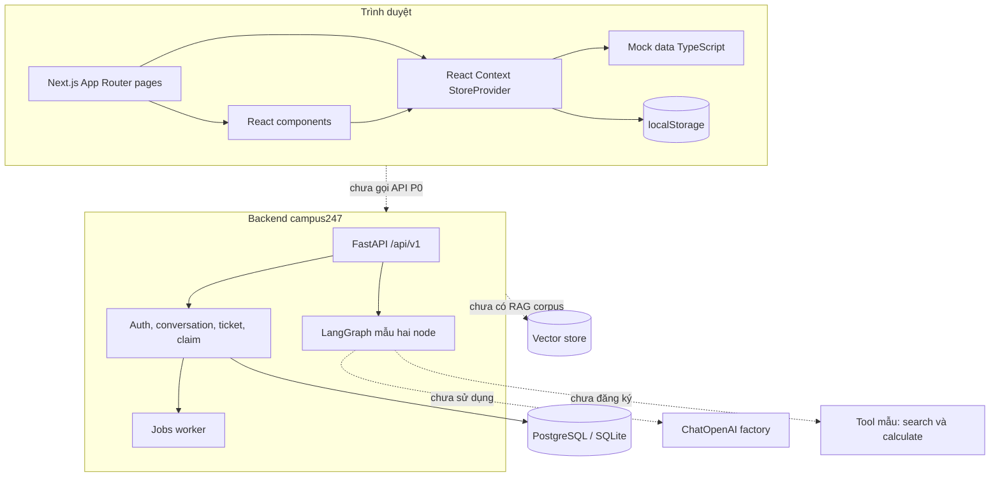
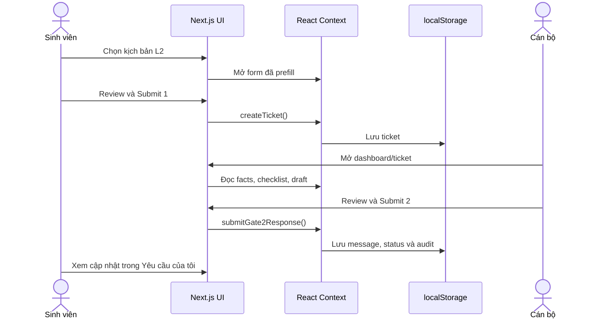
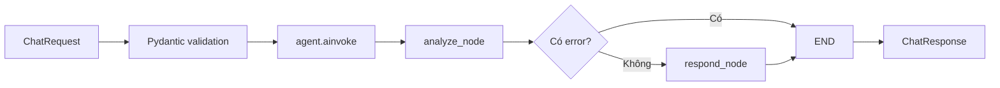
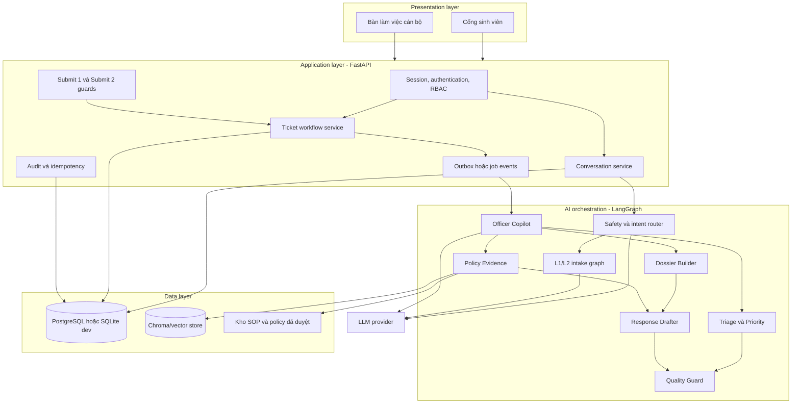

> Tài liệu lịch sử, hiện trạng ngày 26/09/2026. Kiến trúc hiện hành: [Gate 2](../gate-2/architecture.md).

# Kiến trúc và công nghệ — Campus 24/7

> **Dự án:** EDU-14 / P-120
>
> **Ngày rà soát:** 26/09/2026
>
> **Phạm vi:** code trong `backend/`, `frontend/`, cấu hình hạ tầng và tài liệu nghiệp vụ/thiết kế trong `docs/`
>
> **Lưu ý:** tài liệu này phân biệt rõ **hiện trạng đã chạy trong code** và **kiến trúc đích được mô tả trong tài liệu**.

## 1. Tóm tắt hệ thống

Campus 24/7 là prototype trợ lý AI cho vận hành học vụ. Sản phẩm phục vụ hai vai trò:

- **Sinh viên:** tra cứu quy chế, tạo yêu cầu cấp giấy xác nhận, theo dõi ticket và bổ sung thông tin.
- **Cán bộ học vụ:** xem hàng chờ, đọc hồ sơ AI chuẩn bị, kiểm tra dữ kiện/checklist, chỉnh sửa phản hồi và quyết định hoàn tất ticket.

Repository là **monorepo** với hai ứng dụng rõ ràng:

1. **Frontend Next.js** (`frontend/`) có giao diện và các luồng demo; nghiệp vụ UI vẫn chạy bằng mock data, React Context và `localStorage`, chưa gọi API P0.
2. **Backend FastAPI** (`backend/src/campus247`) đã có persistence P0 (SQLAlchemy 2, Alembic, seed, worker) và HTTP contract `/api/v1`. Agent/RAG production vẫn là stub theo port. Graph LangGraph mẫu hai node còn nằm cạnh API P0.

Luồng demo trên trình duyệt vẫn là **thick client mock**. Backend P0 chạy độc lập và là nguồn sự thật khi được gọi.

### Quy ước trạng thái trong tài liệu

| Nhãn | Ý nghĩa |
|---|---|
| **Đã triển khai** | Có code và đang tham gia luồng chạy hiện tại |
| **Đã khai báo** | Có dependency/config/code khung nhưng chưa nối vào luồng chính |
| **Kiến trúc đích** | Được thiết kế trong PRD/kế hoạch, chưa có triển khai hoàn chỉnh |

## 2. Phạm vi nghiệp vụ

Sản phẩm tổ chức hành vi theo bốn lớp:

| Lớp | Nghiệp vụ | Cổng kiểm soát của con người |
|---|---|---|
| **L1** | Tra cứu quy chế có nguồn; không tạo ticket | Không có thao tác ghi |
| **L2** | AI điền sẵn yêu cầu cấp giấy, hỏi phần thiếu và hiển thị preview | Sinh viên review và bấm **Submit 1** |
| **L3** | AI chuẩn bị tóm tắt, facts, checklist và draft cho cán bộ | Cán bộ review và bấm **Submit 2** |
| **L4** | Nhận diện khiếu nại/ca nhạy cảm, dừng AI và bàn giao ưu tiên cao | Cán bộ tiếp tục xử lý trong L3 |

Hai nguyên tắc xuyên suốt là:

- AI chuẩn bị và đề xuất, nhưng không tự gửi thay người dùng và không tự quyết định nghiệp vụ cuối cùng.
- Ticket chỉ chuyển sang `resolved` sau thao tác xác nhận của cán bộ.

Vòng đời ticket tối thiểu:

```text
open (Mới tiếp nhận)
  → pending_officer (Chờ cán bộ)
  → resolved (Đã hoàn tất)
```

Luồng sản phẩm tổng quát:



## 3. Kiến trúc hiện trạng (As-Is)



### 3.1. Frontend

Frontend dùng **Next.js App Router**. `RootLayout` bọc toàn bộ ứng dụng trong `StoreProvider`; phần lớn màn nghiệp vụ là Client Component và thao tác trực tiếp với store trong bộ nhớ.

| Route | Vai trò hiện tại |
|---|---|
| `/` | Chọn cổng sinh viên hoặc cán bộ |
| `/login` | Đăng nhập demo theo email/mã người dùng; không có xác thực server |
| `/chat` | Chat demo L1/L2/L4, mở form Submit 1 và mô phỏng handover |
| `/my-requests` | Sinh viên xem ticket của tài khoản hiện tại và gửi tin bổ sung |
| `/dashboard` | Hàng chờ cán bộ, tìm kiếm/lọc/sắp xếp ticket |
| `/tickets/[ticketId]` | Hồ sơ chi tiết, facts, checklist, audit, draft và Submit 2 |

Các thành phần chính:

- [`frontend/app/layout.tsx`](../../frontend/app/layout.tsx): metadata, global theme và `StoreProvider`.
- [`frontend/lib/store.tsx`](../../frontend/lib/store.tsx): state và toàn bộ nghiệp vụ demo phía client.
- [`frontend/lib/mock-data.ts`](../../frontend/lib/mock-data.ts): user, ticket và chat session mẫu.
- [`frontend/lib/types.ts`](../../frontend/lib/types.ts): mô hình dữ liệu TypeScript.
- [`frontend/components/student/Submit1Modal.tsx`](../../frontend/components/student/Submit1Modal.tsx): cổng xác nhận của sinh viên.
- [`frontend/app/tickets/[ticketId]/page.tsx`](../../frontend/app/tickets/[ticketId]/page.tsx): cổng review/Submit 2 của cán bộ.

#### State và persistence hiện tại

`StoreProvider` quản lý:

- theme;
- tài khoản demo hiện tại;
- ticket và các thao tác tạo/cập nhật;
- chat sessions/messages;
- trạng thái L4 handover;
- dữ liệu form Gate 1;
- checklist, officer draft, message và audit log.

Chỉ `theme`, `currentUser` và `tickets` được lưu vào `localStorage`. Chat session, message chat, trạng thái Gate 1 và L4 chỉ tồn tại trong state của phiên chạy và quay lại dữ liệu mẫu sau reload/reset.

Không có HTTP client, `fetch`, WebSocket hay Server Action kết nối backend. Việc “AI trả lời”, tạo ticket, đổi trạng thái và ghi audit đều là logic deterministic trong TypeScript, có một số `setTimeout` để mô phỏng độ trễ.

#### Các luồng frontend đã mô phỏng



### 3.2. Backend API

Backend nằm trong `backend/src/campus247`:

```text
main.py                 FastAPI app, lifespan, CORS, /health /ready
api/v1.py               REST P0: auth, conversations, tickets, officer
api/routes.py           Chat LangGraph mẫu
models/contracts_v1.py  Pydantic P0
db/                     SQLAlchemy models, engine, seed
services/               preview, ticket, handover, brief, claim
workers/                prepare_brief / retry_handover
agents/                 stubs AgentPort/RagPort + graph mẫu
config.py               Settings đọc từ môi trường/.env
```

API P0 đã mount tại `/api/v1` (auth demo, conversation, Submit 1/2, claim, brief, audit). Chat LangGraph mẫu vẫn còn:

| Method | Endpoint | Chức năng |
|---|---|---|
| `GET` | `/health` | Trả `status` và môi trường chạy |
| `GET` | `/ready` | Ping database |
| `GET` | `/api/v1/status` | Trạng thái tĩnh của agent mẫu |
| `POST` | `/api/v1/chat` | Chat graph mẫu `{ "message": string }` |

Luồng `POST /api/v1/chat` hiện tại:



`analyze_node` và `respond_node` chỉ nối chuỗi văn bản. Chúng chưa gọi `get_llm()`, chưa truy xuất dữ liệu và chưa gọi tool. `search_knowledge` hiện trả chuỗi mẫu; `calculate` là tool tính toán AST an toàn nhưng chưa được graph đăng ký.

State hiện tại của agent gồm các trường tùy chọn:

```text
query, context, analysis, response, error, metadata
```

### 3.3. Dữ liệu hiện tại

Frontend định nghĩa các entity chính sau:

- `User`: định danh demo và role `student | officer`.
- `Ticket`: thông tin sinh viên, trạng thái, ưu tiên, dữ liệu đơn, AI summary, facts, checklist, draft, message và audit log.
- `ChatSession` / `ChatMessage`: lịch sử hội thoại, nhãn L1/L2/L4, citation và action card.
- `FactItem`: dữ kiện với trạng thái `verified | unverified | disputed`.
- `AuditLogEntry`: nguồn, actor, hành động và thời gian.

Nguồn dữ liệu **trên UI demo** vẫn là `INITIAL_*` trong `mock-data.ts` cộng với bản sao ticket trong `localStorage`. Backend P0 đã có SQLAlchemy, Alembic và seed `edu14_demo.json`; frontend chưa đọc nguồn này. Vector store/Chroma vẫn là kiến trúc đích.

## 4. Công nghệ sử dụng

### 4.1. Technology stack đã xác nhận từ code/config

| Lớp | Công nghệ | Phiên bản/khai báo | Trạng thái |
|---|---|---|---|
| Web framework | Next.js, App Router | `16.3.6` | **Đã triển khai** |
| UI runtime | React / React DOM | `19.2.8` | **Đã triển khai** |
| Ngôn ngữ frontend | TypeScript | lockfile `5.9.3`, strict mode | **Đã triển khai** |
| Styling | Tailwind CSS + PostCSS | Tailwind `4.3.3` | **Đã triển khai** |
| Icon | Lucide React | `1.48.0` | **Đã triển khai** |
| Client state | React Context + hooks | custom `StoreProvider` | **Đã triển khai** |
| Backend runtime | Python | image/CI dùng Python `3.11` | **Đã triển khai** |
| API framework | FastAPI + Uvicorn | `fastapi>=0.115`, `uvicorn>=0.34` | **Đã triển khai** |
| Validation/config | Pydantic + pydantic-settings | `>=2.10`, `>=2.7` | **Đã triển khai** |
| Agent orchestration | LangGraph + LangChain | `langgraph>=0.2`, `langchain>=0.3` | **Đã triển khai ở mức skeleton** |
| LLM adapter | `langchain-openai` / `ChatOpenAI` | `>=0.3`; mặc định `gpt-4o-mini` | **Đã khai báo, chưa được graph gọi** |
| Database | SQLite local; PostgreSQL tích hợp | SQLAlchemy 2 + Alembic + `psycopg` | **Đã triển khai P0** |
| RAG/vector store | ChromaDB + embeddings | dependency Chroma đang comment | **Kiến trúc đích** |
| Backend test | pytest, pytest-asyncio, HTTPX | `pytest>=8`, `httpx>=0.28` | **Đã triển khai cơ bản** |
| Backend lint/format | Ruff | `>=0.8`, target Python 3.11 | **Đã triển khai** |
| Frontend lint | ESLint + Next core-web-vitals | ESLint `9.39.5` | **Đã triển khai** |
| Container | Docker multi-stage + Docker Compose | backend container | **Đã triển khai cho backend** |
| CI | GitHub Actions | Ruff + pytest | **Đã triển khai cho backend** |
| Tracing | LangSmith environment variables | chưa có instrumentation riêng | **Đã khai báo** |

Phiên bản frontend chính xác ở trên lấy từ `frontend/package-lock.json`; constraint backend lấy từ [`backend/pyproject.toml`](../../backend/pyproject.toml).

### 4.2. Cấu hình runtime

[`backend/src/campus247/config.py`](../../backend/src/campus247/config.py) dùng `BaseSettings` để đọc `.env`:

- app: host, port, environment, log level, CORS origins;
- LLM: OpenAI API key, model, temperature;
- data: database URL và Chroma persistence directory.

API bật CORS theo danh sách `CORS_ORIGINS`, cho phép credentials, mọi method và mọi header. Các secret được dự kiến truyền qua biến môi trường; `.env` không được commit.

### 4.3. Build, test và deploy hiện tại

- Backend chạy local bằng `uvicorn campus247.main:app --reload --port 8000` hoặc `make run`.
- Frontend chạy riêng từ thư mục `frontend/` bằng `npm run dev`, mặc định cổng 3000.
- `backend/Dockerfile` build từ context `backend/` dưới non-root user, healthcheck `/health`.
- Docker Compose khai báo `db`, `backend`, `worker`; mount `./data:/app/data`.
- GitHub Actions chạy Ruff + pytest backend và lint/build frontend.
- Tài liệu định hướng deploy backend lên Render và frontend lên Vercel; chưa có manifest riêng cho hai nền tảng này.

Kết quả kiểm chứng tại thời điểm rà soát:

- backend: `5` test pytest đều pass;
- frontend: production build pass và sinh đủ các route nêu ở mục 3.1;
- frontend lint: chưa pass, còn `2` lỗi `no-explicit-any` trong `lib/store.tsx` và `6` cảnh báo import/biến chưa dùng.

## 5. Kiến trúc đích (To-Be)

Kiến trúc đích trong PRD và `plan2-3-4.md` là hệ thống ba lớp với backend làm nguồn sự thật, có kiểm soát quyền và human-in-the-loop.



### 5.1. Ranh giới trách nhiệm

| Thành phần | Trách nhiệm đích |
|---|---|
| Next.js | Hiển thị, nhập liệu, state giao diện tạm thời; không là nguồn sự thật nghiệp vụ |
| FastAPI | Xác thực/phân quyền, API contract, workflow ticket, validation, idempotency và audit |
| Database | Nguồn sự thật cho user, conversation, message, ticket, log, packet và AI artifact |
| Safety Router | Phân loại L1/L2/L4 và khóa trả lời khi handover |
| Intake graph | Tra cứu L1 hoặc thu thập/prefill/preview cho L2 |
| Officer Copilot | Điều phối việc chuẩn bị hồ sơ sau khi ticket đã được commit |
| Policy/RAG | Chỉ truy xuất tài liệu/SOP được duyệt và trả provenance |
| Submit guards | Bắt buộc đúng người review trước thao tác ghi hoặc quyết định cuối |

### 5.2. Agent design đích

Thiết kế chọn một agent điều phối `Officer Copilot` cùng các node/subgraph chuyên trách có input/output schema rõ ràng, thay vì nhiều agent tự do trao đổi.

Các năng lực mục tiêu:

- **Safety Router:** phân loại intent/risk, tạo `handover_reason` và dừng AI đúng lúc.
- **Dossier Builder:** tóm tắt case, timeline, facts và phần còn thiếu; không tự đánh dấu verified.
- **Triage & Priority:** đề xuất ưu tiên và lý do; backend mới là nơi áp rule thật.
- **Policy Evidence:** nạp SOP/template có phiên bản; mở rộng bằng retrieval ở giai đoạn sau.
- **Response Drafter:** tạo draft nội bộ từ facts và nguồn đã duyệt; không tự gửi.
- **Quality Guard:** kiểm tra schema, người nhận, trạng thái, nguồn và revision trước Submit 2.

Luồng intake mục tiêu:

```text
authenticate/authorize
  → kiểm tra conversation lock
  → safety_and_intent_router
      ├─ L1: retrieve nguồn → trả lời có citation → kết thúc
      ├─ L2: prefill/hỏi thiếu → preview → chờ Submit 1
      │       → commit ticket action/open + audit + event
      └─ L4: khóa thread → build handover packet
              → commit complaint/pending_officer/high + audit + event
```

Luồng Officer Copilot mục tiêu:

```text
ticket event
  → authorize và load snapshot/revision
  → build dossier || load nguồn || suggest priority
  → checklist + draft
  → quality guard
  → kiểm tra revision
  → lưu AIArtifact có version
  → cán bộ review và Submit 2 qua API nghiệp vụ
```

### 5.3. Mô hình dữ liệu đích

Ngoài `User`, `Conversation`, `Message`, `Ticket` và `OfficerLog`, thiết kế yêu cầu:

- `IntakePacket`: dữ liệu đã được sinh viên xác nhận ở L2.
- `HandoverPacket`: lý do, summary, hội thoại và risk metadata của L4.
- `AIArtifact`: summary, draft, checklist, evidence, model/prompt/template version và quality result.
- `FactProvenance`: liên kết mỗi fact với message, profile, policy hoặc tool result.
- `IdempotencyRecord`: chống Submit 1/Submit 2/handover trùng.
- `ReviewFeedback` ở P1 và `SLAEvent` ở P2.

Các metadata quan trọng gồm `workflow_phase`, `service_type`, `risk_type`, `priority_source`, `priority_reasons`, `ticket_revision`, `officer_brief_version`, `ai_response_locked` và `handover_status`.

## 6. Quyết định kiến trúc và guardrails

1. **Backend là nguồn sự thật.** Không dùng React state hoặc `localStorage` làm bằng chứng thao tác nghiệp vụ đã thành công.
2. **Read/write barrier.** Tra cứu có thể tự động; tạo ticket, gửi phản hồi và đổi trạng thái phải đi qua rule/cổng duyệt tương ứng.
3. **Human-in-the-loop bắt buộc.** Sinh viên duyệt Submit 1; cán bộ duyệt mọi Submit 2; AI không tự `resolved`.
4. **L4 fail closed.** Khi phát hiện ca nhạy cảm, AI dừng tư vấn; chỉ báo “đã chuyển” sau khi backend commit thành công.
5. **Authorization ở server.** Việc ẩn nút hoặc filter ticket trong frontend không thay thế kiểm tra quyền trên từng API/resource.
6. **Provenance và versioning.** Fact, policy, draft và AI artifact cần truy được nguồn và revision đã dùng.
7. **Idempotency.** Retry không được tạo thêm ticket/message hoặc lặp thao tác ghi.
8. **Không ghi đè công việc cán bộ.** Artifact mới cần version/diff; không ghi đè draft cán bộ đang sửa.

## 7. Khoảng cách giữa hiện trạng và kiến trúc đích

| Hạng mục | Hiện trạng | Việc còn thiếu |
|---|---|---|
| Frontend ↔ backend | Hai ứng dụng tách rời | Typed API client, error/loading/retry và cấu hình `NEXT_PUBLIC_API_URL` |
| Authentication | Chọn user demo ở client | Session/token thật, route guard và server-side RBAC |
| Persistence | Mock + `localStorage` | Schema SQL, repository/service, migration, seed và transaction |
| Ticket API | Chưa có | CRUD, list/filter, message, Submit 1/2, handover, audit, idempotency |
| Agent | Graph hai node nối chuỗi | Safety/intent routing, intake, Officer Copilot và structured output |
| LLM | Factory chưa được gọi | Prompt, timeout/retry, error policy, token/cost control và evaluation |
| RAG | Chưa có | Ingestion, chunking, embedding, vector search, citation và policy version |
| L4 handover | Logic mock phía client | Atomic backend workflow: lock + ticket + priority + audit + event |
| Authorization dữ liệu | Filter phía client | Kiểm tra ownership/scope ở mọi endpoint |
| Observability | Biến LangSmith và AI-use hooks | Structured application log, trace, metrics và correlation/request ID |
| Security | CORS + Pydantic validation cơ bản | Secret management, sanitized errors, rate limit, authz tests và audit policy |
| Test | Một số test graph/API cơ bản | Service/repository, contract, E2E, authorization, failure/idempotency và agent eval |
| CI/CD | Ruff + pytest backend | Frontend lint/build/test, image scan/build và deploy pipeline |
| Container | Backend only | Frontend image/service hoặc quy trình Vercel được chuẩn hóa |

Một số giới hạn cần lưu ý khi đánh giá demo hiện tại:

- Login không kiểm tra mật khẩu và dashboard tự chuyển user sang `OF001`; đây không phải authentication/authorization.
- Cô lập ticket sinh viên hiện chỉ là `filter()` trong UI, không phải kiểm soát truy cập.
- Backend trả `detail=str(exception)` cho lỗi chat, chưa phù hợp để lộ ra production.
- Frontend chưa gọi API P0; contract HTTP đã có runtime trong `campus247.api.v1`.
- ChromaDB/RAG corpus chưa vận hành; SQLAlchemy, Alembic và PostgreSQL đã có trong P0.
- `ChatOpenAI` và model mặc định `gpt-4o-mini` đã được cấu hình nhưng luồng agent hiện không thực hiện request LLM.

## 8. Lộ trình kỹ thuật đề xuất

Thứ tự dưới đây giữ đúng phụ thuộc của tài liệu dự án và giảm việc phải viết lại frontend:

1. **Chốt contract và domain model:** thống nhất schema TypeScript/Pydantic, status transition, error model và quyền từng role.
2. **Xây nền backend:** database, migration, repository/service, seed demo, session/RBAC, audit và idempotency.
3. **Nối frontend với API:** thay các mutation mock bằng typed client; chỉ giữ Context cho UI/session cache tạm thời.
4. **Khép hai luồng P0:** L2 Submit 1 → L3 Submit 2 và L4 handover → L3; kiểm thử cả lỗi ghi và retry.
5. **Triển khai Officer Copilot:** versioned `AIArtifact`, dossier, priority, SOP/template, draft và quality guard.
6. **Bổ sung RAG L1:** kho tài liệu đã duyệt, ingestion, retrieval, citation và evaluation.
7. **Production hardening:** logging/tracing/metrics, rate limit, sanitized error, backup, CI frontend, deploy và security tests.

## 9. Cấu trúc repository liên quan

```text
.
├── frontend/
│   ├── app/                 Next.js routes và global layout/style
│   ├── components/          Thành phần dùng chung và UI nghiệp vụ
│   ├── lib/
│   │   ├── mock-data.ts     Dữ liệu demo
│   │   ├── store.tsx        Client state và nghiệp vụ mock
│   │   └── types.ts         Domain types phía frontend
│   └── public/              Static assets
├── backend/
│   ├── src/campus247/       Package FastAPI P0
│   ├── tests/               pytest
│   ├── alembic/             Migration (revision ID giữ nguyên)
│   ├── Dockerfile
│   └── pyproject.toml
├── docs/                    contracts, architecture, database, gate-1, guide
├── scripts/                 Hook AI và export contract
├── docker-compose.yml
└── Makefile
```

## 10. Nguồn đối chiếu chính

- Hiện trạng code: [`frontend/`](../../frontend/), [`backend/src/campus247/`](../../backend/src/campus247/) và [`backend/tests/`](../../backend/tests/).
- Luồng nghiệp vụ chốt: [`docs/Quy-trinh.md`](../Quy-trinh.md) và [`docs/Pipeline-L2-L3-L4.md`](../Pipeline-L2-L3-L4.md).
- Yêu cầu nghiệp vụ/sản phẩm: [`docs/gate-1/00-brd.md`](../gate-1/00-brd.md) và [`docs/gate-1/02-prd.md`](../gate-1/02-prd.md).
- Kiến trúc agent đích và lộ trình P0–P2: [`plan2-3-4.md`](../../plan2-3-4.md).
- Cấu hình hạ tầng/chất lượng: [`backend/Dockerfile`](../../backend/Dockerfile), [`docker-compose.yml`](../../docker-compose.yml), [`backend/pyproject.toml`](../../backend/pyproject.toml), [`frontend/package.json`](../../frontend/package.json) và [`.github/workflows/ci.yml`](../../.github/workflows/ci.yml).
