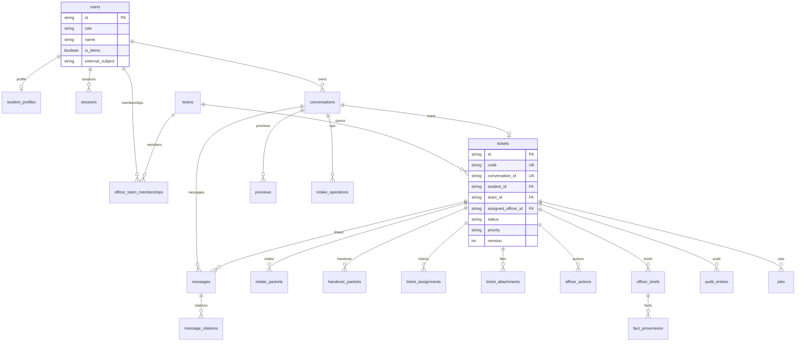

# Database Campus 24/7 — P0

Lớp persistence cho L1–L4 hiện tại: chat/tra cứu, preview xin giấy, Submit 1, hàng chờ/hồ sơ cán bộ, Submit 2, L4 handover, nhận ca. PostgreSQL là chuẩn tích hợp, transaction và concurrency. SQLite dùng local qua `DATABASE_URL`.

Nguồn sự thật: backend + PostgreSQL/SQLite. Frontend mock/`localStorage` không chứng minh dữ liệu đã ghi. Agent/RAG chỉ đề xuất; backend mới commit.

## Chạy

```bash
# Local SQLite (mặc định)
mkdir -p data
.venv/bin/alembic -c backend/alembic.ini upgrade head
.venv/bin/python -m campus247.db.seed
# Chỉ thêm bản ghi còn thiếu; không ghi đè assignee/revision/membership đã đổi.
.venv/bin/python -m campus247.db.seed --reset
# Khôi phục các dòng demo có trong backend/src/campus247/db/seed_data/edu14_demo.json.
.venv/bin/uvicorn campus247.main:app --reload --port 8000
.venv/bin/python -m campus247.workers

# PostgreSQL (Compose)
docker compose up --build

# Rollback một revision
.venv/bin/alembic downgrade -1

# Test
.venv/bin/python -m scripts.export_contracts_v1 --check
.venv/bin/ruff check backend/src backend/tests scripts/export_contracts_v1.py scripts/seed_edu14.py scripts/generate_edu14_seed.py
.venv/bin/pytest backend/tests -q --rootdir=backend
# pytest tự chạy nhận ca đồng thời trên Postgres. EDU14_TEST_DATABASE_URL chỉ được
# trỏ tới DB test (tên campus24_pytest hoặc kết thúc bằng _test/_pytest); fixture
# DROP SCHEMA public CASCADE nên không dùng DB compose campus24.
# Không set URL: Docker postgres:16, container edu14-pytest-postgres, cổng 54329, DB campus24_pytest.
.venv/bin/pytest tests/test_db/test_postgres_concurrency.py -q
```

Không commit `data/*.db`. Seed chỉ đọc `backend/src/campus247/db/seed_data/edu14_demo.json` (dữ liệu giả, `is_demo`, provenance). Khảo sát nguồn mở nằm ở [`datasets.md`](datasets.md). Không nhập Kaggle vào bảng nghiệp vụ. Mặc định seed insert-only; `--reset` mới ghi đè tiến trình demo.

## ERD

Quan hệ vòng `conversations.ticket_id` ↔ `tickets.conversation_id` **không** được lưu. SQL chỉ giữ `tickets.conversation_id` (unique). API suy ra `Conversation.ticket_id`.



Bảng dành cho tăng trưởng, **chưa tạo** vì P0 không có luồng đọc/ghi: `review_feedback`, `sla_events`, `notifications`, `service_catalog`. RAG corpus/vector nằm ngoài schema này.

## Bảng và ràng buộc

| Bảng | PK / unique | FK / check | Lý do |
|---|---|---|---|
| `users` | `id`; `external_subject` unique nullable | `role ∈ {student,officer}` | Định danh demo; SSO gắn sau qua `external_subject`. Không lưu mật khẩu. |
| `student_profiles` | `user_id` 1–1 | FK users | Prefill tên/MSSV/khoa/khóa giả. |
| `teams` | `id` (`academic`, `student_support`) | | Tách hàng chờ học vụ và hỗ trợ. |
| `officer_team_memberships` | `(user_id, team_id)` | FK user+team; khoảng hiệu lực | Chỉ member còn hiệu lực được đọc/nhận ca. |
| `sessions` | `id`; `token_hash` unique | FK user; `expires_at` | Bearer demo 8 giờ; hash SHA-256, không plaintext. |
| `conversations` | `id` | FK owner; status/lock/handover check | Không cột `ticket_id`. |
| `messages` | `id`; `(conversation_id, seq)` unique | FK conversation; ticket nullable | Thứ tự ổn định; ticket gắn sau Submit 1/L4. |
| `message_citations` | `id` | FK message | Metadata nguồn L1; không phải corpus RAG. |
| `previews` | `id` | FK owner+conversation; status; consumed ticket nullable | 30 phút; consume một lần. |
| `preview_revisions` | `(preview_id, version)` | FK preview | Snapshot audit/replay. |
| `intake_operations` | `id`; một `processing` / conversation | FK conversation+message | Chặn hai lượt intake; phục hồi crash. |
| `safety_decisions` | `id`; `operation_id` unique | FK operation+conversation | Lock L4 bền vững trước khi có ticket. |
| `tickets` | `id`; `code`; `conversation_id` | FK student+team+assignee; enum status/priority/category | Routing `team_id` do backend, không lấy từ client. |
| `ticket_code_sequences` | `year` | | Cấp `TKT-YYYY-NNNN` atomic. |
| `intake_packets` | `id` | FK ticket | Snapshot L2; giữ khi L4 nâng ticket. |
| `handover_packets` | `id` | FK ticket | Quyết định safety đã commit. |
| `ticket_assignments` | `id` | FK ticket+team+officer | Lịch sử nhận/chuyển/trả ca; khớp `assigned_officer_id`. |
| `ticket_attachments` | `id` | FK ticket; object_key nullable | Chỉ metadata; không blob, không URL giả. |
| `officer_actions` | `id` | FK ticket+actor | Submit 2 đã xác nhận. |
| `officer_briefs` | `(ticket_id, brief_version)` unique | FK ticket | Lịch sử brief; stale khi revision đổi. |
| `fact_provenance` | `id` | FK brief | Fact + source + verification; lời SV không `verified`. |
| `audit_entries` | `id` | FK ticket; **không** cascade delete | Nhật ký bất biến. |
| `idempotency_records` | `(actor_id, operation, resource_id, key)` | expires ≥ 24h | Replay cùng payload; khác payload = conflict. |
| `jobs` | `id`; dedup kind/resource/revision | state/lease | `prepare_brief`, `retry_handover`; worker lease. |

JSON/JSONB chỉ cho payload đã version hóa (`request_data`, facts, checklist, citations, error). PostgreSQL dùng JSONB (`PortableJSON` / `JSON().with_variant(JSONB())`); SQLite dùng JSON. Cột lọc/quyền (`status`, `priority`, `team_id`, `student_id`, `assigned_officer_id`) là cột thật.

## Chỉ mục

- Ticket: `student_id + created_at`; `team_id + status + priority + created_at`; `code` unique.
- Message: `conversation_id + created_at + id`.
- Job: `state + available_at`; `lease_until`.
- Audit: `ticket_id + created_at`.
- Session: `token_hash`; `expires_at`.
- Idempotency: `expires_at`.
- Conversation: `owner_id + updated_at`.

Hàng chờ cán bộ: `high` trước `normal`, `created_at` tăng dần, `id` tie-break. List sinh viên/conversation: `updated_at` giảm dần, `id` tie-break. Message: thời gian tăng dần, `id` tie-break.

## Thời gian và giữ dữ liệu

- Lưu UTC trong DB; API trả ISO 8601 có timezone (`Z`).
- Seed `+07:00` chuẩn hóa UTC lúc nhập.
- Idempotency tối thiểu 24 giờ; unique conversation/preview vẫn chống trùng sau khi hết hạn.
- Audit, assignment, packet, brief cũ không xóa theo cascade.
- Preview hết hạn 30 phút kể từ lần cập nhật hợp lệ.
- Session demo 8 giờ; logout thu hồi.

## Ánh xạ Pydantic / OpenAPI → SQL

| Contract | SQL | Ghi chú |
|---|---|---|
| `User` | `users` | `is_demo` cột riêng, không có password. |
| `Profile` | `student_profiles` | `student_id` = `user_id`. |
| `Conversation` | `conversations` + ticket unique | `ticket_id` serialize từ `tickets.conversation_id`. |
| `Message` | `messages` | `sender_user_id` nội bộ, không lộ schema public. |
| `Citation` | `message_citations` | Gắn message assistant L1. |
| `Preview` | `previews` + `preview_revisions` | `can_submit` tính khi serialize. |
| `Ticket` / `TicketPublic` | `tickets` | `request_data` JSONB version hóa. |
| `Intake` | `intake_packets` | Giữ bản cũ khi nâng L4. |
| `Handover` | `handover_packets` + `safety_decisions` | Decision trước ticket; packet sau commit. |
| `OfficerBrief` / `Artifact` / `BriefEnvelope` | `officer_briefs` + `fact_provenance` | Không ghi đè `tickets.officer_draft`. |
| `AuditEntry` | `audit_entries` | Thêm action `claim`. |
| `Submit1` / `Submit2` / `ClaimRequest` | giao dịch + `idempotency_records` | Không lưu request làm bảng ticket. |
| `JobAccepted` | `jobs` | Dedup prepare theo ticket+revision. |
| `LoginResult` | `sessions` | Chỉ `token_hash`. |
| `ErrorEnvelope` | không persist nguyên | `jobs.last_error` / brief error JSON an toàn. |

Endpoint mở rộng tương thích: `POST /api/v1/officer/tickets/{id}/claim`.

## Giao dịch nghiệp vụ

| Thao tác | Commit nguyên tử |
|---|---|
| Submit 1 | consume preview + ticket `open` + audit + job `prepare_brief` + idempotency |
| Submit 2 | revision/brief guard + officer action + message + status/revision + audit + idempotency |
| Bổ sung | một message + tăng revision + brief stale + job |
| Handover | tạo/nâng ticket `pending_officer/high` + team theo risk + lock + audit + job |
| Nhận ca | `assigned_officer_id` từ null → cán bộ team + assignment + revision + audit |

Không giữ transaction mở khi gọi LLM. Không báo thành công / cấp mã ticket trước commit. `resolved` không reopen. Revision tăng khi message nghiệp vụ, status, priority, owner/assignee/request đổi; lưu brief không tăng revision.

## Quyền

- Sinh viên: chỉ conversation/ticket của mình; 404 nếu đọc của người khác.
- Cán bộ: chỉ team còn hiệu lực. `academic` không thấy `student_support` (wellbeing). `OF-DEMO-01/03` academic; `OF-DEMO-02` student_support.
- Role `officer` không có quyền toàn cục.
- Nhận ca: atomic, một người thắng; ngoài team → 404; đã có assignee khác → 409.

## SQLite local — giới hạn

| Hành vi | PostgreSQL | SQLite |
|---|---|---|
| Isolation / row lock | `SELECT FOR UPDATE SKIP LOCKED` | Ghi tuần tự; `BEGIN IMMEDIATE`; **không** hứa isolation giống Postgres |
| Worker đa process | Lease + skip locked | Một worker local; hai process có thể đụng cùng job |
| JSON | JSONB | JSON |
| Concurrency Submit 1 / claim | Unique + row lock | Unique vẫn chống trùng; race test **bắt buộc** chạy Postgres |

Lỗi DB trả `PERSISTENCE_UNAVAILABLE` / trạng thái chưa xác nhận, không biên nhận giả.

## Phụ thuộc chưa thuộc lớp DB

- RAG index/Chroma và câu trả lời có nguồn thật (stub không bịa citation).
- LangGraph intake/brief production (P0 inject `AgentPort` stub có contract).
- Upload file / object storage.
- SSO, đặt phòng, bảng điểm, thanh toán, PDF ký số.
