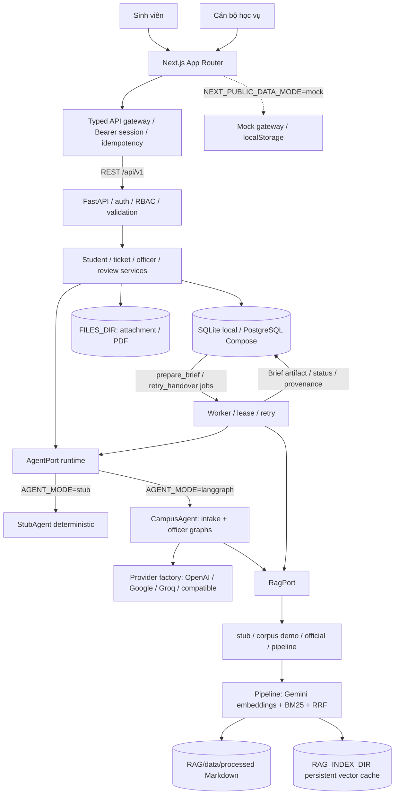
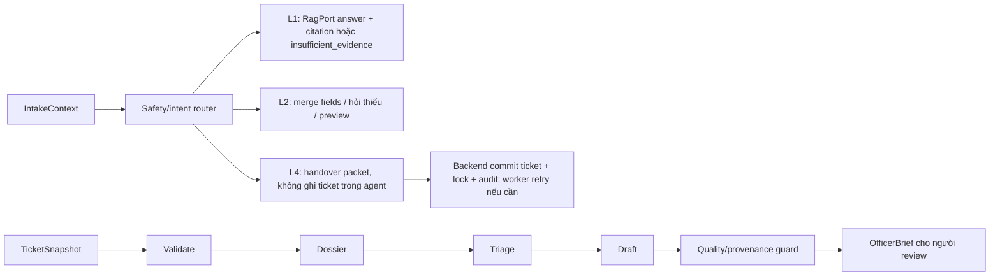

# Architecture — Campus 24/7 MVP

Cập nhật 04/10/2026 từ code tích hợp trên `feat/gate-2-mvp`.
Sơ đồ biểu diễn cấu phần đã có trong repo; agent/RAG được chọn theo cấu hình.

## Components



API và worker là hai process dùng **cùng DB và cấu hình runtime**. SQLite local
phải cùng absolute URL; Compose dùng PostgreSQL. API kiểm tra ownership/team
trên server; client không thay thế phân quyền. Job có lease/retry để tránh
worker ghi brief của revision cũ. Backend lưu token hash và audit; không lưu
mật khẩu thô. UI API mode dùng Bearer session, request có idempotency key và
version/revision để retry không tạo hồ sơ trùng.

Không có Chroma/FAISS trong hybrid runtime này. Gemini embedding/normalization
là lời gọi online khi chọn pipeline ngoài `APP_ENV=test`. RAG lỗi provider trả
lỗi, không chuyển stub hoặc giả vờ có căn cứ.

## Data flow: Submit 1 → L3 → Submit 2

```mermaid
sequenceDiagram
    actor SV as Sinh viên
    participant UI as Next.js/API gateway
    participant API as FastAPI/services
    participant AI as AgentPort
    participant DB as Database
    participant W as Worker
    actor CB as Cán bộ
    SV->>UI: Chat cấp giấy hoặc khiếu nại
    UI->>API: POST conversation/messages + idempotency key
    API->>AI: IntakeContext
    AI-->>API: L2 collecting hoặc preview_ready
    API->>DB: Lưu message và preview/version
    API-->>UI: Fields / missing_fields / can_submit
    SV->>UI: Review, sửa preview, xác nhận Submit 1
    UI->>API: POST tickets (preview_version, confirmed)
    API->>DB: Ticket + intake + job + audit (transaction)
    API-->>UI: Mã ticket từ DB
    W->>DB: Lease prepare_brief job
    W->>AI: TicketSnapshot + nguồn truy xuất
    AI-->>W: OfficerBrief/facts/checklist/draft
    W->>DB: Artifact + brief version; kiểm tra revision/lease
    CB->>UI: Mở hàng chờ và claim ticket
    UI->>API: Claim với expected_revision
    API->>DB: Assignment + audit
    CB->>UI: Review brief, kiểm tra, soạn phản hồi, xác nhận Submit 2
    UI->>API: Officer action + reviewed_brief_version
    API->>DB: Message/status/revision/audit
    SV->>UI: Xem hồ sơ/reload
    UI->>API: GET ticket/messages
    API-->>UI: Phản hồi và status đã lưu
```

Khiếu nại điểm thông thường đi qua **L2 preview → sinh viên xác nhận Submit 1**,
không auto-create ticket/khóa AI ngay khi nhắc đến khiếu nại. Hồ sơ khiếu nại
đã nộp chuyển chờ cán bộ và khóa phản hồi AI theo trạng thái conversation.

## LangGraph và bàn giao



L4 dùng tín hiệu cần hỗ trợ hoặc yêu cầu vượt thẩm quyền (ví dụ yêu cầu AI sửa
điểm). Backend chỉ trả mã ticket sau commit. Agent không tự submit thay sinh
viên, không tự hoàn tất ticket và không tự quyết định nghiệp vụ.

## Chế độ chạy và giới hạn MVP

| Cấu hình | Phạm vi |
| --- | --- |
| `DATA_MODE=api`, `AGENT_MODE=stub`, `RAG_MODE=stub` | UI/API/DB/worker thật; agent deterministic, L1 thiếu căn cứ; chế độ evidence tự động Gate 2 |
| `AGENT_MODE=langgraph`, `RAG_MODE=corpus` | Model thật + demo corpus đóng gói có provenance |
| `RAG_MODE=pipeline` | Hybrid retrieval trên Markdown, embedding cache theo source hash |
| `RAG_MODE=official` | Kho ingest riêng; trống/chưa nguồn phù hợp thì thiếu căn cứ |
| `DATA_MODE=mock` | UI review độc lập, dữ liệu browser; không chứng minh backend/AI |

Trong bảng, `DATA_MODE` là viết gọn của biến frontend `NEXT_PUBLIC_DATA_MODE`.
Đối soát SIS/KHTC chưa có connector thật nên báo thiếu căn cứ; thao tác cán bộ
xác nhận thủ công được audit. Tệp lưu local, chưa object storage. PDF do MVP
tạo không tự chứng minh chữ ký số/phát hành giấy chính thức. Review học phần
là đề xuất cán bộ, chưa phải quyết định được nhà trường ký.

## Code và tài liệu gốc

- [API](../../backend/src/campus247/api/v1.py), [runtime](../../backend/src/campus247/services/runtime.py), [Settings](../../backend/src/campus247/config.py).
- [Intake graph](../../backend/src/campus247/agents/intake_graph.py), [officer graph](../../backend/src/campus247/agents/officer_graph.py), [RAG factory](../../backend/src/campus247/rag/factory.py).
- [API gateway](../../frontend/lib/data/api/api-gateway.ts), [data config](../../frontend/lib/data/config.ts), [Compose](../../docker-compose.yml).
- [Contract](../contracts/README.md), [database](../database/README.md), [capability matrix](../production/capability-matrix.md).
