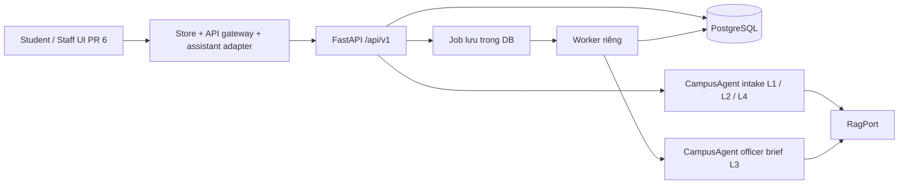

# Kế hoạch cho Grok: tích hợp frontend PR #6, backend P0 và CampusAgent

Ngày khảo sát: 02/10/2026. Đây là kế hoạch triển khai dựa trên mã nguồn; chưa phải báo cáo hệ thống đã tích hợp hoặc đã chạy thử với provider thật.

## 1. Phiên bản đã khảo sát và cách hợp nhất

- Frontend: [PR #6](https://github.com/AI20K-Build-Phase-Cohort-4/P-120/pull/6), `origin/feat/frontend-ai-rebuild`, commit `dfeb94a9f696d885a920b3e8f760e3bc880609ad`, base `develop`.
- Backend nền: `origin/develop`, commit `dea2ad3cb0fe2eed7bbeee9e4a1b3935c4a97266`.
- AI-agent và backend hiện tại: `feat/ai-agent` và HEAD của `feat/connect-frontend-backend` cùng commit `7aa13f9e1a3b8456f1fc0a2d4a4e76c401b8e0dd`. Có CampusAgent, guards, eval và runtime wiring mà develop chưa có.
- Merge base HEAD/develop: `6a590cd6e8acfa41dc77157fb041f49e448b4fe5`; merge base HEAD/frontend: `f9458f25d3eb13fb28791bad35becf7cb46a79c8`.

Grok phải fetch lại và ghi SHA mới trước khi làm. Không coi tên nhánh là snapshot bất biến. Làm trên nhánh tích hợp hiện tại hoặc worktree riêng khi working tree có thay đổi. Hợp nhất develop trước, sau đó frontend PR #6; giải quyết conflict dựa trên chức năng cuối cùng, giữ triển khai CampusAgent và các kiểm thử của nó. Không chép toàn bộ backend từ nhánh frontend vì PR frontend không chứa cập nhật agent mới. Kiểm tra diff từng vùng: frontend, services/runtime, jobs, config, dependencies, contracts và CI. Không reset/hard checkout lên công việc chưa commit của người dùng.

## 2. Kết luận kiến trúc



Backend sở hữu identity, quyền, workflow, revision, idempotency, commit DB và audit. AI trả kết quả có schema qua AgentPort, không trực tiếp tạo ticket hoặc phát hành tài liệu. Frontend chỉ hiển thị receipt sau backend commit. Provider keys ở backend/worker. L3 là officer brief, không phải một giá trị route chat mới: route hiện có là L1/L2/L4.

## 3. Những khoảng trống đã xác nhận

| Vùng | Hiện trạng trong mã nguồn | Việc cần làm |
|---|---|---|
| API bootstrap | `frontend/lib/store.tsx:bootstrapData` chủ động ném lỗi ở api mode | Bootstrap theo session/role/capability; không bắt API phải tải mock reviews và demo users |
| Login | API gateway gửi `{userId}`; backend yêu cầu `{user_id}`. Client không gắn Bearer và bỏ kết quả token | Dùng LoginResult, lưu session đúng tùy chọn nhớ đăng nhập, gọi `/me`, logout server |
| ID demo | UI mock dùng SV001/OF001; DB seed dùng SV-DEMO-001/OF-DEMO-01… | Danh sách account demo riêng theo mode hoặc endpoint demo giới hạn môi trường; không tự đổi ID mơ hồ |
| Gateway | Các thao tác ngoài login ném UnsupportedOperationError | Implement theo ma trận endpoint dưới đây; bổ sung interface nghiệp vụ cần thiết |
| HTTP client | Timeout cố định 10s, chỉ trả body; đọc lỗi top-level `message` | Giữ status/headers, parse `error` envelope, Bearer, Idempotency-Key, abort; intake budget agent là 25s |
| Assistant | `guidanceAdapter` là hướng dẫn/regex cục bộ; không gọi CampusAgent | API assistant dùng conversation và ChatResult; api mode không sinh câu trả lời giả khi server lỗi |
| DTO | FE camelCase, Ticket nhiều field bắt buộc; BE snake_case và schema nhỏ hơn | Wire DTO riêng + mapper có kiểm tra; không ép kiểu trực tiếp hoặc bịa SLA/profile/AI evidence |
| Form đang chạy | Route certificate/complaint dùng `VinUniForm`, không phải chỉ CertificateFlow/ComplaintFlow | Nối đúng component đang được route sử dụng; giữ requestPayload/attachments |
| Phạm vi biểu mẫu | VinUniForm chứa nhiều loại tài liệu, nhận/chuyển phát, khiếu nại nhiều trường | P0 chỉ có student_certificate với 3 trường; cần contract mở rộng để giữ đủ dữ liệu |
| Upload/download | File mock lưu ở trình duyệt; chưa có endpoint file P0 | Storage server + quyền download + attachment IDs; không gửi blob URL cho backend |
| Lưu nháp/checklist | Mock hỗ trợ; P0 chưa có endpoint riêng | Nháp local theo user/ticket ở giai đoạn đầu, hoặc thêm contract lưu server với revision |
| Reviews học phần | ReviewCase/findings/doc versions là luồng mock; không có API tương ứng | Milestone riêng với schema, migration, quyền, worker và agent riêng |
| RAG | Runtime mặc định StubRag; đổi AGENT_MODE không đổi RagPort | Gắn RagPort thật riêng; ghi rõ chế độ agent và nguồn dữ liệu đang chạy |
| Worker | Có service worker trong compose | Chạy worker cùng DB/config/provider với API; kiểm tra migration hoàn tất trước worker |

Nguồn đối chiếu: `frontend/lib/data/{gateway.ts,api/api-gateway.ts,api/api-client.ts,config.ts}`, `frontend/lib/{store.tsx,types.ts,assistant-adapter.ts}`, `frontend/components/student/VinUniForm.tsx`, `frontend/lib/vinuni-forms.ts` trên SHA PR #6; backend `api/v1.py`, `models/contracts_v1.py`, `models/ports_v1.py`, `services/{student,staff,runtime,jobs}.py`, `agents/adapter.py`, `config.py`, `docker-compose.yml` trên HEAD khảo sát.

## 4. Mapping thao tác cho phần P0 hiện có

Các mutation đã dùng dependency IdempotencyKey phải gửi `Idempotency-Key`. Login/logout không mặc nhiên áp dụng yêu cầu này.

| Nhu cầu UI | API hiện có | Quy tắc |
|---|---|---|
| Đăng nhập/khôi phục | POST `/auth/demo-login`, GET `/me` | Login `{user_id}`; token/expiry/user từ LoginResult; restore bằng `/me`, không đăng nhập lại bằng user ID đã lưu |
| Đăng xuất | POST `/auth/logout` body `{}` | Hủy token ở server và xóa state/draft/session thuộc account theo policy |
| Danh sách/tạo chat | GET/POST `/conversations` | Danh sách là Page, không phải array; tạo body `{}` |
| Lịch sử chat | GET `/conversations/{id}/messages` | Phân trang, chống trùng message theo ID |
| Chat với agent | POST `/conversations/{id}/messages` | Chỉ gửi `{content}`; backend trả ChatResult có reply/citations/preview/ticket/conversation_state |
| Sửa preview | PATCH `/previews/{id}` | `{expected_version, fields:{purpose,destination_org,receive_method}}`; fields là full snapshot, null xóa trường |
| Submit 1 | POST `/tickets` | `{preview_id,preview_version,confirmed:true}`; không POST Partial<Ticket> |
| Yêu cầu sinh viên | GET `/tickets`, GET `/tickets/{id}` | Detail là `{ticket,messages:Page}`; backend lọc quyền |
| Bổ sung/trao đổi | POST `/tickets/{id}/messages` | `{content}`; không dùng gửi message cán bộ để bypass Submit2 |
| Hàng chờ cán bộ | GET `/officer/tickets` | Filter/search/page server; không dùng danh sách sinh viên thay thế |
| Nhận ca | POST `/officer/tickets/{id}/claim` | `{expected_revision,confirmed:true}`; lấy revision mới sau claim |
| Chuẩn bị AI L3 | POST `/officer/tickets/{id}/prepare` | `{expected_revision}`; 202 rồi đọc brief, không giả delay để báo thành công |
| Xem brief | GET `/officer/tickets/{id}/brief` | pending/processing/ready/failed/stale; dùng artifact và source_ticket_revision |
| Submit 2 | POST `/officer/tickets/{id}/actions` | `{action,content,expected_revision,reviewed_brief_version,confirmed:true}` |
| Audit | GET `/officer/tickets/{id}/audit` | Actor/time/action từ server; không tự chế actor audit từ name UI |

Tất cả đường dẫn trên có tiền tố `/api/v1`. Không có endpoint operation-status/delete-conversation/profile đầy đủ trong router P0 hiện tại: không tự giả định có sẵn.

## 5. Quy tắc nối dữ liệu và xử lý đồng thời

1. Sinh wire types từ artifact OpenAPI đã kiểm tra, hoặc định nghĩa DTO chính xác theo artifact; mapper riêng chuyển snake_case/camelCase. Giữ ticket revision, preview version, brief version trong state. View model cho phép thiếu SLA, email, MSSV và dữ liệu xác minh; UI hiển thị chưa có dữ liệu.
2. Map sender `assistant` sang UI bot/ai ở đúng component; citation giữ đủ document ID/version/chunk/locator/quote. Không làm mất nhiều citations vì UI hiện chỉ có một `citation`/`source`. Refactor UI citations thành danh sách; URL kiểm tra scheme và nguồn được backend cho phép, không dùng allowlist VINUNI_SOURCES cứng để loại toàn bộ nguồn RAG hợp lệ.
3. Một intent mutation có một key bền qua timeout/retry/reload; retry cùng payload dùng cùng key. Intent/payload mới dùng key mới. Không tự retry thao tác confirmed với key mới sau mất response. Pending operations tách theo account và mode.
4. HTTP result phải phân biệt 200/201/202/204. Với 202 Processing và không có endpoint status, replay request cùng key/payload theo Retry-After với số lần/thời gian hữu hạn; kết hợp refetch resource khi có ID. Prepare trả JobAccepted pending/processing: poll GET brief để nhận BriefEnvelope. Không biến Processing thành Ticket/ChatResult bằng cast.
5. 409 phân biệt STALE_REVISION, STALE_PREVIEW, STALE_BRIEF, IDEMPOTENCY_CONFLICT và CONVERSATION_BUSY. Giữ nội dung người dùng, tải snapshot mới, yêu cầu kiểm tra lại trước submit. Web Locks của mock không bảo vệ đa thiết bị; server revision mới là chuẩn.
6. Abort/timeout chỉ dừng chờ ở client, không chứng minh server chưa ghi. Timeout chat cấu hình phù hợp budget 25s + overhead; reverse proxy cũng phải phù hợp. UI cho retry an toàn với cùng key và đối soát kết quả.
7. Refresh sau mutation, khi quay lại tab và khi mở detail; bỏ kết quả request của account/session cũ. Không tự merge dữ liệu mock vào api mode. Logout/account/mode switch phải xóa cache nhạy cảm và hủy polling/request cũ.
8. Cán bộ phải claim trước Submit2. Claim tăng revision có thể làm brief cũ stale; ưu tiên claim rồi prepare brief, hoặc regenerate sau claim. Nếu xử lý thủ công thì `reviewed_brief_version:null` phải là lựa chọn rõ ràng; không xóa version âm thầm để né STALE_BRIEF.
9. L4 lấy `ai_response_locked` từ backend. Handover chỉ báo thành công khi ChatResult có committed ticket; tin tiếp theo vào luồng cán bộ. Không chạy local assistant để trả lời nghiệp vụ khi đã lock.
10. Checklist AI ban đầu luôn unchecked; thông tin sinh viên tự khai không nâng thành verified. Resolve chỉ kết thúc xử lý ticket; không tạo giấy đã ký hoặc quyết định công nhận học phần.
11. **Bảo toàn Dual-Mode: mock chạy độc lập song song với api.** Mọi HTTP request, Bearer/session adapter, wire DTO/mapper, idempotency và assistant API adapter phải nằm trong `frontend/lib/data/api/*`. Không sửa, xóa hoặc ghi đè `MockDataGateway`, `frontend/lib/data/mock/*` và `frontend/lib/mock-data.ts`; không chuyển fixture mock thành dữ liệu API. Cho phép sửa tối thiểu phần chọn gateway/capability trong Store, interface dùng chung và UI để nối các thao tác P0 mới, vì bootstrap và các nút đang nằm ngoài thư mục adapter. Các sửa này phải có nhánh xử lý theo mode, giữ nguyên hành vi mock và không thêm phụ thuộc backend vào mock. Ưu tiên interface/capability API riêng hoặc optional, không ép MockDataGateway implement nghiệp vụ server. Khi `NEXT_PUBLIC_DATA_MODE=mock`, student/staff/reviews phải chạy đầy đủ sau reload, kể cả khi backend và worker tắt, không có cấu hình API và mạng bị chặn. API lỗi phải giữ trạng thái lỗi của API; người demo có thể chủ động chuyển sang mock, không tự fallback hoặc trộn dữ liệu giữa hai mode. Token/cache/pending operations có namespace riêng, đổi mode không xóa dữ liệu mock đã lưu. Kiểm chứng offline trên bản frontend đã build; cài dependencies/build lần đầu không thuộc cam kết offline runtime.

> [!IMPORTANT]
> **Ưu tiên đợt demo sắp tới:** G0–G3 là critical path: login `{user_id}` → chat L1/L2/L4 qua CampusAgent → Submit1 → queue/Claim → Worker sinh L3 → Submit2 và phản hồi sinh viên. G4/G5 chỉ là backlog; không triển khai upload nhị phân, schema ReviewCase, form mở rộng hoặc migration cho các tính năng này trước khi G0–G3 chạy trơn tru E2E trong môi trường demo thực tế. Trong api mode, capability chưa nối phải có trạng thái chưa hỗ trợ rõ ràng; trong mock mode, toàn bộ prototype vẫn hoạt động. Demo P0 cần đường chat/preview/Submit1 rõ ràng, không phụ thuộc upload bắt buộc của VinUniForm. Hoàn thành G3 thì bàn giao bằng chứng và dừng; chỉ mở G4/G5 khi người điều hành giao milestone tiếp theo.

## 6. Lộ trình triển khai và điều kiện hoàn thành

### G0 — Hợp nhất và baseline

Hợp nhất các snapshot theo mục 1, ghi SHA, conflict resolution và sơ đồ thành phần. Chạy baseline frontend regression của PR #6 và backend contract/API/DB/agent tests. Giữ gói verification cũ để so sánh, không gọi nó là bằng chứng cho bản tích hợp mới. Ghi content hash các file mock sau hợp nhất và trước tích hợp; đối chiếu lại sau mỗi lượt để chứng minh logic/fixtures mock không bị sửa. Nếu tích hợp đã bắt đầu trước đó, kiểm tra thêm diff các file mock so với SHA PR #6.

Đầu ra: nhánh tích hợp build được, danh sách capability theo mode, bảng gap có owner và phạm vi milestone. Mỗi bước sau có commit/PR riêng dễ review.

### G1 — HTTP/session và bootstrap theo capability

Sửa ApiClient, login/logout/restore, error envelope, status/headers, idempotency và DTO mapping trong `frontend/lib/data/api/*`. Mở bootstrap api bằng sửa tối thiểu Store/capability: unauthenticated vẫn vào login; restore qua `/me`, student chỉ tải dữ liệu được phép; officer tải queue. `/me` chỉ xác định session/role, không thay endpoint danh sách. Không gọi getReviewCases/getDemoUsers nếu chưa có capability. Nhớ đăng nhập có TTL theo expires_at; chọn policy token demo rõ ràng, không lưu khóa provider. Production auth là hạng mục riêng nếu cần SSO/cookie. Mock bootstrap, auth và persistence giữ nguyên.

Đầu ra: login account DB seed, refresh, logout và đổi account hoạt động; không 422 do userId, không `/me` thiếu Bearer, không rò dữ liệu account trước.

### G2 — Một luồng P0 chạy xuyên suốt với stub xác định

Dùng AGENT_MODE=stub để kiểm tra transport/DB/workflow trước. Nối assistant → conversation → L2 preview → edit → Submit1 → ticket detail/queue → claim → prepare/poll brief → Submit2 → phản hồi sinh viên/audit. Thêm phương thức gateway rõ như sendConversationMessage/patchPreview/submitPreview/claimTicket/prepareBrief thay vì nhét metadata server vào Partial<Ticket>.

Đối với form trực tiếp: P0 chưa có create-preview từ form. Bản tối thiểu có thể gửi các trường chứng nhận qua conversation intake, nhận preview rồi PATCH bằng dữ liệu form và cho người dùng kiểm tra preview cuối trước submit. Chỉ hỗ trợ đúng student_certificate/3 fields; các loại transcript/khác phải báo chưa hỗ trợ hoặc đi milestone mở rộng. Cho demo, ưu tiên đường chat → preview P0 → Submit1; UI chỉ thêm phần nối cần thiết, không bắt dùng VinUniForm đầy đủ và không bỏ validation/required files của prototype mock. Cách tốt cho form đầy đủ là endpoint structured intake/preview ở G4; không tự POST Ticket để né confirmation.

Khiếu nại P0: gửi nội dung đã xác nhận qua conversation, backend quyết định L4 và commit; đọc ticket trả về. Không tự set isL4/high trong payload ghi server. Đây là bản hỗ trợ nội dung text; chưa được coi là đã bảo toàn mọi trường/file của VinUniForm.

Đầu ra: E2E DB thật cho chứng nhận, request_info → bổ sung, respond/resolve, khiếu nại L4; retry không tạo trùng, hai account/thiết bị nhận conflict đúng.

### G3 — CampusAgent thật và nguồn RAG

Bật AGENT_MODE=langgraph cho cả API và worker, dùng config provider/model đã được hỗ trợ trong services/llm.py. Kiểm tra startup/runtime dùng CampusAgent, không gọi legacy `/chat` để bỏ qua workflow P0. Mock provider vẫn dùng cho CI; thêm smoke provider thật có cấu hình ngoài repository.

RagPort thật cần implementation + wiring + dữ liệu đã duyệt/index version; hiện StubRag chỉ chứng minh interface. Demo có thể dùng corpus nhỏ đã duyệt hoặc bộ tài liệu demo kiểm soát với provenance/version/scope rõ ràng và retrieval thực sự; không cần làm ingestion tổng quát trước demo. Phân biệt corpus quy chế thật với tài liệu demo, không gọi fixture được hard-code là citation quy chế thật. Nối retrieval cho L1 và cấp approved_sources cho snapshot worker L3; thay RagPort thôi chưa đủ vì worker hiện để approved_sources rỗng. Không tuyên bố L1 có nguồn thật khi chưa nối retrieval. Giữ fail-closed khi thiếu bằng chứng, schema/source lỗi hoặc provider timeout; hiển thị lỗi an toàn/request_id. UI đọc quality_status/warnings/stale và không biến draft AI thành quyết định.

Đầu ra: intake/L4/brief thật với DB/worker, provenance/model/prompt/template/index metadata đúng; provider lỗi không sinh success giả; báo rõ smoke nào dùng stub hay provider thật.

### G4 — Bảo toàn form PR #6, tệp và nháp server

**Backlog sau demo.** Chỉ bắt đầu khi G0–G3 đã có bằng chứng E2E đạt trên môi trường demo và người điều hành giao milestone này.

Mở rộng contracts_v1 và artifact trước khi gọi API mới. Đề xuất structured preview/form intake có schema typed cho documentType, identity khai báo, shipping và complaint; lưu request payload đầy đủ với schema version, phân biệt profile server và student declaration. Backend validates loại dịch vụ/field/độ dài và confirmation; complaint giữ semantics L4. Tránh chuỗi text để làm storage thay cho schema đầy đủ.

Thêm upload metadata/content, liên kết file với owner/request, download có quyền và byte integrity; migration/storage config/giới hạn file/cleanup orphan. UI chỉ ghi success khi upload và liên kết request đã thành công. Thiết kế retry để upload/submit không tạo tệp hoặc ticket trùng; bổ sung attachments qua endpoint được kiểm tra quyền. Không chạy OCR giả để báo đã xác minh.

Nếu cần nháp/checklist đồng bộ: endpoint và bảng riêng, actor từ Bearer, expected_revision hoặc draft_version; AI regenerate không ghi đè nháp cán bộ. Nếu chọn nháp local ở G2, ghi rõ giới hạn đa thiết bị. SLA/cấp giấy thật yêu cầu nguồn và contract riêng, không suy ra từ mock fixtures.

Đầu ra: toàn bộ trường của route VinUniForm được lưu và đọc lại không mất dữ liệu; tải tệp sau reload/thiết bị khác đúng bytes; sửa nháp stale không mất nội dung.

### G5 — Workspace rà soát học phần

**Backlog sau demo.** Chỉ bắt đầu khi G0–G3 đã đạt và người điều hành giao milestone này; các phần tài liệu/file phụ thuộc G4 phải được hoàn thành trước.

Thiết kế contract ReviewCase/DocumentVersion/criterion/finding/citation/supplement/finalReport, migration, access scope và revision. Thêm API cho create/list/detail, review job/status, finding confirmation, supplement request/submission và finalize. AgentPort hiện tại chỉ intake/brief: thêm review port/graph có schema riêng, không gọi prepare_officer_brief rồi cast thành ReviewFinding.

Nguồn evidence gắn document/version/page/section; upload version mới làm findings/report stale. AI chỉ đề xuất, cán bộ xác nhận; finalize tạo phiếu đề xuất, không cấp quyết định chính thức. Mọi mutation có actor server, revision và idempotency. Không đánh dấu hỗ trợ reviews trong api mode trước khi toàn bộ chuỗi này hoạt động.

Đầu ra: review → supplement → version mới → rerun → xác nhận → finalize xuyên DB/worker; race hai cán bộ, citation version cũ và lỗi job được kiểm thử.

## 7. Kiểm chứng bắt buộc cho Grok

Frontend trên bản đã merge: đọc `frontend/AGENTS.md` và docs Next.js cục bộ trước khi sửa framework APIs; chạy TypeScript, ESLint phạm vi sản phẩm, production build và bốn script `test-store-config.mjs`, `test-student-release.mjs`, `test-staff-workspace.mjs`, `test-staff-audit-regression.mjs`. Khi kiến trúc đổi, cập nhật test để kiểm tra behavior mới, không xóa assertions audit chỉ để pass.

Backend: dùng môi trường Python repo, Ruff, `scripts.export_contracts_v1 --check`, tests contracts/API/DB/agents; chạy pytest với cwd `backend` vì Alembic hiện dùng script_location tương đối. Exporter chạy từ repo root với `PYTHONPATH=backend/src`. Chạy kiểm thử PostgreSQL/concurrency theo fixture/config hiện có, không kết luận từ SQLite. Khi đổi schema phải regenerate JSON examples/OpenAPI bằng exporter và cập nhật fixtures. CI cần kiểm chứng cả các vùng thay đổi.

Bổ sung integration/E2E có ý nghĩa:

- Sau mỗi lượt G0–G3: build mock mode, tắt backend/worker và chặn mạng; smoke login/student tạo hồ sơ/staff phản hồi hoặc hoàn tất/reviews xử lý và supplement, reload rồi kiểm tra dữ liệu vẫn còn. Kiểm tra không có HTTP request tới backend/provider. Hash các file mock so với baseline phải giống nhau. Nếu có runtime mode switch, chứng minh chuyển api → mock chủ động không trộn session/token/cache hoặc mất dữ liệu mock.
- Student A không đọc/ghi ticket/conversation của B; officer ngoài scope bị từ chối. Kiểm tra quyền file khi triển khai G4.
- Login nhớ/không nhớ, token hết hạn, reload, logout, mode/account switch khi request đang chạy.
- Submit1 double click/retry/mất response; preview stale/expired/already submitted.
- Claim hai cán bộ, stale revision/brief sau claim hoặc bổ sung; draft còn nguyên sau conflict.
- 202 xử lý hữu hạn, worker tắt/khởi động lại, provider timeout/schema sai, Retry-After và request_id.
- L4 không thông báo trước commit, AI bị lock, follow-up chuyển cán bộ và không sinh ticket trùng.
- Không hiện SLA/xác minh/tài liệu phát hành giả; thiếu capability không làm hỏng bootstrap/login.
- G4/G5 sau demo: file download đúng bytes và quyền; review giữ citation theo version sau supplement. Các ca API mở rộng này không là điều kiện cho G0–G3; regression file/reviews ở mock vẫn bắt buộc.
- Browser smoke desktop/mobile, sáng/tối, keyboard/dialog/zoom cho các UI bị sửa; QA mock PR #6 không thay thế QA api.

## 8. Bộ prompt thực thi từng lượt cho Grok

Người điều hành copy lần lượt các prompt dưới đây. Mỗi lượt chỉ làm milestone được giao, bàn giao kết quả rồi dừng chờ kiểm tra; không tự bắt đầu lượt kế tiếp hay G4/G5. Các yêu cầu Dual-Mode và giới hạn demo ở mục 5 áp dụng cho mọi lượt. Báo cáo rõ agent/provider/corpus là stub, demo hay thật.

### Lượt 1 — Auth, session và bootstrap (G0 + G1)

```text
Bạn là Senior Fullstack Engineer. Đọc docs/integration/Grok-Frontend-Backend-Agent-Plan.md,
đặc biệt mục 1, 3, 4, 5, 7 và 10; chỉ triển khai G0 + G1 trên nhánh tích hợp.

1. Kiểm tra working tree, fetch và ghi SHA frontend PR #6/develop/feat/ai-agent.
   Hợp nhất và xử lý conflict theo mục 1, giữ CampusAgent và tests của nó.
   Không reset công việc chưa commit; dùng worktree riêng nếu cần.
2. Ghi hash baseline MockDataGateway, data/mock/* và mock-data.ts sau hợp nhất.
   Không sửa/xóa các file này. Mọi HTTP/session adapter/DTO mapping đặt trong
   frontend/lib/data/api/*. Chỉ sửa tối thiểu Store/interface/UI để chọn đúng mode
   và nối capability; giữ nguyên hành vi mock.
3. ApiClient và ApiCampusDataGateway:
   - Login POST /api/v1/auth/demo-login với {user_id: userId}; dùng LoginResult.
   - Gắn Authorization Bearer cho request được bảo vệ; restore bằng GET /api/v1/me,
     không đăng nhập lại chỉ bằng user ID lưu local. Hỗ trợ remember/expiry/logout.
   - Account API dùng ID seed SV-DEMO-xxx/OF-DEMO-xx; không đổi account mock.
   - Parse ErrorEnvelope.error: code/message/request_id/retryable/details.
   - Trả status/headers/body để phân biệt 200/201/202/204, đọc Retry-After khi có.
   - Idempotency-Key cho mutation yêu cầu header: một key cho một intent;
     retry cùng payload giữ key, không sinh key mới cho mỗi lần fetch/retry.
   - Timeout/abort cấu hình phù hợp; abort không có nghĩa server chưa commit.
4. Bỏ nhánh ném UnsupportedOperationError cho API bootstrap trong Store.
   Khi chưa có session thì hiển thị login; khi restore thành công qua /me thì tải
   dữ liệu đúng role/capability. Không bắt bootstrap tải mock reviews/demo users
   hoặc endpoint chưa implement. Kiểm tra payload/Page theo contract.
   Logout/account/mode switch hủy request cũ và bỏ kết quả account trước.
5. Không làm upload, ReviewCase, form mở rộng hoặc migration G4/G5.
   API lỗi không tự đổi sang mock. Mock build vẫn chạy offline không cần API URL.

Đầu ra:
- Diff và SHA ngắn gọn; giải thích các sửa ngoài data/api/* nếu có.
- Commands, exit code và kết quả TypeScript/ESLint/npm run build, bốn regression
  scripts PR #6 và kiểm thử auth/bootstrap API phù hợp với thay đổi.
- Smoke mock với backend/worker tắt và mạng bị chặn: student/staff/reviews + reload;
  hash file mock không đổi và không có request backend/provider.
- Bàn giao hướng dẫn chạy/capability/giới hạn. Dừng chờ người điều hành kiểm tra
  và giao Lượt 2; chưa làm G2.
```

### Lượt 2 — Luồng P0 với backend stub (G2)

```text
Tiếp tục theo docs/integration/Grok-Frontend-Backend-Agent-Plan.md, chỉ làm G2.
Đối chiếu báo cáo/SHA Lượt 1; chạy API và worker cùng DB với AGENT_MODE=stub.
Giữ Dual-Mode theo mục 5.11: không sửa MockDataGateway/fixtures/mock-data.ts.

1. Student: API assistant adapter gọi POST /api/v1/conversations để tạo conversation
   rồi POST /api/v1/conversations/{id}/messages với {content}; xử lý ChatResult.
   API adapter nằm trong data/api/*; Store/UI chỉ nối mode/capability cần thiết.
   Không gọi legacy /chat hoặc guidanceAdapter để giả trả lời trong api mode.
2. L2: hiển thị preview và form P0 3 fields. PATCH /api/v1/previews/{id} gửi
   {expected_version, fields:{purpose,destination_org,receive_method}} full snapshot.
   Giữ edit khi conflict, dùng preview.version mới; người dùng kiểm tra/xác nhận.
   Submit1 POST /api/v1/tickets: {preview_id,preview_version,confirmed:true}.
   Không POST Partial<Ticket> hoặc ép mọi loại tài liệu thành student_certificate.
   Demo dùng chat/preview P0; không phụ thuộc file upload/VinUniForm đầy đủ.
3. L4: backend quyết định và trả ticket đã commit; đồng bộ conversation_state và
   ai_response_locked. Khóa trả lời AI và Submit1 khi có lock, vẫn cho gửi follow-up
   tới cán bộ theo workflow backend khi ticket còn mở; không khóa toàn bộ chat.
4. Staff: GET /api/v1/officer/tickets; detail/message/audit lấy từ server.
   Claim POST /api/v1/officer/tickets/{id}/claim:
   {expected_revision,confirmed:true}. Dùng revision trả về sau claim.
   Prepare POST /api/v1/officer/tickets/{id}/prepare: {expected_revision}.
   Xử lý 202 JobAccepted, poll GET /api/v1/officer/tickets/{id}/brief có giới hạn;
   hiển thị pending/processing/ready/failed/stale, không báo ready bằng fake delay.
   Claim trước prepare để tránh brief stale sau tăng revision.
5. Submit2 POST /api/v1/officer/tickets/{id}/actions:
   {action,content,expected_revision,reviewed_brief_version,confirmed:true}.
   Actor từ Bearer, nội dung do cán bộ kiểm tra. STALE_REVISION/STALE_BRIEF giữ draft,
   tải snapshot mới và yêu cầu kiểm tra lại. Xử lý thủ công với brief_version null
   phải rõ ràng với reviewed_brief_version:null, không tự xóa version để bypass guard.
   Resolve không phát hành giấy.
6. Một intent mutation giữ cùng key qua mất response/retry; 202 Processing replay
   cùng key/payload hữu hạn, không giả endpoint operation-status chưa tồn tại.
   Student bổ sung qua /tickets/{id}/messages; refetch ticket/brief sau mutation.
7. Không làm G4/G5; reviews/upload API chưa hỗ trợ có trạng thái rõ ràng,
   mock vẫn giữ đầy đủ prototype offline.

Đầu ra:
- E2E browser với frontend + API + worker thật, agent stub: student tạo ticket mới
  -> officer claim -> worker sinh brief -> Submit2 -> student đọc phản hồi.
- Thử request_info/bổ sung, L4 lock/follow-up, duplicate submit/retry/conflict.
- Có SQLite smoke trên DB demo riêng; dùng DATABASE_URL tuyệt đối, ghi rõ API và
  worker trỏ cùng file. Nếu môi trường demo dùng PostgreSQL, E2E phải chạy thêm trên
  PostgreSQL đó; SQLite không thay bằng chứng concurrency Postgres.
- Commands/test results, request_id và record IDs (không token/secrets), migration
  target, mock offline smoke + hash không đổi. Chỉ tạo dữ liệu demo mới, không reset
  DB hiện tại. Ghi cấu hình để chạy lại.
- Dừng chờ người điều hành kiểm tra và giao Lượt 3; chưa bật agent thật.
```

### Lượt 3 — CampusAgent thật, worker và RAG (G3)

```text
Tiếp tục theo docs/integration/Grok-Frontend-Backend-Agent-Plan.md, chỉ làm G3.
Đối chiếu báo cáo/SHA Lượt 2; không làm G4/G5. Giữ MockDataGateway và fixtures nguyên vẹn.

1. AGENT_MODE=langgraph cho cả API và worker; cùng DATABASE_URL/provider/model.
   Kiểm tra runtime đang dùng CampusAgent và worker nhận prepare_brief jobs.
   Provider secrets ở backend/worker, không đưa vào NEXT_PUBLIC_* hay báo cáo.
2. Nối RagPort và retrieval với corpus nhỏ có document ID/version/chunk/locator/
   scope/effective dates/provenance. Ưu tiên quy chế đã duyệt; nếu dùng tài liệu demo,
   ghi rõ là demo. Vector store test/in-memory có thể dùng làm storage, nhưng phải
   truy xuất passage từ tài liệu thực có trong corpus, không hard-code citation giả.
   Không cần làm ingestion tổng quát hoặc schema học vụ mới trước demo.
3. Nối retrieval L1 và approved_sources vào TicketSnapshot worker L3:
   worker hiện dùng approved_sources=[]; chỉ thay RagPort không giải quyết L3.
   Citation phải đối soát được quote và document/version/chunk trong corpus.
   Nếu không có nguồn phù hợp, hiển thị insufficient_evidence, không bịa căn cứ.
4. Test provider timeout/schema/source lỗi: giữ error envelope/request_id, lock và
   receipt theo backend; không tạo thành công/AI response giả, không fallback mock.
   UI hiển thị warnings/quality_status/stale và giữ nội dung để retry an toàn.
5. Chạy E2E trên môi trường demo: L1 trả citation đối soát được; L2 trích xuất đủ
   3 fields -> preview/edit/Submit1; L4 bàn giao sau commit và follow-up tới cán bộ;
   Claim -> Worker L3 Fact Sheet/brief -> Submit2 -> student thấy phản hồi.
   Facts do sinh viên khai giữ unverified; AI không tự quyết định/phát hành.

Đầu ra:
- SHA, cách chạy API/worker/frontend, kết quả build/regression/integration.
- Bằng chứng E2E với provider thật: request IDs, ticket/job/brief versions và metadata
  model/prompt/template/index; không lộ token hoặc API keys.
- Nêu rõ corpus quy chế thật hay demo, nguồn citation và kết quả negative tests.
- Mock offline student/staff/reviews vẫn pass; hash mock không đổi; API lỗi không
  tự chuyển mode. Nếu thiếu credentials/corpus hoặc E2E chưa đạt, báo đúng phần chưa
  chứng minh, không đánh dấu G3 hoàn thành và không chuyển sang G4/G5.
- Bàn giao demo P0 rồi dừng chờ người điều hành. G4/G5 chỉ mở khi được giao riêng.
```

## 9. Bàn giao và định nghĩa hoàn thành

Bàn giao gồm nhánh/commit tích hợp, contract/generated artifacts, migration, cấu hình mẫu không có secrets, hướng dẫn khởi động DB/API/worker/frontend, seed accounts đúng mode, E2E và báo cáo QA mới. Config frontend dùng `NEXT_PUBLIC_DATA_MODE=api`, `NEXT_PUBLIC_API_BASE_URL=http://localhost:8000`, khóa mode switch phù hợp môi trường. CORS cho origin frontend; nếu JS cần đọc Retry-After/X-Request-Id phải expose headers ở server. API và worker phải có cùng DATABASE_URL/AGENT_MODE/provider configuration; migration xong trước nhận job.

“P0 nối xong” chỉ khi G0–G3 và kiểm thử tương ứng đạt, kèm nhãn giới hạn form/upload/reviews/RAG. “Toàn bộ workspace PR #6 nối xong” chỉ khi G4–G5 cũng đạt và không còn thao tác được bật trong api mode nhưng ném UnsupportedOperationError hoặc chỉ thay local fixtures. Auth demo và xử lý ticket không đồng nghĩa SSO vận hành hoặc phát hành giấy tờ chính thức.

Đợt demo hiện tại chỉ yêu cầu hoàn thành P0 G0–G3 và mock offline regression; G4/G5 còn backlog không cản bàn giao P0. Citation của tài liệu demo phải được ghi rõ, không coi là quy chế vận hành thật. Mỗi lượt ở mục 8 dừng sau bàn giao để người điều hành kiểm tra và giao lượt tiếp theo. Tài liệu này cập nhật kế hoạch, không tự khởi động triển khai hoặc tự coi các điều kiện E2E là đã đạt.

## 10. Đối chiếu database thực tế ngày 02/10/2026

Đã đọc `data/app.db` bằng SQLite read-only, không migrate/seed/reset DB hiện tại. Settings hiện trỏ `sqlite:///./data/app.db`; `docker compose ps` không liệt kê service đang chạy. Đây là đánh giá DB local và schema repository, chưa phải xác nhận một PostgreSQL triển khai bên ngoài.

### Dữ liệu đang có

Schema có 24 bảng nghiệp vụ, ngoài `alembic_version`. DB local có:

| Nhóm | Số dòng / độ phủ |
|---|---|
| Users / profiles | 33 users: seed gồm 30 sinh viên + 3 cán bộ; 30 profiles có tên/MSSV/khoa/khóa |
| Teams / memberships | 2 teams, 3 memberships |
| Tickets | 30: 18 student_certificate, 8 academic_complaint, 4 student_support |
| Status tickets | 5 open, 19 pending_officer, 6 resolved |
| Conversations / messages | 31 conversations, 81 messages; cả 30 ticket có student message |
| Assignment / audit | 25 assignments, 49 audit entries |
| Preview / session | 1 preview + 1 preview revision, 3 sessions |
| Intake / handover packets | 0 / 0 |
| Brief / fact provenance / jobs | 0 / 0 / 0 |
| Officer actions / officer draft | 0 actions; không ticket nào có draft đã lưu |
| Attachments / message citations | 0 / 0 |

Foreign key check: 0 lỗi. Seed đóng gói có 30 conversations và 79 messages; DB local đã có thêm hoạt động nên không đồng nhất tuyệt đối với fixture. Không coi số sessions là số phiên còn hiệu lực.

DB local đang ghi revision `20260929_0001`, trong repo head là `20260929_0002`. Revision 0002 chuyển JSON sang JSONB trên PostgreSQL và no-op schema trên SQLite; cần upgrade head khi triển khai nhưng revision này không bổ sung các nghiệp vụ đang thiếu. Xác định DATABASE_URL/cwd đích trước migration để tránh tạo nhầm một `backend/data/app.db` khác do URL tương đối.

### Đủ chạy gì, còn thiếu gì

- **Đủ nền persistence cho P0**: auth demo, quyền theo team, chat, preview 3 fields, Submit1, queue, claim, Submit2, L4, audit/revision/idempotency và worker jobs. Các bảng trống như session/job/packet/brief có thể được workflow tạo khi chạy, không phải mọi bảng cần seed trước.
- **Seed hiện tại chưa là bộ dữ liệu hoàn chỉnh cho mọi màn hình**: seed chỉ nạp user/profile/team/membership/conversation/ticket/assignment/message/audit; không nạp packet, brief, file, citations hoặc officer_actions. Ticket resolved có lịch sử message/audit nhưng không có đầy đủ action record để replay toàn bộ nghiệp vụ. Prepare + worker có thể tạo brief mới cho ticket chưa resolved; backend hiện từ chối prepare cho ticket resolved.
- **Profile chưa đủ và API chưa trả hết phần đã có**: DB profile chỉ tên, MSSV, khoa, khóa; thiếu email, phone, chuyên ngành chi tiết, tình trạng học tập và dữ liệu học vụ xác thực. `/me` chỉ trả id/role/name, chưa đưa profile sẵn có ra frontend. Phân biệt student declaration với dữ liệu từ SIS; không coi profile demo là xác minh chính thức.
- **Form đầy đủ chưa được bảo toàn**: `tickets.request_data` tuy là JSON nhưng serializer validate bằng `Fields(extra=forbid)` chỉ chứa purpose/destination_org/receive_method. Không nhét shipping, documentType, copies hoặc toàn bộ Grade Appeal vào đó mà chưa mở contract. Cần snapshot biểu mẫu có schema version, field IDs/raw values ổn định, declaration/confirmation và liên kết file.
- **Files có bảng nền**: `ticket_attachments` đã tồn tại với filename/mime/size/object_key/uploader, nhưng chưa có file bytes/storage và API upload/download. Mở rộng từ bảng này, tránh tạo bảng trùng; bổ sung checksum, lifecycle/version/link/ownership theo nhu cầu review và retry. Trước-submit upload cần attachment độc lập hoặc staging owner vì bảng hiện yêu cầu ticket_id.
- **AI thiếu nguồn thực**: `message_citations` và `fact_provenance` lưu kết quả/provenance, không phải corpus. Runtime còn StubRag; worker đang dựng TicketSnapshot với `approved_sources=[]` cố định. G3 phải nối retrieval vào snapshot worker trước khi kỳ vọng L3 có citation quy chế, ngoài việc thay RagPort cho L1.
- **Review học phần chưa có schema**: thiếu case/criterion/document-version/finding/confirmation/supplement/final-report và review jobs. Bảng jobs hiện giới hạn kind prepare_brief/retry_handover; thêm review cần migration constraint và worker mới.
- **Học vụ xác thực và phát hành**: chưa có kết nối/schema dữ liệu điểm, enrollment, môn học/đề cương, biên bản thi, thanh toán, SLA/calendar và giấy đã ký. Những nghiệp vụ cần xác minh/phát hành không thể hoàn tất bằng bộ seed ticket hiện tại.

### Phần database giao thêm cho Grok

1. Ở G0–G2: giữ schema P0, migrate đúng DB lên head; chỉ dùng profile đã có trong contract, các trường chưa có hiển thị chưa có dữ liệu và đưa API/profile mở rộng vào G4. Tạo scenario fixtures qua workflow backend trên DB demo/test riêng cho L2 complete/incomplete, request_info → supplement, L4, brief ready/stale/failed và resolved. Không chỉ copy mock fixtures vào SQL hoặc reset tiến trình live. Ghi scenario map và kiểm tra join/quyền/revision/provenance.
2. Ở G3: nhập corpus được duyệt với version/scope/effective dates trong store RAG; nối approved_sources vào worker snapshot. Seed dữ liệu giả dùng cho demo phải có provenance/is_demo rõ ràng.
3. Ở G4: thêm typed/versioned form snapshot, schema/API profile, upload/storage; nháp/checklist theo actor và version nếu cần đồng bộ. Schema migration + contract + seed scenarios + tests đi cùng một thay đổi.
4. Ở G5: migration review domain và review job kinds; fixtures cho version mới làm finding stale, supplement, finalize và conflict hai cán bộ.
5. Dữ liệu SIS/grade/payment/phát hành chỉ thêm khi nghiệp vụ đó vào phạm vi; trước khi có nguồn thật, màn hình ghi thiếu dữ liệu hoặc demo, không tạo kết quả verified tự động.

Kiểm thử trên DB SQLite tạm do pytest tạo, cwd `backend`: `../.venv/bin/pytest tests/test_db/test_migrations_and_seed.py -q` — 5 passed; `../.venv/bin/pytest tests/test_db/test_submit_and_l4.py tests/test_db/test_jobs.py tests/test_db/test_scope_and_claim.py -q` — 17 passed. Tổng 22 passed cho migration/seed, Submit1/Submit2/L4, jobs, scope/claim. Lần đầu chạy migration tests từ repo root thất bại setup do Alembic script_location tương đối; chạy lại đúng cwd đã pass. Việc này không thay đổi DB local và không chứng minh concurrency PostgreSQL hoặc E2E frontend đã đạt.
