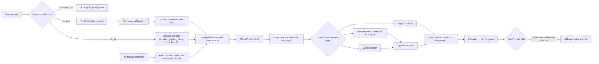

# Plan L2–L3–L4 — AI Copilot ưu tiên hỗ trợ cán bộ

**Dự án:** Campus 24/7 (EDU-14 / P-120)

**Trọng tâm:** AI chuẩn bị gần như toàn bộ hồ sơ; cán bộ kiểm chứng, chỉnh sửa và quyết định.

**Tài liệu liên quan:** [Pipeline L2–L3–L4](docs/Pipeline-L2-L3-L4.md) · [L2](docs/L2-Tiep-nhan-yeu-cau-dich-vu.md) · [L3](docs/L3-Hang-cho-can-bo-theo-doi-ticket.md)

**Quan hệ với pipeline:** kế hoạch này mở rộng năng lực AI trên hai luồng hiện có: giấy xác nhận sinh viên và L4 khiếu nại/handover. Toàn bộ checklist trong `docs/Pipeline-L2-L3-L4.md` là baseline nghiệm thu bắt buộc; các tiêu chí bên dưới bổ sung vào baseline. Hỏi thủ tục vẫn đi L1. Cấp/ký PDF chính thức, sửa điểm và tích hợp portal/LMS thật vẫn ngoài MVP.

---

## 1. Quyết định sản phẩm

### 1.1. Ai là người được ưu tiên?

**Cán bộ học vụ là người dùng được ưu tiên số 1 của kế hoạch L2–L3–L4.**

L2 vẫn phục vụ sinh viên, nhưng dữ liệu L2 phải được thu thập theo cách giúp cán bộ không phải:

- đọc lại toàn bộ cuộc chat;
- hỏi lại thông tin đã có;
- tự xác định hồ sơ thiếu gì;
- tự tìm quy định cho từng ca;
- tự viết lại các phản hồi lặp lại;
- tự dò ticket nào cần làm trước.

Mục tiêu không phải để AI thay cán bộ ra quyết định. Mục tiêu là đưa mỗi ticket đến trạng thái **“cán bộ có thể kiểm tra và quyết định trong một màn hình”**.

### 1.2. Phân bổ ưu tiên

| Phần | Tỷ trọng đề xuất | Giá trị chính |
|---|---:|---|
| **L3 — Officer Copilot** | **55%** | Giảm thời gian đọc, kiểm tra, soạn phản hồi và quản lý hàng chờ |
| **L4 — Safety & Handover** | **25%** | Chặn AI xử lý sai thẩm quyền và bàn giao cho đúng cán bộ với đủ ngữ cảnh |
| **L2 — Intake thông minh** | **20%** | Thu đúng, đủ, có cấu trúc ngay từ đầu để giảm việc làm lại ở L3 |

Tỷ trọng trên mô tả trọng tâm sản phẩm sau khi có nền tảng dùng chung, không thay thế thứ tự phụ thuộc kỹ thuật. Thứ tự triển khai là: **ticket/API/quyền → hai luồng giấy và L4 E2E với OfficerBrief tối thiểu → evidence/quality nâng cao → tối ưu hàng chờ → pilot**. Nếu nguồn lực hạn chế, chạy pilot sau P1 và lùi phần tối ưu hàng chờ P2.

P0 phải có cả Submit 1, handover L4, Submit 2 và cổng SV theo dõi/bổ sung. Các tối ưu L2 như phát hiện yêu cầu tương tự, cùng các chức năng phân tích hàng chờ, triển khai sau khi hai luồng cốt lõi đã chạy ổn.

### 1.3. AI được phép đi xa đến đâu?

| Mức | AI được làm | Áp dụng |
|---|---|---|
| A0 — Quan sát | Đọc ticket, hội thoại, dữ liệu đã được phân quyền | Tự động |
| A1 — Chuẩn bị | Tóm tắt, phân loại, checklist, tìm nguồn, phát hiện thiếu | Tự động |
| A2 — Đề xuất | Gợi ý ưu tiên, bước tiếp theo, cán bộ phụ trách, draft phản hồi | Tự động nhưng phải hiện lý do |
| A3 — Thực thi có duyệt | Gửi phản hồi, yêu cầu bổ sung, chuyển trạng thái | **Chỉ sau khi cán bộ bấm xác nhận** |
| A4 — Quyết định cuối | Duyệt nghiệp vụ, sửa điểm, cấp giấy, hoàn tất hồ sơ | **Cán bộ thực hiện; AI không tự làm** |

Ba cổng cứng:

1. Sinh viên review trước **Submit 1** của yêu cầu giấy L2.
2. Cán bộ review trước mọi **Submit 2**.
3. AI không bao giờ tự chuyển ticket sang `resolved`.

L4 kế thừa cơ chế tự bàn giao của pipeline: khi router nhận diện ca bắt buộc, backend tạo ticket `complaint`, đặt `pending_officer` và `high`, khóa AI trả lời sinh viên và ghi audit. Luồng này không chờ Submit 1 giấy. Đây là thao tác hệ thống theo quy tắc đã duyệt; model không có tool ghi nghiệp vụ tùy ý. Thông báo tiếp nhận/handover cố định chỉ báo thành công sau khi ghi dữ liệu thành công; phản hồi nghiệp vụ của cán bộ vẫn qua Submit 2.

---

## 2. Chọn mô hình agent nào?

### 2.1. Kiến trúc được chọn

Sử dụng **một agent điều phối chính `Officer Copilot`** và các **subagent chuyên trách dạng LangGraph subgraph/node** để chuẩn bị hồ sơ trên ticket đã tồn tại. Luồng tiếp nhận phía sinh viên chạy trước đó, dùng chung Safety Router và tạo ticket qua backend theo đúng cổng L2 hoặc quy tắc L4.



Không chọn mô hình nhiều agent tự do trao đổi với nhau vì MVP cần:

- đầu ra ổn định và dễ kiểm thử;
- biết subagent nào tạo ra đề xuất nào;
- giới hạn chi phí và độ trễ;
- không có hai agent đưa ra hai “quyết định” mâu thuẫn;
- dễ khóa tool ghi dữ liệu sau cổng duyệt của cán bộ.

Ở mức triển khai, “subagent” là một năng lực có input/output schema rõ, không phải một chatbot độc lập.

### 2.2. Agent và subagent ưu tiên

| Thành phần | Ưu tiên | Nhiệm vụ | Đầu ra bắt buộc | Không được làm |
|---|---:|---|---|---|
| **Officer Copilot** | P0 | Điều phối toàn bộ quá trình chuẩn bị hồ sơ L3 | `OfficerBrief` hợp nhất, trạng thái từng subagent | Gửi hoặc hoàn tất ticket |
| **Safety Router** | P0 | Nhận diện khiếu nại, wellbeing, vượt thẩm quyền, lộ dữ liệu | `route`, `risk_type`, `handover_reason`, `confidence` | Tư vấn tiếp khi đã handover |
| **Dossier Builder** | P0 | Tóm tắt case, dựng timeline, bóc tách dữ kiện và việc còn thiếu | `facts`, `missing_items`, `timeline`, `case_summary` | Bịa dữ kiện hoặc đánh dấu đã kiểm chứng |
| **Triage & Priority** | P0 | Đề xuất ưu tiên theo rubric; backend quyết định giá trị dùng cho hàng chờ | `suggested_priority`, `priority_reasons`, `deadline_source`, `next_action` | Tự đổi người phụ trách, priority thật hoặc SLA |
| **Response Drafter** | P0 | Điền draft từ SOP/template đã duyệt và facts có nguồn; P1 mở rộng soạn theo evidence truy xuất | `draft`, `template_version`, `claims_used`, `open_questions` | Tự gửi; hứa SLA chưa được cấu hình |
| **Policy Evidence** | P0 tối thiểu / P1 mở rộng | P0 nạp SOP/template theo `service_type` hoặc `risk_type`; P1 truy xuất nhiều tài liệu đã duyệt | mã nguồn, phiên bản, đoạn áp dụng; P1 thêm ngày hiệu lực và mức phù hợp | Dùng nguồn ngoài kho đã duyệt như nguồn chính thức |
| **Quality Guard** | P0 tối thiểu / P1 mở rộng | P0 kiểm tra schema, đúng ticket/người nhận, nguồn và trạng thái; P1 kiểm tra claim sâu và policy mâu thuẫn/hết hiệu lực | `pass/fail`, lỗi chặn gửi, cảnh báo | Tự sửa dữ liệu gốc để “làm cho đúng” |
| **Queue Analyst** | P2 | Tổng hợp backlog, nhóm ca lặp, cảnh báo tắc nghẽn | shift digest, cluster, xu hướng | Can thiệp từng ticket hoặc chấm hiệu suất cá nhân |

**Năng lực quan trọng nhất cho cán bộ trong MVP:** `Dossier Builder + Triage & Priority + Response Drafter`. `Safety Router`, nguồn SOP/template tối thiểu và kiểm tra trước gửi đều bắt buộc ở P0. Nạp template, áp quy tắc ưu tiên và validate có thể là node nghiệp vụ thông thường, không bắt buộc thêm một lần gọi LLM.

### 2.3. Cách chạy để nhanh nhưng vẫn an toàn

1. Luồng tiếp nhận kiểm tra quyền và chạy `Safety Router` trước mọi trả lời/tạo yêu cầu. Ca L4 được khóa và bàn giao trước khi chuẩn bị hồ sơ AI.
2. Sau khi ticket đã lưu, `Dossier Builder`, `Triage & Priority` và bộ nạp SOP/template có thể chạy song song trên cùng snapshot dữ liệu.
3. `Response Drafter` chạy sau khi có facts và nguồn được duyệt. P0 dùng template; thiếu nguồn thì chỉ chuẩn bị câu tiếp nhận/hỏi bổ sung đã duyệt, ghi rõ câu hỏi còn mở, không tự kết luận nghiệp vụ.
4. `Quality Guard` kiểm tra gói cuối. API Submit 2 kiểm tra lại payload cán bộ sắp gửi, không chỉ dựa vào kết quả kiểm tra bản draft cũ.
5. Cán bộ nhận một hồ sơ hợp nhất cho cả ticket giấy và L4. Với L4, summary/checklist/draft chỉ hiển thị nội bộ; AI không gửi chúng lên thread sinh viên.

---

## 3. North-star workflow của cán bộ

### 3.1. Khi bắt đầu ca làm việc

Ở P2, Officer Copilot tạo **Shift Brief**. P0 cung cấp dashboard lọc/tìm ticket và xếp `high` trước `normal`; Shift Brief mở rộng thêm:

- số ticket mới, đang chờ, gần quá hạn;
- top ticket cần xem ngay và lý do;
- ca L4 chưa có người nhận;
- ticket đang chờ sinh viên bổ sung;
- nhóm yêu cầu lặp lại có thể xử lý theo mẫu;
- cảnh báo ticket đã lâu không có hoạt động.

Shift Brief chỉ hỗ trợ điều hành hàng chờ; không tự gán trách nhiệm hoặc tự thay đổi trạng thái.

### 3.2. Khi cán bộ mở một ticket

Màn hình phải trả lời được trong khoảng 30 giây:

1. Sinh viên đang cần gì?
2. Vì sao ticket này được ưu tiên?
3. Dữ kiện nào đã xác nhận, dữ kiện nào chỉ là lời sinh viên?
4. Hồ sơ còn thiếu gì?
5. Quy định/SOP nào áp dụng?
6. Bước tiếp theo được đề xuất là gì?
7. Phản hồi dự thảo nào có thể dùng?
8. AI chắc chắn đến đâu và cảnh báo gì?

### 3.3. Bố cục “một màn hình để quyết định”

| Vùng | Nội dung | Hành động của cán bộ |
|---|---|---|
| Header | mã, trạng thái, ưu tiên, thời gian chờ, owner | nhận việc/chuyển người nếu có quyền |
| AI brief | tóm tắt 3–5 dòng, mục tiêu của SV, next action | xác nhận hoặc báo tóm tắt sai |
| Facts & evidence | facts có nguồn, facts chưa kiểm chứng, citation | mở nguồn và đối chiếu |
| Missing items | trường/tài liệu còn thiếu, vì sao cần | chọn yêu cầu bổ sung |
| Checklist | bước SOP theo loại hồ sơ | tick thủ công hoặc xác nhận kết quả tool |
| Draft | phản hồi AI, claim được dùng, cảnh báo | sửa và gửi Submit 2 |
| Timeline & audit | ai/AI làm gì, phiên bản trước/sau | truy vết |

### 3.4. Sau khi có thông tin mới

P0 giữ phiên bản `OfficerBrief` cùng revision dữ liệu nguồn, đánh dấu brief cũ khi có tin mới, chạy lại chuẩn bị hồ sơ và không ghi đè draft cán bộ đang sửa. Kết quả của job cũ không được thay thế kết quả từ revision mới hơn. Trước Submit 2, nếu ticket đã đổi từ lúc review thì yêu cầu cán bộ đọc lại thay đổi và xác nhận payload mới.

P1 tối ưu cách cập nhật:

- chỉ cập nhật facts/checklist/draft bị ảnh hưởng;
- hiển thị diff: “thêm”, “thay đổi”, “không còn đúng”;
- cho cán bộ duyệt lịch sử phiên bản cùng metadata đã lưu từ P0.

---

## 4. Kế hoạch sâu theo từng lớp

### 4.1. L2 — Intake thông minh để giảm việc cho L3

#### Mục tiêu

Đầu ra L2 không chỉ là một ticket có nội dung chat. Đầu ra phải là **hồ sơ đầu vào có cấu trúc**, đã được sinh viên review.

#### Luồng

```text
SV yêu cầu giấy
  → xác định đúng loại dịch vụ
  → prefill dữ liệu tài khoản
  → hỏi đúng các field còn thiếu
  → kiểm tra định dạng và tính nhất quán
  → P1: phát hiện ticket có khả năng trùng
  → preview toàn bộ payload
  → SV review và Submit 1
  → backend tạo ticket action/open + IntakePacket + audit
  → đưa vào hàng chờ cán bộ và “Yêu cầu của tôi”; kích hoạt Officer Copilot
```

#### `IntakePacket` tối thiểu

```json
{
  "service_type": "student_confirmation_certificate",
  "preview_version": 2,
  "student_confirmed_fields": {
    "full_name": "Nguyễn Văn An",
    "student_id": "SV001",
    "purpose": "Vay vốn ngân hàng"
  },
  "field_provenance": {
    "full_name": "student_profile",
    "student_id": "student_profile",
    "service_type": "student_confirmed_preview",
    "purpose": "student_message"
  },
  "missing_fields": [],
  "possible_duplicate_ticket_ids": [],
  "student_confirmed_at": "ISO-8601",
  "conversation_excerpt_ids": ["msg-01", "msg-04"]
}
```

`possible_duplicate_ticket_ids` là phần mở rộng P1; P0 có thể để trống. Backend gắn xác nhận với đúng preview/version đã review và lấy họ tên/MSSV từ session/profile được phép, không tin dữ liệu định danh client tự sửa.

#### AI hỗ trợ cán bộ từ L2

- Chuẩn hóa cùng một loại yêu cầu về cùng schema.
- Gắn nguồn cho từng field: hồ sơ tài khoản, tin nhắn, hay suy luận AI.
- Không coi dữ kiện suy luận là dữ kiện đã xác minh.
- Cảnh báo mục đích không rõ hoặc nội dung mâu thuẫn.
- P1 phát hiện yêu cầu có khả năng trùng nhưng không tự hủy ticket. P0 đã phải chống tạo trùng khi retry cùng một Submit 1 bằng idempotency.
- Tạo tóm tắt ban đầu và checklist theo `service_type`.

#### Acceptance criteria L2 bổ sung

- 100% ticket giấy có `service_type`, field bắt buộc và provenance.
- Cán bộ nhìn được field nào do SV xác nhận.
- Thiếu field bắt buộc thì AI hỏi trước preview.
- P1: có ticket tương tự đang mở trong phạm vi được quyền xem thì hiện cảnh báo trùng cho SV và cán bộ.
- Sửa nội dung sau preview bắt buộc tạo preview/version mới.
- Hủy preview thì không có ticket; backend từ chối Submit 1 của preview đã cũ hoặc thread đã chuyển L4.
- API ghi thất bại thì không báo nộp thành công, không trả mã/`IntakePacket` giả. Nếu client mất response sau khi server đã commit, retry cùng idempotency key trả lại ticket đã lưu.

---

### 4.2. L3 — Officer Copilot là lõi sản phẩm

#### Mục tiêu

Giảm tối đa thao tác chuẩn bị, nhưng không giảm quyền kiểm soát của cán bộ. L3 vẫn gồm hai mặt bắt buộc: cán bộ xử lý hàng chờ và sinh viên theo dõi/bổ sung trên cùng ticket.

#### Pipeline trước khi cán bộ mở ticket

```text
Ticket mới / có tin nhắn mới
  → kiểm tra quyền và safety
  → trích xuất facts + timeline
  → kiểm tra completeness
  → tìm SOP/quy định liên quan
  → đề xuất priority + giải thích; backend áp rubric vào Ticket.priority
  → đề xuất next action (P1 thêm gợi ý owner)
  → tạo checklist
  → soạn draft
  → quality check
  → lưu OfficerBrief version mới
```

#### `OfficerBrief` đề xuất

```json
{
  "ticket_id": "TKT-2026-0142",
  "brief_version": 3,
  "source_ticket_revision": 7,
  "case_summary": "...",
  "student_goal": "...",
  "facts": [
    {
      "text": "Sinh viên xin giấy để vay vốn",
      "source_type": "student_confirmed",
      "source_id": "msg-04",
      "verification": "confirmed_by_student"
    }
  ],
  "missing_items": [],
  "suggested_priority": "normal",
  "priority_reasons": ["Chưa ghi nhận deadline cụ thể", "Không thuộc ca L4"],
  "recommended_next_action": "verify_enrollment_status",
  "checklist": [],
  "policy_evidence": [],
  "draft_reply": "...",
  "warnings": [],
  "confidence": 0.89,
  "generated_at": "ISO-8601"
}
```

Đây là schema minh họa. P0 lưu version, nguồn và kết quả quality check cho artifact; P1 bổ sung `recommended_owner` và diff giữa các phiên bản. Priority hiển thị/lọc trên dashboard lấy từ `Ticket.priority` hiện hành, không lấy trực tiếp từ một brief có thể đã cũ.

#### Quy tắc xếp ưu tiên

P0 giữ hai mức `normal` / `high` và chốt cơ chế ghi như sau:

| Tình huống | Giá trị `Ticket.priority` | Cơ chế áp dụng |
|---|---|---|
| Handover L4 đang có hiệu lực | `high` | Backend đặt theo quy tắc bắt buộc khi bàn giao; AI/override thông thường không hạ được |
| Giấy có deadline cụ thể hoặc “còn X giờ” | `high` | Backend áp rubric từ deadline có nguồn tin nhắn/field; dữ kiện SV khai vẫn ghi là chưa được xác minh độc lập |
| Giấy thường, chưa có căn cứ ưu tiên cao | `normal` | Giá trị mặc định của backend |
| Cán bộ override trên ca không bị khóa bởi quy tắc L4 | Giá trị cán bộ chọn | Kiểm tra quyền, lưu lý do và audit; AI refresh không ghi đè override |

`Triage & Priority` tạo `suggested_priority` và lý do. Backend kiểm tra dữ kiện với rubric đã duyệt trước khi cập nhật `Ticket.priority`, `priority_source` (`rule` / `officer_override`) và `priority_reasons`. Mọi thay đổi có audit. Dashboard sort/filter theo giá trị đã lưu này; hiển thị đề xuất AI riêng nếu chưa được áp dụng. Cán bộ chỉ được hạ ca L4 sau khi xác nhận phân loại nhầm và gỡ handover theo quyền, có audit.

Trong P0, ticket chưa hoàn tất được xếp `high` trước `normal`, cùng mức thì ticket cũ hơn trước. P2 mở rộng thứ tự trong từng nhóm dựa trên dữ liệu đã cấu hình:

1. L4 hoặc rủi ro an toàn/quyền lợi sinh viên.
2. Deadline có nguồn và thời gian còn lại; phân biệt SV khai với dữ kiện đã xác minh.
3. Ticket sắp vi phạm SLA nội bộ.
4. Ticket đã trao đổi nhiều vòng nhưng chưa tiến triển. Mở lại ticket `resolved` chưa thuộc state machine MVP.
5. Hồ sơ đủ dữ liệu và có thể xử lý nhanh.
6. Thời gian tạo ticket.

Mỗi kết quả phải có `priority_reasons`. Chỉ nói “gấp” mà không có deadline cụ thể thì AI hỏi thêm/gắn cảnh báo; không tự coi là deadline đã xác minh. P0 chưa dùng SLA nếu chưa có cấu hình thật.

#### Tính năng giúp cán bộ nhiều nhất

##### A. Tóm tắt có thể kiểm chứng

- Tách `student_goal`, `confirmed_facts`, `unverified_claims`, `missing_items`.
- Mỗi fact bấm được để quay về tin nhắn hoặc nguồn gốc.
- Không chỉ tóm tắt câu cuối; phải giữ các thay đổi quan trọng trong timeline.

##### B. Checklist động theo ca

- Lấy checklist từ SOP/template đã duyệt.
- AI được gợi ý mục cần làm, nhưng chỉ đánh dấu hoàn thành khi:
  - cán bộ tick; hoặc
  - tool nghiệp vụ trả kết quả thành công và được ghi audit.
- Nếu loại yêu cầu thay đổi, checklist cũ được lưu lịch sử.

##### C. Draft phản hồi có căn cứ

AI tạo tối đa ba kiểu draft khi phù hợp:

- phản hồi tiếp nhận;
- yêu cầu bổ sung, liệt kê đúng mục còn thiếu;
- phản hồi kết quả/hoàn tất.

Draft phải:

- dùng tên và dữ kiện đúng ticket;
- không hứa thời gian nếu chưa có SLA;
- không nói “đã hoàn tất” nếu trạng thái chưa `resolved`;
- đánh dấu claim nào dựa trên policy/SOP;
- để chỗ trống rõ ràng nếu cần cán bộ quyết định.

P0 chỉ điền dữ kiện có nguồn vào template đã duyệt; `claims_used` phải dẫn về fact hoặc đoạn SOP/template cho phép phát biểu đó. Citation vào template không chứng minh rằng một công việc đã được thực hiện: câu “đã kiểm tra học phí” vẫn cần kết quả nghiệp vụ tương ứng. Placeholder/câu cần xác nhận chỉ nằm trong draft nội bộ, phải được bổ sung căn cứ hoặc loại bỏ trước khi gửi. P1 mở rộng sinh draft từ nhiều nguồn và kiểm tra claim sâu hơn.

##### D. Next-best action

Chỉ đề xuất một hành động chính tại một thời điểm, ví dụ:

- “Kiểm tra tình trạng sinh viên”; hoặc
- “Yêu cầu bổ sung mục đích sử dụng”; hoặc
- “Chuyển cán bộ khảo thí do đây là khiếu nại điểm”.

Kèm theo lý do, dữ liệu cần và nút hành động. Không để cán bộ tự suy ra từ một đoạn văn dài.

##### E. Hỗ trợ hàng chờ

- P0: lọc trạng thái/ưu tiên/loại, tìm mã đúng một dòng; sort bằng `Ticket.priority` theo quy tắc trên;
- P2: sort bổ sung theo risk/SLA/deadline; saved views “L4 chưa nhận”, “gần SLA”, “chờ SV”, “có thể xử lý nhanh”;
- giải thích vì sao một ticket nằm ở đầu hàng;
- cho phép cán bộ override và ghi lý do;
- không dùng AI để bí mật chấm điểm năng suất cán bộ.

#### Cổng Submit 2

Trước khi gửi, UI hiển thị:

- người nhận;
- nội dung cuối cùng sau chỉnh sửa;
- trạng thái sau hành động;
- cảnh báo claim thiếu nguồn hoặc dữ liệu nhạy cảm;
- checkbox xác nhận của cán bộ.

Các hành động phải tách riêng:

| Hành động | Kết quả |
|---|---|
| Gửi phản hồi | Tạo message; `open` chuyển `pending_officer`, ticket đang `pending_officer` giữ nguyên; không tự `resolved` |
| Yêu cầu bổ sung | Tạo message + `workflow_phase = waiting_student`; `status = pending_officer` |
| Nhận việc | Gán owner theo quyền; `open` chuyển `pending_officer` + audit |
| Hoàn tất | Chỉ cán bộ bấm; `pending_officer` chuyển `resolved`, `workflow_phase = done` + audit |

Backend commit message/thay đổi trạng thái/audit của cùng hành động trong một transaction. MVP yêu cầu nhận việc/chuyển `pending_officer` trước khi hoàn tất; API từ chối transition không hợp lệ. Cán bộ có thể soạn thủ công khi AI chuẩn bị thất bại; việc gửi vẫn phải qua các kiểm tra P0.

#### Sinh viên theo dõi và bổ sung — P0 bắt buộc

```text
Ticket L2 hoặc L4 đã lưu
  → SV thấy mã, tóm tắt và trạng thái trong “Yêu cầu của tôi”
  → CB gửi phản hồi/yêu cầu bổ sung
  → SV nhận đúng message trên cùng ticket
  → SV gửi bổ sung → kiểm tra quyền và safety → lưu message → CB thấy cập nhật
  → kích hoạt chuẩn bị OfficerBrief mới; không ghi đè draft CB đang sửa
  → CB hoàn tất → cả hai cổng cùng hiển thị “Đã hoàn tất”
```

- API giới hạn danh sách/chi tiết theo sinh viên đăng nhập; kiểm tra quyền ở backend, không chỉ lọc trên UI.
- Hai cổng dùng cùng mã và nhãn: `open` = **Mới tiếp nhận**, `pending_officer` = **Chờ cán bộ**, `resolved` = **Đã hoàn tất**.
- Tin bổ sung trên ticket L4 vẫn đến cán bộ; `ai_response_locked` tiếp tục có hiệu lực. Với ticket giấy đang xử lý, nếu tin mới phát sinh L4 thì backend nâng chính ticket đó thành `complaint`/`high`/`pending_officer`, giữ intake và audit chuyển loại, không tạo ticket trùng.
- Khi SV bổ sung cho một yêu cầu đang `waiting_student`, backend chuyển phase sang `officer_processing`, giữ `pending_officer` và đánh dấu brief cần cập nhật.
- P0 tải lại hoặc polling API để hai cổng nhận dữ liệu đã lưu. Lỗi gửi giữ nguyên nội dung nhập; retry cùng thao tác không tạo message trùng.
- Hệ thống không mở lại `resolved` khi có tin mới; một yêu cầu mới đi qua luồng tiếp nhận riêng.

#### Acceptance criteria L3 bổ sung

- Cán bộ mở ticket thấy brief, facts, thiếu sót, checklist, evidence, next action và draft.
- Mỗi fact quan trọng truy về được source.
- Priority hiển thị/lọc/sort lấy cùng `Ticket.priority` và có ít nhất một lý do; L4 luôn `high` khi handover còn hiệu lực.
- AI update hồ sơ khi có tin mới nhưng không ghi đè draft cán bộ đang sửa.
- Draft bị chặn gửi nếu nhầm người, nhầm ticket, chứa claim nghiệp vụ không có nguồn hoặc nói sai trạng thái.
- Phản hồi không tự hoàn tất ticket.
- Mọi đề xuất AI có version và audit metadata.
- SV thấy mã, trạng thái, phản hồi; gửi bổ sung và CB nhận được trên cùng ticket; đổi tài khoản không lộ dữ liệu.
- P1: cán bộ có nút báo “AI tóm tắt sai / ưu tiên sai / draft không phù hợp”.

---

### 4.3. L4 — Bàn giao tốt để cán bộ xử lý ngay

#### Mục tiêu

L4 không chỉ “tạo ticket high”. L4 phải tạo một **HandoverPacket đủ dùng**, giúp cán bộ hiểu rủi ro và tiếp quản mà không hỏi lại từ đầu.

#### Các nhóm cần nhận diện

| `risk_type` | Ví dụ | Xử lý AI |
|---|---|---|
| `academic_complaint` | phản ánh điểm sai hoặc gửi ca khiếu nại/phúc khảo cụ thể | dừng quyết định nghiệp vụ, bắt buộc bàn giao |
| `unauthorized_action` | yêu cầu AI sửa điểm/xóa môn | chặn thao tác, bắt buộc L4 theo pipeline |
| `wellbeing` | tín hiệu căng thẳng nghiêm trọng | dùng thông điệp an toàn đã duyệt, bàn giao theo protocol trường |
| `privacy_or_access` | hỏi/xem hồ sơ người khác | P0 chặn truy cập/tiết lộ; P1 thêm routing ca cần cán bộ theo quy tắc đã chốt |
| `ambiguous_policy` | nguồn mâu thuẫn hoặc không đủ căn cứ | P0 không đoán, đánh dấu cần xác nhận; P1 thêm routing khi ca cần cán bộ xử lý |

#### Ranh giới L1/L2/L4 kế thừa pipeline

- Chỉ hỏi “khiếu nại nộp ở đâu?”, “phúc khảo cần giấy gì?” mà chưa gửi ca cụ thể → L1 có nguồn, không ticket L4.
- Chỉ hỏi thủ tục giấy → L1; muốn tạo yêu cầu giấy → L2 và review trước Submit 1.
- Ca khiếu nại cụ thể, wellbeing hoặc yêu cầu AI sửa điểm/xóa môn → L4 bắt buộc.
- Tin nhắn lẫn FAQ/xin giấy với ca nhạy cảm → L4 thắng trước khi trả lời L1 hay tiếp tục L2; preview giấy cũ bị vô hiệu hóa.
- Nếu chưa rõ người dùng hỏi thủ tục hay muốn gửi ca, hỏi làm rõ; không tạo ticket chỉ vì một từ khóa. Tín hiệu L4 bắt buộc đã rõ thì bàn giao ngay.

#### Handover thực thi ở backend — P0

```text
Safety Router phát hiện ca L4
  → backend khóa AI trả lời trên conversation, vô hiệu hóa preview L2
  → chuẩn bị HandoverPacket từ dữ kiện/đoạn chat có nguồn
  → ghi transaction: ticket complaint + pending_officer + high
                    + gói bàn giao + hàng chờ đúng quyền + audit + sự kiện chuẩn bị brief
      ├─ thành công → thông báo cố định với mã thật; SV theo dõi trên L3-B
      │             → Officer Copilot chuẩn bị hồ sơ nội bộ → CB review/Submit 2
      └─ thất bại   → “chưa chuyển được”; giữ khóa AI, cho thử lại cùng handover key
```

Handover chạy từ conversation chưa có ticket hoặc cập nhật ticket đang xử lý trên conversation đó. Backend dùng routing table đã duyệt để đặt `assigned_team` và phạm vi truy cập ngay trong transaction; không chờ AI gợi ý owner. Ca wellbeing vào hàng chờ riêng đúng quyền. `recommended_owner` P1 chỉ hỗ trợ điều phối tiếp, không thay thế phân quyền/routing ban đầu.

Backend sinh handover key từ conversation và message kích hoạt; request retry giữ cùng định danh sự kiện, backend tự nạp dữ liệu hiện hành để dựng gói. Nếu bước tóm tắt AI lỗi, dùng đoạn chat gốc, loại ca và lý do theo rule làm gói tối thiểu để bàn giao, không chờ dossier hoàn chỉnh.

Retry cùng handover key trả lại ticket đã commit; khóa phản hồi thuộc conversation và vẫn giữ khi ghi ticket thất bại. Trong lúc chờ retry, tin bổ sung được lưu vào conversation nếu storage hoạt động và ghép vào lần bàn giao thành công; UI không nói tin đã đến cán bộ khi chưa có ticket. Nếu lưu tin cũng lỗi, giữ nội dung nhập và báo chưa gửi. Không chạy trả lời L1/L2 để thay thế handover lỗi. Nếu tạo brief AI lỗi sau khi ticket đã lưu, ticket vẫn có thật trong hàng chờ và cán bộ đọc gói bàn giao gốc để xử lý.

#### `HandoverPacket` tối thiểu

```json
{
  "conversation_id": "conv-01",
  "handover_key": "handover-conv-01-msg-08",
  "risk_type": "academic_complaint",
  "risk_signals": [
    {"source_id": "msg-08", "signal": "Sinh viên phản ánh điểm bị sai"}
  ],
  "handover_reason": "Khiếu nại điểm thuộc thẩm quyền cán bộ khảo thí",
  "student_goal": "Đề nghị kiểm tra điểm cuối kỳ",
  "case_summary": "...",
  "conversation_excerpt_ids": ["msg-03", "msg-08"],
  "assigned_team": "examination_office",
  "recommended_next_action": "verify_grade_record",
  "priority": "high",
  "ai_response_locked": true
}
```

`assigned_team` do backend tra routing table; `priority` và trạng thái khóa là kết quả của quy tắc hệ thống. Model chỉ chuẩn bị nội dung mô tả và các nguồn trong gói.

#### Sau handover

- AI dừng trả lời nội dung nghiệp vụ trên thread.
- Tin nhắn mới của sinh viên được chuyển vào ticket cho cán bộ.
- Officer Copilot được phép cập nhật summary/facts/checklist và draft nội bộ theo SOP/template L4 đã duyệt. Draft hướng xử lý hoặc hỏi bổ sung chỉ đến SV khi cán bộ review và Submit 2; AI không kết luận điểm hay tư vấn tâm lý.
- Cán bộ thấy rõ trigger nào làm L4 được kích hoạt.
- P1: nếu phát hiện nhầm, cán bộ có quyền gỡ khóa theo quyền và phải để lại audit; P0 vẫn xử lý ca qua cán bộ khi thread đang khóa.
- Nếu API handover lỗi, hệ thống nói rõ **chưa chuyển được**, không sinh mã giả.

#### Acceptance criteria L4 bổ sung

- Bộ test nhạy cảm bắt buộc đạt handover recall 100% trong phạm vi đã định nghĩa.
- Handover thành công có đúng `risk_type`, lý do, đoạn hội thoại liên quan và team nhận thực tế; P1 có thể thêm owner đề xuất.
- Ticket đã ghi có `complaint` / `pending_officer` / `high`, team thực tế theo routing table, xuất hiện đúng hàng chờ và “Yêu cầu của tôi”; retry không tạo bản sao.
- Không tiếp tục tư vấn sau khi `ai_response_locked = true`.
- Ca wellbeing chỉ dùng nội dung/protocol được nhà trường duyệt; không chẩn đoán.
- Cán bộ tiếp nhận được toàn bộ gói mà không cần mở lại chat để hiểu mục tiêu chính.
- L4 có OfficerBrief nội bộ gồm summary/checklist/draft thích hợp, cho phép cán bộ hoàn thành luồng L3-A; lỗi AI không làm mất ticket đã bàn giao.
- Toàn bộ ca L4-R/A/B/C của pipeline gốc pass, bao gồm hỏi thủ tục vẫn là L1 và handover ghi lỗi không báo thành công.

---

## 5. State và dữ liệu cần bổ sung

### Nền tảng dữ liệu P0

Frontend prototype cũ đã được xóa; dựng mới từ bộ ảnh Stitch do người dùng cung cấp. Asset ảnh trong `frontend/public/assets/` được giữ lại. Backend hiện có graph/chat mẫu. Đợt dựng prototype chỉ mô phỏng giao diện bằng mock; P0 vẫn cần bổ sung lưu trữ thật trước khi nối Officer Copilot:

- `User`/role/phạm vi truy cập; danh tính lấy từ session đã xác thực.
- `Conversation`, `Message`, `Ticket`, `OfficerLog`; liên kết conversation/ticket/student, phân biệt message gửi SV với artifact nội bộ.
- `IntakePacket`, `HandoverPacket` và SOP/template đã duyệt có phiên bản.
- Bản ghi idempotency gắn actor, thao tác, key, payload và kết quả; sự kiện tạo/cập nhật ticket để chạy chuẩn bị hồ sơ có retry.
- Migration, seed `SV001`, `SV024`, `OF001` cùng role/phạm vi demo để kiểm tra cả trường hợp đúng quyền và sai quyền.

Không lấy state frontend làm nguồn dữ liệu chính hoặc bằng chứng đã ghi thành công. `AIArtifact` và brief nội bộ chỉ cấp cho cán bộ thuộc phạm vi ticket; API phía SV trả dữ liệu theo dõi và message được phép xem.

### State ticket và metadata

Giữ state ticket của pipeline:

```text
open → pending_officer → resolved
```

Không nhồi mọi trạng thái vận hành vào `status`. Bổ sung các field:

| Field | Mục đích |
|---|---|
| `workflow_phase` | `ai_preparing`, `ready_for_review`, `waiting_student`, `officer_processing`, `done` |
| `service_type` | Loại nghiệp vụ cụ thể thay vì chỉ `action/complaint` |
| `risk_type` | Nhóm rủi ro L4 |
| `sla_due_at` | P2: deadline SLA do cấu hình nghiệp vụ, không do LLM bịa |
| `external_deadline` | Deadline sinh viên cung cấp, kèm provenance |
| `assigned_team` / `assigned_officer_id` | Routing và ownership |
| `priority`, `priority_source`, `priority_reasons` | Giá trị thật để dashboard lọc/sort; backend áp rule hoặc override được phép |
| `ticket_revision` | Revision dữ liệu để chống áp brief cũ hoặc submit trên dữ liệu đã thay đổi |
| `officer_brief_version` | Version hồ sơ AI hiện hành |
| `ai_response_locked` | Khóa trả lời trên `Conversation`; ticket/UI đọc trạng thái này, không có khóa độc lập dễ lệch nhau |
| `handover_status` | `pending` / `failed` / `completed` trên conversation, theo dõi retry trước khi có ticket |

L2 tạo `open`; L4 tạo hoặc nâng ticket đang xử lý thành `pending_officer`. AI refresh chỉ cập nhật artifact và metadata được phép, không đổi status hay ghi đè phase `waiting_student`/`officer_processing`/`done`. Phase `ai_preparing`/`ready_for_review` dùng cho hồ sơ mới chưa được cán bộ tiếp nhận; lỗi job ghi trong artifact/job để cán bộ vẫn xử lý thủ công. Ticket `resolved` luôn có phase `done`.

Các entity mới:

- P0 `AIArtifact`: lưu summary, draft, checklist, evidence, source revision, model/prompt/template version, kết quả kiểm tra và lỗi chuẩn bị nếu có.
- P0 `FactProvenance`: nối fact với message, profile, policy hoặc tool result.
- P1 `ReviewFeedback`: lưu cán bộ chấp nhận/sửa/từ chối đề xuất AI.
- P2 `SLAEvent`: cảnh báo và mốc thời gian; không thay thế `OfficerLog`.

---

## 6. LangGraph target design

### State đề xuất theo ranh giới luồng

Đây là phác thảo schema, không phải graph triển khai hoàn chỉnh. Luồng intake có thể chưa có ticket; Officer Copilot chỉ chạy sau khi backend đã lưu ticket. Quyền truy cập, khóa thread và dữ liệu nghiệp vụ lấy từ backend, không tin giá trị model tự khai.

```python
class IntakeState(TypedDict, total=False):
    conversation_id: str
    messages: list[dict]
    route: str
    safety: dict
    preview: dict
    handover_packet: dict
    ticket_id: str  # Chỉ có sau khi backend commit thành công


class CaseState(TypedDict, total=False):
    ticket_id: str
    source_ticket_revision: int
    ticket: dict
    messages: list[dict]
    intake_packet: dict
    handover_packet: dict
    safety: dict
    facts: list[dict]
    missing_items: list[dict]
    policy_evidence: list[dict]
    triage: dict
    checklist: list[dict]
    draft_reply: dict
    quality_result: dict
    officer_brief: dict
    errors: list[dict]
```

### Routing tiếp nhận phía sinh viên

```text
START
  → authenticate + authorize_conversation_or_ticket
  → load_conversation_lock
      ├─ locked → lưu bổ sung cho CB / retry handover đang lỗi → END
      └─ unlocked → safety_and_intent_router
          ├─ L1: hỏi thủ tục → trả lời có nguồn, không ticket → END
          ├─ L2: xin giấy → prefill + hỏi thiếu → preview → chờ SV review
          │       → Submit 1 API kiểm tra preview/version/lock
          │       → commit action/open + IntakePacket + audit + sự kiện → END
          └─ L4: ca bắt buộc → khóa thread + vô hiệu preview → build_handover_packet
                  → backend commit complaint/pending_officer/high + routing + audit + sự kiện
                  → thông báo mã thật / lỗi chưa chuyển → END
```

Tin bổ sung gửi qua API ticket cũng phải đi qua kiểm tra quyền/safety. Nếu ticket đang xử lý đã tồn tại thì L4 nâng chính ticket đó; thread đang khóa chỉ chuyển tin cho cán bộ, không chạy lại L1/L2. Chi tiết retry/ghi lỗi áp dụng mục 4.3.

### Routing Officer Copilot nội bộ

```text
Sự kiện ticket đã lưu hoặc ai-prepare do cán bộ yêu cầu
  → authorize_and_load_ticket_snapshot
  → load_intake_or_handover_context (giữ khóa AI nếu L4)
  → [build_dossier || load_approved_sources || suggest_priority]
  → build_checklist + draft_for_officer
  → quality_guard
  → kiểm tra source revision còn hiện hành
  → persist_brief_version + backend_apply_priority_rules + audit
  → UI cán bộ review → Submit 2 qua API nghiệp vụ
```

`load_approved_sources` P0 lấy SOP/template theo loại ca, P1 thêm retrieval. Nhánh L4 vẫn chạy dossier/checklist/draft nội bộ theo nguồn L4 được duyệt. Graph này không trả draft cho sinh viên và không có node tự gửi/hoàn tất. Kết quả bị quality guard từ chối chỉ lưu cảnh báo và phần hợp lệ, không trở thành draft đủ điều kiện gửi. Job lỗi có thể retry mà không tạo thêm ticket hoặc message; cán bộ vẫn xem hồ sơ gốc.

### Tool policy

| Tool | AI gọi trực tiếp? | Điều kiện |
|---|---|---|
| Đọc ticket/profile theo quyền | Có | read-only, scoped theo user/role |
| Tìm policy/SOP | Có | chỉ kho đã duyệt |
| Tạo/cập nhật AI artifact | Có | versioned + audit |
| Gợi ý priority; P1 gợi ý owner | Có | chỉ lưu suggestion; backend áp priority theo rubric và giữ override |
| Tạo ticket L2 | Không tự gọi | sau Submit 1 + idempotency key |
| Tạo/nâng ticket L4, khóa thread, đặt team và high | Backend thực thi theo route | Ca L4 theo rule đã duyệt, đúng quyền, idempotency + audit; không chờ Submit 1 giấy |
| Gửi phản hồi | Không tự gọi | sau Submit 2 của cán bộ |
| Đổi owner/status khi cán bộ xử lý | Không tự gọi | quyền cán bộ + xác nhận; chuyển trạng thái tiếp nhận L4 do backend theo rule riêng ở trên |
| Hoàn tất ticket | Không | cán bộ thực hiện |

---

## 7. API và UI cần triển khai

### API nền tảng P0 — hoàn thành trước khi nối Copilot

- Session/authentication cho SV và CB, quyền trên ticket/conversation/nguồn; API lấy danh tính hiện hành.
- `POST /api/v1/chat`: mở rộng chat hiện có với conversation đã xác thực, route L1/L2/L4 và tôn trọng khóa thread.
- `GET /api/v1/conversations/{id}`: tải lại tin nhắn được phép xem, preview hiện hành và trạng thái handover/lock.
- `POST /api/v1/tickets`: Submit 1 từ preview còn hiệu lực, tạo `action/open` + IntakePacket; backend kiểm tra SV xác nhận đúng payload.
- `POST /api/v1/internal/handovers`: contract nội bộ cho service tiếp nhận tạo/nâng ticket L4 và retry; client/model không tự chỉ định team/quyền/status. Chỉ backend có quyền gọi theo kết quả router đã validate.
- `GET /api/v1/tickets` và `GET /api/v1/tickets/{id}`: danh sách/chi tiết theo role; hỗ trợ lọc/tìm cho CB và “Yêu cầu của tôi” cho SV.
- `POST /api/v1/tickets/{id}/messages`: SV bổ sung vào đúng ticket đang xử lý, kiểm tra safety, phát sự kiện chuẩn bị brief.
- `POST /api/v1/tickets/{id}/take`: CB nhận việc và chuyển `pending_officer`.
- `POST /api/v1/tickets/{id}/priority-override`: CB điều chỉnh priority trong phạm vi cho phép, bắt buộc lý do.
- `POST /api/v1/tickets/{id}/reply`, `/request-info`, `/resolve`: ba hành động Submit 2 tách biệt; kiểm tra revision, trạng thái, quyền và nội dung cuối.
- `GET /api/v1/tickets/{id}/audit`: nhật ký cho cán bộ được quyền xem.

### API Officer Copilot P0

- `POST /api/v1/tickets/{id}/ai-prepare`: tạo/cập nhật `OfficerBrief`.
- `GET /api/v1/tickets/{id}/officer-brief`: lấy version mới nhất.
- `GET /api/v1/tickets/{id}/officer-brief/{version}`: audit phiên bản.
- `POST /api/v1/tickets/{id}/checklist-review`: lưu cán bộ xác nhận mục checklist, nguồn và audit.

Các endpoint brief/version/checklist phục vụ cán bộ đúng quyền; không trả artifact nội bộ qua API phía SV. Tạo ticket và lưu tin bổ sung tự phát sự kiện chuẩn bị brief, không yêu cầu SV bấm `ai-prepare`.

### API mở rộng

- P1 `POST /api/v1/tickets/{id}/ai-feedback`: cán bộ đánh giá đề xuất.
- P1 `POST /api/v1/tickets/{id}/assignment`: chuyển người phụ trách theo quyền; AI chỉ gợi ý.
- P1 `POST /api/v1/tickets/{id}/handover-review`: cán bộ có quyền xác nhận phân loại nhầm/gỡ khóa, bắt buộc lý do và audit; không tự đổi ticket thành `resolved`.
- P2 `GET /api/v1/officer/shift-brief`: tổng hợp hàng chờ trong phạm vi cán bộ được xem.

Mọi API kiểm tra authentication/authorization ở backend. API ghi có audit actor và kiểm tra transition/revision phù hợp. `X-Request-Id` dùng truy vết; **không thay thế idempotency**. Các thao tác gửi chat/message, Submit 1/2 và handover nhận `Idempotency-Key`: retry cùng actor/thao tác/key/payload trả lại kết quả đã ghi, key cũ với payload khác bị từ chối. Transaction ghi nghiệp vụ kèm audit/sự kiện phải nhất quán; lỗi AI sau commit không được báo rằng việc nộp/bàn giao đã thất bại.

### UI P0

- Chat L1/L2/L4, preview có version và Submit 1; hủy/đổi nội dung đúng baseline.
- Banner L4 phân biệt đã chuyển/chưa chuyển; tải lại trang vẫn giữ khóa AI và liên kết đúng ticket.
- “Yêu cầu của tôi”: mã/trạng thái/message thật, gửi bổ sung, không thấy ticket ngoài quyền.
- Dashboard lọc/tìm theo baseline và giải thích thứ tự ưu tiên từ `Ticket.priority`.
- Chi tiết ticket có Officer Brief và source links.
- Tách facts đã xác nhận/chưa xác nhận.
- Checklist có trạng thái và nguồn hoàn thành.
- Draft editor không bị ghi đè khi AI refresh.
- Submit 2 modal cho gửi/yêu cầu bổ sung/hoàn tất.
- Loading/error/retry cho lưu dữ liệu và chuẩn bị brief; lỗi gửi giữ nội dung đang soạn.

P1 thêm diff/version navigation, feedback, evidence mở rộng và gợi ý owner. P2 thêm Shift Brief/saved views/analytics.

Dựng mới các màn trong `frontend/` từ bộ ảnh Stitch được cung cấp, có sáng/tối và welcome/login bán trong suốt. Không tái sử dụng code prototype cũ. Khi nối backend, thay mock service của prototype mới bằng API. Summary/checklist/draft mẫu không được coi là dữ kiện đã kiểm chứng hoặc kết quả nghiệp vụ thật. Nền tảng backend, source links, version và kiểm tra trước gửi vẫn phải hoàn thành trong P0.

---

## 8. Chỉ số thành công

### Chỉ số cho cán bộ

| Metric | Mục tiêu pilot | Cách đo |
|---|---:|---|
| Thời gian từ mở ticket đến quyết định đầu tiên | giảm ≥ 40% | so nhóm có/không OfficerBrief |
| Ticket phải hỏi lại thông tin đã có | giảm ≥ 50% | audit message “yêu cầu bổ sung” |
| Tỷ lệ draft được dùng sau chỉnh sửa | ≥ 70% | compare AI draft và message gửi |
| Tỷ lệ facts có provenance | 100% facts trọng yếu | artifact validator |
| Priority đúng top bucket | ≥ 90% trên bộ test | cán bộ gán nhãn chuẩn |
| Cán bộ hiểu đúng lý do L4 | ≥ 90% | usability test theo kịch bản |

### Chỉ số an toàn bắt buộc

- 0 trường hợp AI tự gửi draft/phản hồi nghiệp vụ L3 khi chưa có Submit 2; L1 và thông báo hệ thống theo mục 1.3 được đo riêng.
- 0 trường hợp AI tự `resolved`.
- 0 trường hợp lộ ticket khác quyền trong bộ test.
- 100% case nhạy cảm bắt buộc được handover trong test set.
- 100% case chỉ hỏi thủ tục trong baseline giữ L1, không tạo ticket ngoài ý định.
- 100% lỗi ghi dữ liệu không hiển thị thành công giả.
- 100% claim policy trong draft nội bộ có citation hoặc được đánh dấu “cần cán bộ xác nhận”; nội dung gửi cuối không còn claim thiếu căn cứ/placeholder chưa xử lý.
- 100% retry cùng thao tác trong bộ test không tạo trùng ticket/message/handover; hai cổng hiển thị cùng trạng thái đã lưu.

### Chỉ số không nên dùng đơn lẻ

- Số ticket đóng/cán bộ/ngày.
- Số draft AI được chấp nhận mà không xét độ chính xác.
- Thời gian xử lý ngắn mà không xét reopen hoặc khiếu nại.

Các số này dễ khuyến khích xử lý vội và không phản ánh chất lượng phục vụ.

---

## 9. Lộ trình triển khai

P0 hoàn thành ở cuối Sprint 2; P1 ở cuối Sprint 3. Sprint 4 là tối ưu P2, có thể lùi để chạy pilot sau Sprint 3 nếu nguồn lực hạn chế. Mỗi sprint phải giữ các kiểm tra đã pass ở sprint trước; không coi demo dùng mock là kết quả E2E với backend.

### Sprint 0 — Chốt baseline, nghiệp vụ và contract

- Chọn 2 case demo chuẩn: giấy xác nhận và khiếu nại điểm.
- Lập bảng đối chiếu toàn bộ ID checklist pipeline với test/điều kiện pass; giữ L3-B và các ca L4 lỗi/riêng tư.
- Cán bộ/người đóng vai nghiệp vụ gán nhãn 30–50 ticket mẫu.
- Chốt schema ticket/user/conversation/message/log, `IntakePacket`, `OfficerBrief`, `HandoverPacket` và API hai cổng.
- Chốt SOP/checklist/template P0, thông điệp wellbeing/handover và routing table/phạm vi nhận ca.
- Chốt rubric ghi priority, transition, retry/idempotency, revision và bộ test safety/permission.

**Exit:** contract đủ cho hai luồng E2E; dữ liệu mẫu có expected route, summary, facts, missing items, priority, next action và expected handover. Phân biệt câu hỏi thủ tục với yêu cầu gửi ca cụ thể.

### Sprint 1 — P0 nền tảng ticket/API/quyền và nối frontend

- Database/migration, session/role, seed demo, message/audit và idempotency.
- API nền tảng mục 7, gồm tạo ticket L2 sau preview đã xác nhận và service handover L4 có lock/routing/high.
- Transaction nghiệp vụ và phát sự kiện chuẩn bị brief có retry; API ghi kiểm tra quyền và transition.
- Nối frontend được dựng mới từ ảnh Stitch vào API: preview/Submit 1, hàng chờ, chi tiết, Submit 2 và “Yêu cầu của tôi”.
- Hoàn thành vòng CB hỏi bổ sung → SV gửi trên cùng ticket → CB thấy message; hai cổng đồng bộ trạng thái.

**Exit:** thao tác nghiệp vụ lưu bền vững; tải lại trang vẫn thấy dữ liệu đúng quyền; cán bộ gửi/hoàn tất thủ công được; retry không tạo bản sao và lỗi lưu giữ nội dung. Service L4 kiểm tra được transaction/lock/team trong test; chưa công bố đạt toàn bộ pipeline AI trước Sprint 2.

### Sprint 2 — P0 hai luồng E2E với OfficerBrief tối thiểu

- Thay graph chat mẫu bằng luồng intake có Safety Router và graph Officer Copilot nội bộ.
- L2 prefill/hỏi thiếu/preview có version, Submit 1 tạo IntakePacket; L4 nhận diện → khóa → bàn giao thật → Copilot nội bộ.
- Dossier Builder, Triage & Priority; backend áp rubric `Ticket.priority` và giữ override.
- Nạp SOP/template đã duyệt và tạo draft từ facts có nguồn; Quality Guard P0 chặn sai ticket/người nhận/trạng thái/claim thiếu căn cứ.
- Persist artifact có version/source revision/audit, source links; chạy lại khi có tin mới và giữ draft CB đang sửa.
- Giữ Submit 2 do CB; kiểm tra lại nội dung cuối và revision trước khi gửi, không tự đóng ticket.
- Kiểm tra hai luồng ở cả cổng CB và SV; AI lỗi không làm mất ticket đã nộp/bàn giao.

**Exit P0:** toàn bộ baseline pipeline và các tiêu chí P0 mục 11 pass. Giấy và L4 đều có summary/checklist/draft nội bộ; CB review/gửi/hoàn tất, SV theo dõi/bổ sung; khóa L4, privacy, idempotency, nguồn và audit đúng. P0 không phụ thuộc retrieval nâng cao, diff UI hay Shift Brief.

### Sprint 3 — P1 evidence/quality nâng cao và hiệu chỉnh hồ sơ

- Policy Evidence truy xuất nhiều nguồn đã duyệt, hiển thị citation/ngày hiệu lực và phát hiện policy mâu thuẫn/hết hiệu lực.
- Quality Guard kiểm tra claim sâu; mở rộng draft theo evidence, giữ kiểm tra P0 trước gửi.
- Diff/version navigation và cập nhật incremental; feedback theo từng artifact.
- Gợi ý owner, chuyển người/gỡ khóa L4 có quyền và audit; bổ sung routing cho nhóm privacy/ambiguous policy theo quy tắc đã chốt.
- L2 phát hiện yêu cầu tương tự trong phạm vi được phép xem; mở rộng kiểm tra dữ liệu mâu thuẫn.

**Exit P1:** baseline/P0 vẫn pass; evidence/diff/feedback truy vết được; routing mở rộng có test cả nhận diện đúng và tránh handover nhầm; AI refresh không làm mất chỉnh sửa hay override của cán bộ.

### Sprint 4 — P2 tối ưu hàng chờ

- Shift Brief, saved views và Queue Analyst trong phạm vi quyền cán bộ.
- SLA warning và sort bổ sung chỉ khi có SLA/deadline được cấu hình, giữ quy tắc `high` trước `normal`.
- Cluster ca lặp, gợi ý template và analytics missing data từ L2.
- Dashboard metrics chất lượng AI/workload; đề xuất cập nhật FAQ/SOP qua người duyệt.

**Exit P2:** cán bộ thấy ca cần làm trước và lý do; tổng hợp không lộ ca riêng tư, không tự đổi owner/status và không làm sai ưu tiên P0. Sprint này có thể triển khai sau pilot.

### Sprint 5 — Pilot và hiệu chỉnh

- Chạy usability test với kịch bản có đồng hồ đo thời gian.
- Đo acceptance/edit/reject của từng subagent.
- Điều chỉnh prompt, threshold và checklist.
- Red-team privacy, prompt injection, nhầm ticket, stale policy.
- Chạy lại baseline và kiểm tra trạng thái/message từ cả hai cổng sau mỗi hiệu chỉnh.

**Exit:** đạt metric pilot và không vi phạm các chỉ số an toàn bắt buộc. Pilot cần P0/P1; ghi rõ P2 đã triển khai hay còn ngoài phạm vi đợt đo.

---

## 10. Backlog theo mức ưu tiên

### P0 — Hai luồng E2E hoạt động và chứng minh giá trị cho cán bộ

- [ ] Database/migration, authentication/authorization, conversation/ticket/message/audit và idempotency.
- [ ] API nghiệp vụ và frontend mới từ ảnh Stitch dùng dữ liệu thật sau giai đoạn prototype mock.
- [ ] L2 prefill/hỏi thiếu, preview có version; hủy/đổi/review/Submit 1 đúng baseline.
- [ ] Safety Router phân biệt L1/L2/L4; yêu cầu sửa điểm/xóa môn và ca nhạy cảm bắt buộc L4.
- [ ] L4 tạo/nâng ticket complaint/pending_officer/high, HandoverPacket, khóa conversation, team đúng quyền và retry an toàn.
- [ ] OfficerBrief cho cả giấy và L4 có summary/facts/missing/suggested priority/next action/checklist/draft nội bộ.
- [ ] Facts có provenance.
- [ ] SOP/template P0 có version/nguồn; Quality Guard tối thiểu và kiểm tra lại payload cuối của Submit 2.
- [ ] Backend ghi Ticket.priority theo rubric; dashboard dùng cùng giá trị, có reason và giữ override.
- [ ] Artifact có version/source revision/audit; tin mới kích hoạt chuẩn bị lại, không ghi đè draft CB.
- [ ] Submit 2 gửi/hỏi bổ sung/nhận việc/hoàn tất đúng quyền và transition.
- [ ] L3-B: SV theo dõi mã/trạng thái/message, gửi bổ sung đúng ticket; hai cổng đồng bộ và không lộ dữ liệu.
- [ ] Lỗi lưu không báo thành công giả; lỗi AI giữ ticket đã lưu để CB xử lý thủ công.
- [ ] Không tự `resolved`.
- [ ] Toàn bộ checklist baseline pipeline và bộ test P0 mục 11 pass.

### P1 — Cần có cho pilot đáng tin

- [ ] Policy Evidence retrieval mở rộng, citation/ngày hiệu lực và kiểm tra nguồn mâu thuẫn/hết hiệu lực.
- [ ] Quality Guard kiểm tra claim sâu trên draft sinh từ nhiều nguồn.
- [ ] Diff/version navigation và cập nhật incremental OfficerBrief; lưu version cơ bản đã có ở P0.
- [ ] Feedback cán bộ theo từng artifact.
- [ ] Suggested owner; chuyển người/gỡ khóa do CB có quyền, có audit; routing team ban đầu đã có ở P0.
- [ ] Routing mở rộng privacy/ambiguous policy theo quy tắc và test đã chốt; chặn truy cập/claim thiếu căn cứ đã có ở P0.
- [ ] L2 cảnh báo yêu cầu tương tự và kiểm tra mâu thuẫn; idempotency đã có ở P0.

### P2 — Tối ưu vận hành

- [ ] Shift Brief và Queue Analyst.
- [ ] Saved views, sort nâng cao và SLA warning dựa trên cấu hình thật.
- [ ] Cluster ticket lặp lại.
- [ ] Gợi ý mẫu trả lời theo cluster.
- [ ] Analytics về missing data từ L2.
- [ ] Đề xuất cập nhật FAQ/SOP từ các ca lặp, vẫn cần người duyệt.

---

## 11. Bộ kịch bản nghiệm thu trọng yếu

### 11.1. Baseline kế thừa — toàn bộ bắt buộc ở P0

Giữ nguyên từng ID và điều kiện pass trong [Pipeline L2–L3–L4](docs/Pipeline-L2-L3-L4.md). Bảng dưới xác định phạm vi kiểm tra, không thay thế checklist chi tiết. Khi triển khai, mỗi ID phải có test hoặc bằng chứng demo; chỉ tick baseline khi hành vi thật đã pass.

| Nhóm baseline | Điều kiện giữ nguyên khi mở rộng |
|---|---|
| L2-R, L2-A | Phân biệt hỏi/xin giấy/L4; prefill/hỏi thiếu/preview/review, hủy/đổi, Submit 1, mã thật, chống trùng |
| L3-P | Giấy normal, deadline high, L4 high; cán bộ có summary/field/checklist/draft trước khi xử lý |
| L3-A | Lọc/tìm, review/Submit 2, gửi không đóng, hỏi bổ sung, transition/audit, lỗi lưu và privacy |
| L3-B | SV thấy mã/trạng thái/summary/message của mình, gửi bổ sung, thấy hoàn tất; SV khác không thấy hộ |
| L4-R | Ca bắt buộc được handover; tín hiệu nhạy cảm thắng khi trộn intent; hỏi thủ tục khiếu nại vẫn L1 |
| L4-A/B/C | Complaint/high/pending_officer, khóa AI, wellbeing đúng quyền, mã thật, fail không báo đã chuyển, nối L3 |
| Chuỗi demo khép | Giấy E2E và khiếu nại E2E chạy liên tục qua hai cổng; kiểm tra handover lỗi là bắt buộc trong P0 mở rộng |

### 11.2. Kịch bản bổ sung P0

1. **Giấy đủ dữ liệu:** brief đúng, normal, checklist chưa tự đánh dấu kiểm chứng, draft từ template không hứa SLA chưa cấu hình.
2. **Giấy thiếu mục đích:** L2 hỏi trước Submit 1; L3 không hỏi lại thông tin đã có.
3. **Preview cũ/hủy:** không nộp payload đã đổi hoặc đã hủy; retry Submit 1 đã commit trả đúng ticket cũ.
4. **Deadline cụ thể:** “còn X giờ” có nguồn SV khai → backend áp high; UI không gọi đó là dữ kiện đã xác minh độc lập.
5. **Chỉ nói “gấp”:** hỏi thêm/gắn cảnh báo, không bịa deadline để nâng priority.
6. **Khiếu nại điểm:** tạo complaint/pending_officer/high, team thực tế đúng quyền; SV thấy mã thật; CB có brief/checklist/draft nội bộ.
7. **Chỉ hỏi thủ tục khiếu nại:** L1 có nguồn, không tự tạo ticket.
8. **Yêu cầu sửa điểm/xóa môn:** chặn thao tác và bắt buộc L4.
9. **Tin nhắn trộn intent:** FAQ/xin giấy + ca nhạy cảm → L4 trước; preview giấy mất hiệu lực, Submit 1 cũ bị từ chối.
10. **Wellbeing:** thông điệp/protocol đã duyệt; không chẩn đoán; ticket và artifact không lộ list chung.
11. **Thiếu nguồn:** chỉ dùng template tiếp nhận/hỏi bổ sung đã duyệt; nội dung cần xác nhận đánh dấu trong draft, không được gửi thành claim đã xác thực.
12. **SV bổ sung:** CB thấy message trên cùng ticket; brief có version/source revision mới; giữ draft CB đang sửa. Tin mới là ca L4 thì nâng chính ticket đang xử lý, giữ intake/audit.
13. **CB gửi/yêu cầu bổ sung:** SV nhận đúng message; status pending_officer, chưa resolved; phase waiting_student chuyển officer_processing khi SV bổ sung.
14. **CB hoàn tất:** đúng transition và xác nhận; audit đủ actor/thời gian/trạng thái, hai cổng cùng nhãn Đã hoàn tất.
15. **Sai quyền:** SV024 không thấy ticket SV001; CB ngoài phạm vi không đọc được ticket, brief, nguồn hay audit qua API.
16. **Lỗi ghi/mất response:** UI không báo thành công giả; giữ nội dung soạn; retry cùng Idempotency-Key không tạo trùng message/ticket. X-Request-Id chỉ dùng truy vết.
17. **Handover lỗi/reload:** chưa báo đã chuyển, thread vẫn khóa; retry thành công đúng một ticket, tin bổ sung đã lưu được bàn giao đầy đủ.
18. **AI chuẩn bị lỗi:** ticket đã commit vẫn thấy ở cả hai cổng; CB xử lý thủ công được, retry AI không tạo ticket mới.
19. **Override priority:** AI refresh không ghi đè lựa chọn CB; L4 đang hiệu lực không bị hạ; dashboard sort/filter nhất quán với Ticket.priority.
20. **Dữ liệu thay đổi lúc review:** job cũ không thay brief mới; Submit 2 với revision cũ yêu cầu review lại; payload CB đã sửa vẫn qua guard trước gửi.
21. **Prompt injection:** tin nhắn/nguồn là dữ liệu; không thể yêu cầu bỏ safety, đọc ticket khác quyền hoặc tự gọi tool gửi/hoàn tất.
22. **L4 tiếp tục ở L3:** tin mới chỉ đến CB; Copilot cập nhật hồ sơ nội bộ, không trả lời SV; CB vẫn review/gửi/hoàn tất được.

### 11.3. Kịch bản mở rộng theo mức ưu tiên

- **P1 — Yêu cầu tương tự:** cảnh báo trong đúng phạm vi quyền; SV/CB quyết định, không tự xóa/hủy.
- **P1 — Evidence/quality:** policy thiếu/hết hiệu lực/mâu thuẫn được phát hiện; không sinh claim chắc chắn từ nguồn chưa đủ căn cứ.
- **P1 — Version/diff/feedback:** đúng thay đổi, đúng artifact, không mất chỉnh sửa CB; gợi ý owner/gỡ khóa không vượt quyền.
- **P1 — Routing mới:** có test dương/âm cho privacy/ambiguous policy, giữ các ca hỏi thủ tục ở L1 khi không có căn cứ bàn giao.
- **P2 — Queue/SLA:** cảnh báo theo cấu hình thật, không làm sai priority nền tảng; Shift Brief/cluster không tiết lộ ca ngoài quyền.

---

## 12. Definition of Done

### Hoàn thành P0

- toàn bộ baseline pipeline và bộ kịch bản P0 mục 11 pass trên backend/API đã nối frontend;
- giấy và L4 chạy E2E từ tiếp nhận đến cán bộ hoàn tất; cán bộ hiểu mục tiêu chính mà không đọc lại toàn bộ chat;
- SV thấy mã, trạng thái, phản hồi và gửi bổ sung trên đúng ticket; cả hai cổng đồng bộ dữ liệu thật;
- mỗi ticket trong hai case có hồ sơ AI đủ dữ kiện, thiếu sót, nguồn SOP/template, checklist, next action và draft nội bộ;
- cán bộ sửa/duyệt/gửi được trong cùng màn hình;
- Copilot không tự gửi phản hồi L3, đổi trạng thái cuối hoặc quyết định nghiệp vụ; backend chỉ thực thi đúng các cổng/rule đã nêu;
- L4 tạo/nâng complaint/pending_officer/high, bàn giao đúng team/phạm vi, đủ ngữ cảnh và khóa thread kể cả khi ghi lỗi/reload;
- dashboard dùng priority thật có lý do; AI không ghi đè override của cán bộ;
- artifact có version/source revision, không mất draft CB; thiếu nguồn/sai ticket/sai trạng thái bị chặn trước gửi;
- mọi hành động người/AI truy vết được;
- lỗi ghi không hiện thành công giả; retry không tạo trùng, lỗi AI không làm mất ticket đã ghi;
- bộ test permission, idempotency, state transition, hallucination và safety đều pass.

### Hoàn thành pilot

- P0/P1 đã đạt điều kiện nghiệm thu và không làm mất hành vi baseline;
- evidence/quality nâng cao, diff và feedback hoạt động, có dữ liệu đo theo mục 8;
- đạt mục tiêu pilot về thời gian, hỏi lại, sử dụng draft, provenance và ưu tiên; không vi phạm chỉ số an toàn bắt buộc;
- phạm vi P2 được ghi rõ; tính năng P2 chưa làm không được tính là đã hoàn thành hoặc dùng để giải thích số đo.

---

## 13. Kết luận ngắn

Agent nên được ưu tiên xây trên nền ticket/API/quyền là **Officer Copilot**. Các node/subagent tạo một hồ sơ thống nhất cho cán bộ, giữ đủ hai luồng E2E và phía sinh viên:

```text
Tiếp nhận SV → L2 review/Submit 1 hoặc L4 khóa/bàn giao theo rule
  → ticket đã lưu + audit + sự kiện
  → Dossier Builder + Triage + SOP/template P0 (retrieval mở rộng P1)
  → Response Drafter nội bộ → Quality Guard
  → Cán bộ review/Submit 2 → SV theo dõi và bổ sung trên cùng ticket
```

Giá trị của Campus 24/7 là **cán bộ nhận đúng ca, đúng thứ tự, đủ hồ sơ, có căn cứ và có draft; sinh viên theo dõi được kết quả; cán bộ giữ quyền quyết định nghiệp vụ**.
